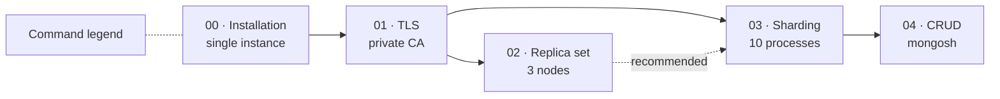

**English** · [Italiano](README.it.md)

# MongoDB 8.0 in Docker on Debian 13

Documentation and configuration files to install **MongoDB 8.0** in a Docker container on a **Debian 13 (trixie)** virtual machine, with a focus on **Azure**.

## Project purpose

Installing MongoDB on Debian 13 is not straightforward: MongoDB does not yet publish official server packages for this release, and many guides out there use commands that are now obsolete (`apt-key`, repositories for old Debian releases, the unsupported MongoDB 5.0, the old `mongo` shell).

This project offers an **up-to-date, complete and field-tested** path from a freshly created VM to a ready-to-use MongoDB instance, without stopping at the installation: security, backup, access and maintenance are part of the path from the start.

The setup is meant for **development and test** environments, with a dedicated checklist of the steps needed before taking it to production.

## Goals

1. **Secure by default.** Authentication always on, database not exposed to the internet, passwords generated randomly and never written in clear text in commands, an application user with permissions limited to its own database.
2. **Protected data.** Automatic backups with multi-level retention (daily, weekly, monthly) and a restore procedure that has been tested, not just described.
3. **Reproducibility.** The same commands and configuration files always lead to the same result; the files in `config/` can be copied to the VM as they are.
4. **Easy maintenance.** Automatic start, automatic security updates, size-limited logs, MongoDB upgrades in a few commands.
5. **Accessibility.** A complete guide for beginners that explains the reason behind every step, and a quick guide for those who only want the commands.
6. **Reasoned choices.** Every technical decision (Docker, ports, permissions, retention) is explained, so it can be adapted knowingly to your own context.
7. **Real experience.** The errors met during an actual installation, and their solutions, are collected in the troubleshooting sections.

## What it covers

Authentication, an application user with limited permissions, automatic backups with daily/weekly/monthly retention, access from the development environment (SSH tunnel or direct access), log management and basic system hardening (automatic updates, key-only SSH). A second part covers encrypting connections with **TLS** through a private CA, a third the **replica set** and a fourth **sharding**, built in a lab and paired with the production scenario. A fifth part teaches how to **use** the cluster with `mongosh`: CRUD operations, indexes, aggregation, transactions, validation, text search, change streams, import and export.

> **Why Docker?** The official MongoDB Docker image includes all dependencies, so it runs on Debian 13 without workarounds, and it makes upgrades and removal simple.

## Documentation

The guides are numbered in the order they should be followed. Each topic comes in two versions: a **complete** one, for those with little experience of Linux, Docker or MongoDB (every step explains what the command does and what to expect), and a **quick** one, for those who already know the environment (the sequence of commands with essential explanations).

The guides are available in English in [`docs/eng`](docs/eng) and in Italian in [`docs/ita`](docs/ita) (index in the [Italian README](README.it.md)). Commands, configuration files and outputs are identical in both versions.

| # | Topic | Complete guide | Quick guide |
|---|---|---|---|
| 00 | Installation, basic security, application user, backup, access, maintenance | [00-complete-guide](docs/eng/00-complete-guide.md) | [00-quick-guide](docs/eng/00-quick-guide.md) |
| 01 | Encrypting connections with TLS (private CA, clients, renewals) | [01-tls-complete-guide](docs/eng/01-tls-complete-guide.md) | [01-tls-quick-guide](docs/eng/01-tls-quick-guide.md) |
| 02 | Replica set: build, failover, external access, rolling TLS, backup with oplog, maintenance | [02-replica-set-complete-guide](docs/eng/02-replica-set-complete-guide.md) | [02-replica-set-quick-guide](docs/eng/02-replica-set-quick-guide.md) |
| 03 | Sharding: full cluster, shard key, balancer, TLS, nightly backup | [03-sharding-complete-guide](docs/eng/03-sharding-complete-guide.md) | [03-sharding-quick-guide](docs/eng/03-sharding-quick-guide.md) |
| 04 | CRUD with mongosh: reads and writes, indexes, aggregation, transactions, validation, text search, change streams, import/export | [04-crud-complete-guide](docs/eng/04-crud-complete-guide.md) | [04-crud-quick-guide](docs/eng/04-crud-quick-guide.md) |

The **[command legend](docs/eng/linux-commands-legend.md)** applies to all guides: it explains every Linux command, shell symbol, Docker, MongoDB and PowerShell command used in the project, with examples taken from the guides.

Guide 01 assumes you have completed 00; 02 assumes 00 and 01 (it reuses the CA for TLS); 03 assumes 00 and 01, and 02 is recommended; 04 assumes the cluster from 03.

### The path



### How to read the guides

- The **🧭** boxes explain every choice, separating what was done **in the lab** (and tested) from what you choose **in production**.
- The collapsible **📋 Real output from the test run** blocks show the output obtained during the tests, so you can compare your result with the expected one.
- Diagrams (architectures, flows, sequences, charts) are written in **Mermaid** and rendered directly by GitHub.
- The **🧪** symbol marks parts that have not been tested yet.

## Repository structure

```
.
├── README.md                         README in English (main page)
├── README.it.md                      README in Italian
├── docs/
│   ├── eng/                          Guides in English
│   │   ├── 00-complete-guide.md
│   │   ├── 00-quick-guide.md
│   │   ├── 01-tls-complete-guide.md
│   │   ├── 01-tls-quick-guide.md
│   │   ├── 02-replica-set-complete-guide.md
│   │   ├── 02-replica-set-quick-guide.md
│   │   ├── 03-sharding-complete-guide.md
│   │   ├── 03-sharding-quick-guide.md
│   │   ├── 04-crud-complete-guide.md
│   │   ├── 04-crud-quick-guide.md
│   │   └── linux-commands-legend.md  (command legend, valid for all guides)
│   └── ita/                          Guides in Italian (same content)
│       ├── 00-guida-completa.md
│       ├── 00-guida-rapida.md
│       ├── 01-tls-guida-completa.md
│       ├── 01-tls-guida-rapida.md
│       ├── 02-replica-set-guida-completa.md
│       ├── 02-replica-set-guida-rapida.md
│       ├── 03-sharding-guida-completa.md
│       ├── 03-sharding-guida-rapida.md
│       ├── 04-crud-guida-completa.md
│       ├── 04-crud-guida-rapida.md
│       └── legenda-comandi-linux.md
└── config/
    ├── 00-base/                      Resources for guide 00 (no TLS)
    │   ├── docker-compose.yml        → ~/mongodb/docker-compose.yml
    │   ├── mongo-backup.sh           → /usr/local/bin/mongo-backup.sh
    │   ├── mongo-backup.service      → /etc/systemd/system/mongo-backup.service
    │   ├── mongo-backup.timer        → /etc/systemd/system/mongo-backup.timer
    │   └── mongodb-thp.conf          → /etc/tmpfiles.d/mongodb-thp.conf
    ├── 01-tls/                       Resources for guide 01 (with TLS)
    │   ├── docker-compose.yml        → ~/mongodb/docker-compose.yml (replaces the one from 00)
    │   ├── mongo-backup.sh           → /usr/local/bin/mongo-backup.sh (replaces the one from 00)
    │   └── genera-certificati-tls.sh → ~/mongodb/tls/ (creates or renews the certificates)
    ├── 02-replica-set/               Resources for guide 02 (replica set lab)
    │   ├── docker-compose.yml        → ~/mongo-lab/02-replica-set/ (initial phase, no TLS)
    │   ├── docker-compose-tls.yml    → ~/mongo-lab/02-replica-set/docker-compose.yml (final, with TLS)
    │   ├── server.ext.example        → ~/mongo-lab/02-replica-set/tls/server.ext
    │   ├── mongo-rs-backup.sh        → /usr/local/bin/mongo-rs-backup.sh (set LAB and FQDN)
    │   ├── mongo-rs-backup.service   → /etc/systemd/system/
    │   └── mongo-rs-backup.timer     → /etc/systemd/system/ (03:00 UTC)
    ├── 03-sharding/                  Resources for guide 03 (sharded cluster)
    │   ├── docker-compose.yml        → ~/mongo-lab/03-sharding/ (no TLS)
    │   ├── docker-compose-tls.yml    → ~/mongo-lab/03-sharding/docker-compose.yml (with TLS)
    │   ├── server.ext.example        → ~/mongo-lab/03-sharding/tls/server.ext
    │   ├── funzioni-lab.sh           → ~/mongo-lab/03-sharding/ (sh_eval, node_eval; TLS version)
    │   ├── mongo-sh-backup.sh        → /usr/local/bin/mongo-sh-backup.sh (set LAB)
    │   ├── mongo-sh-backup.service   → /etc/systemd/system/
    │   └── mongo-sh-backup.timer     → /etc/systemd/system/ (03:30 UTC)
    └── 04-crud/                      Resources for guide 04 (CRUD with mongosh)
        ├── funzioni-crud.sh          → ~/mongo-lab/04-crud/ (app_shell, app_eval, app_export, app_import)
        ├── dati-crud.js              → ~/mongo-lab/04-crud/ (sample data, safe to re-run)
        └── prodotti.csv              → ~/mongo-lab/04-crud/ (CSV for the import test)
```

Each guide has its own resource folder, with the same files shown in the text, ready to be copied to the VM at the paths indicated. Guide 01 contains only the files that change compared to 00: timer, systemd service and kernel settings stay those of `00-base`.

The backup script comes in two versions: the `00-base` one connects without TLS; the `01-tls` one detects by itself whether TLS is enabled and works in both cases, even after a rollback. When you enable TLS you must therefore install the `01-tls` version, otherwise backups stop working.

## Requirements

- Debian 13 VM with a CPU that supports **AVX** instructions (required by MongoDB 8.0)
- SSH access with a user allowed to use `sudo`
- For external access: permissions to change the Network Security Group (NSG) on Azure

## Quick start

After installing Docker and configuring Transparent Huge Pages (see the guide):

```bash
mkdir -p ~/mongodb && cd ~/mongodb
# copy config/00-base/docker-compose.yml here

openssl rand -base64 24 | tr -d '/+=' | sudo tee mongo_root_password.txt > /dev/null
sudo chown 999:999 mongo_root_password.txt && sudo chmod 600 mongo_root_password.txt

sudo docker compose up -d
sudo docker exec -it mongo mongosh -u admin -p --authenticationDatabase admin
```

For the application user, backup, remote access and hardening follow the [quick guide](docs/eng/00-quick-guide.md) or the [complete guide](docs/eng/00-complete-guide.md); for TLS, the [01](docs/eng/01-tls-complete-guide.md) guides.

## Security notes

- Passwords are **not** part of the repository: they are generated on the VM and stored in files readable only by root (excluded through `.gitignore`).
- By default MongoDB is reachable only from the VM's `127.0.0.1`. Never publish the port on `0.0.0.0`: Docker bypasses the system firewall.
- Direct access on port 27017 without TLS is meant **for development only**, because traffic travels in clear text: to encrypt it follow the 01 guides. For production, see the final checklist in the guides.
- The CA private key (`ca.key`) and the server keys must never end up in the repository or be left unprotected: the 01 guides explain how to keep them safe.

## Reference versions and test status

Tested with MongoDB 8.0.32, Docker Engine 29, Docker Compose 5 on Debian 13 (Azure).

| Guide | Status |
|---|---|
| 00 | Tested on a real installation: installation, application user, backup and restore, direct access, logs, automatic updates. Not yet tested (🧪): SSH tunnel, logs with journald, SSH key and disabling passwords, weekly/monthly retention over a real period |
| 01 (TLS) | Parts 2–9 tested on a real installation, including the nightly backup run with TLS. Certificate renewal, rollback and the `genera-certificati-tls.sh` script not yet tested on a VM (🧪) |
| 02 (replica set) | Tested on a real installation (lab with three containers on one VM). Not yet tested (🧪): TLS rollback, password change, teardown, weekly/monthly retention over a real period; advanced options (x.509, hidden secondary, horizons) only described |
| 03 (sharding) | Tested on a real installation (10 containers on one VM), including cold TLS switch, nightly backup and restore. Not tested (🧪): restoring users from the backup, weekly/monthly retention over time; advanced topics (zones, resharding, x.509) only described |
| 04 (CRUD) | Tested on a real installation, on the guide 03 cluster with the application user. Not yet tested (🧪): resuming a change stream with `resumeAfter`, counting invalid documents after switching to `warn`; advanced topics (read concern, collation, geospatial indexes, time series) only listed |

Parts not yet tested are marked in the guides with the 🧪 symbol. If you run them, please report any differences.

## License

Released under the [MIT](LICENSE) license. © 2026 Luca Cacciamani.
