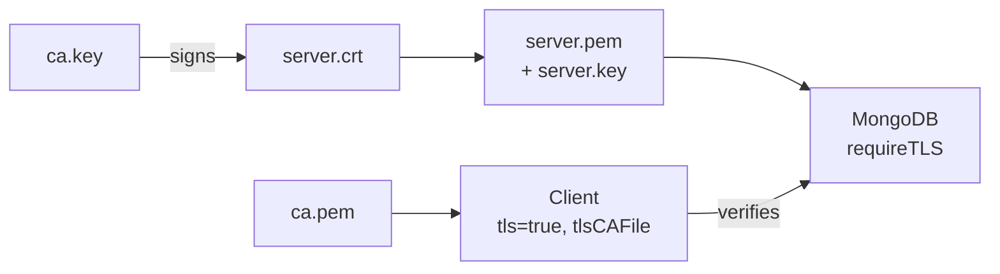

# TLS for MongoDB in Docker — Quick guide

Encryption of MongoDB connections with a private CA: encrypted traffic and server verification, renewals transparent to clients. Assumes the setup from the guide `00-quick-guide.md`.

**Placeholders:** `<IP_PUBBLICO_VM>`, `<IP_PRIVATO_VM>` (e.g. `10.0.0.4`). Example VM user: `azureuser`.
**Verification status:** §1–6 tested on a real installation; renewal (§7) and rollback (§9) not yet tested (🧪).
**Alternative:** for a single developer the SSH tunnel gives the same security without certificates (guide 00, §9.1).

> 📖 **Commands and symbols** (`sudo`, `chmod`, `|`, `<< EOF`, `docker compose`…): the [command legend](linux-commands-legend.md) explains everything that appears in this guide.

---



## 1. Preparation

```bash
sudo /usr/local/bin/mongo-backup.sh
cd ~/mongodb && cp docker-compose.yml docker-compose.yml.pre-tls   # for the rollback (§9)
mkdir -p ~/mongodb/tls && chmod 700 ~/mongodb/tls && cd ~/mongodb/tls
```

The public IP must be **static** (Azure portal → Public IP → Configuration), otherwise the certificate stops being valid when it changes.

## 2. CA and server certificate

Can be automated with `config/01-tls/genera-certificati-tls.sh <IP_PUBBLICO> <IP_PRIVATO>`. Manual steps:

```bash
PUB_IP=<IP_PUBBLICO_VM>
PRIV_IP=<IP_PRIVATO_VM>

# Private CA, 10 years
openssl genrsa -out ca.key 4096
openssl req -x509 -new -key ca.key -sha256 -days 3650 -subj "/CN=MongoDB Dev CA" -out ca.pem

# SAN: all the addresses used by clients (unquoted heredoc: variables are expanded)
cat > server.ext << EOF
basicConstraints=CA:FALSE
keyUsage=digitalSignature,keyEncipherment
extendedKeyUsage=serverAuth
subjectAltName=DNS:localhost,DNS:mongo,IP:127.0.0.1,IP:$PRIV_IP,IP:$PUB_IP
EOF

# Server certificate, 825 days
openssl genrsa -out server.key 2048
openssl req -new -key server.key -subj "/CN=mongo-vm" -out server.csr
openssl x509 -req -in server.csr -CA ca.pem -CAkey ca.key -CAcreateserial \
  -days 825 -sha256 -extfile server.ext -out server.crt
rm server.csr

openssl verify -CAfile ca.pem server.crt                                  # server.crt: OK
openssl x509 -in server.crt -noout -ext subjectAltName -enddate

# Single file for MongoDB, readable by UID 999
cat server.crt server.key | sudo tee server.pem > /dev/null
sudo chown 999:999 server.pem && sudo chmod 600 server.pem
chmod 600 ca.key server.key && chmod 644 ca.pem server.crt
```

| File | Secret | Destination |
|---|---|---|
| `ca.key`, `ca.srl` | Yes (critical) | Off the VM; only needed for signing |
| `ca.pem` | No | Clients and container |
| `server.key`, `server.pem` | Yes | VM only |
| `server.crt`, `server.ext` | No | VM (needed for checks and renewals) |

**Safekeeping of the CA** — from the PC, in PowerShell (same user and same `-i <chiave>`, if any, as the `ssh` command; with password login omit `-i`):

```powershell
mkdir C:\Users\<tuo-nome>\mongodb-ca -Force            # outside the Git repository
scp azureuser@<IP_PUBBLICO_VM>:~/mongodb/tls/ca.key C:\Users\<tuo-nome>\mongodb-ca\
scp azureuser@<IP_PUBBLICO_VM>:~/mongodb/tls/ca.srl C:\Users\<tuo-nome>\mongodb-ca\
Get-FileHash C:\Users\<tuo-nome>\mongodb-ca\ca.key -Algorithm SHA256   # compare with: sha256sum ~/mongodb/tls/ca.key (VM)
```

Then, either:
- **production / recommended:** `shred -u ~/mongodb/tls/ca.key` on the VM (the key goes back on the VM only for renewals);
- **development:** keep it on the VM as well, checking for `-rw-------` on the file and `drwx------` on the folder; never mount the whole `./tls` into the container; watch out for VM snapshots/backups.

`server.pem` shows up as owned by the group `systemd-journal`: normal, that is GID 999 on the host.

## 3. docker-compose.yml with TLS

Unquoted heredoc to expand `$PRIV_IP`; delete that line if direct access is not needed.

```bash
cd ~/mongodb && PRIV_IP=<IP_PRIVATO_VM>
cat > docker-compose.yml << EOF
services:
  mongo:
    image: mongo:8.0
    container_name: mongo
    restart: unless-stopped
    stop_grace_period: 1m
    command:
      - --tlsMode=requireTLS
      - --tlsCertificateKeyFile=/etc/mongo/tls/server.pem
      - --tlsCAFile=/etc/mongo/tls/ca.pem
      - --tlsAllowConnectionsWithoutCertificates
      - --tlsDisabledProtocols=TLS1_0,TLS1_1
    ports:
      - "127.0.0.1:27017:27017"
      - "$PRIV_IP:27017:27017"
    ulimits:
      nofile:
        soft: 64000
        hard: 64000
    logging:
      driver: json-file
      options:
        max-size: "50m"
        max-file: "5"
    environment:
      MONGO_INITDB_ROOT_USERNAME: admin
      MONGO_INITDB_ROOT_PASSWORD_FILE: /run/secrets/mongo_root_password
    volumes:
      - mongo-data:/data/db
      - ./tls/server.pem:/etc/mongo/tls/server.pem:ro
      - ./tls/ca.pem:/etc/mongo/tls/ca.pem:ro
    secrets:
      - mongo_root_password

volumes:
  mongo-data:

secrets:
  mongo_root_password:
    file: ./mongo_root_password.txt
EOF
sudo docker compose config --quiet && echo "compose valido"
sudo docker compose up -d
```

- ⚠️ At `up -d` all clients configured without TLS (apps, Compass, VS Code, scripts) stop connecting until they are updated (§6).
- `requireTLS`: rejects every unencrypted connection (`allowTLS`/`preferTLS` only for gradual migrations).
- `tlsAllowConnectionsWithoutCertificates`: **essential** with `tlsCAFile`, otherwise MongoDB requires a client certificate from everyone.
- `tlsDisabledProtocols`: TLS 1.2 and 1.3 only.
- Only the two files needed are mounted, read-only.

## 4. Verification

```bash
sudo docker compose ps                                              # Up, not Restarting
sudo docker compose logs mongo | grep -E '"s":"(W|E|F)"'
openssl s_client -connect 127.0.0.1:27017 -CAfile tls/ca.pem </dev/null 2>/dev/null | grep -E "Verify return code|Protocol"   # 0 (ok)

sudo docker exec -it mongo mongosh --tls --tlsCAFile /etc/mongo/tls/ca.pem -u admin -p --authenticationDatabase admin
sudo docker exec -it mongo mongosh -u admin -p --authenticationDatabase admin --eval 'db.runCommand({ping:1})'   # must FAIL
```

Leave `mongosh` (`exit`) before running the next command: inside the `test>` prompt a shell command gives `SyntaxError: Missing semicolon`.

## 5. Backup and restore

The backup script must be updated, otherwise with `requireTLS` the dumps fail. The version `config/01-tls/mongo-backup.sh` detects TLS by itself (presence of `/etc/mongo/tls/ca.pem` in the container), so it also works after a rollback; compared with `config/00-base/mongo-backup.sh` only the `docker exec` block changes:

```bash
  TLS=""
  [ -f /etc/mongo/tls/ca.pem ] && TLS="--ssl --sslCAFile=/etc/mongo/tls/ca.pem"
  mongodump $TLS --config=/tmp/dump.yaml -u admin --authenticationDatabase admin --archive --gzip --quiet
```

Install the **whole** script (`config/01-tls/mongo-backup.sh`, or the block from `sudo tee` to `sudo chmod` in the complete guide, Part 8.1): the three lines above run on their own give `mongodump: command not found`.

```bash
sudo grep -n "TLS" /usr/local/bin/mongo-backup.sh     # 3 lines expected
sudo /usr/local/bin/mongo-backup.sh
sudo systemctl start mongo-backup.service && sudo journalctl -u mongo-backup.service -n 5 --no-pager
sudo sh -c 'rm -f /var/backups/mongodb/mongo-*.archive.gz'   # old dumps outside daily/weekly/monthly, if any
```

**Restore with TLS:**

```bash
sudo sh -c 'f=$(ls -t /var/backups/mongodb/daily/mongo-*.archive.gz | head -1); echo "Ripristino: $f"; \
  docker exec -i mongo sh -c "mongorestore --ssl --sslCAFile=/etc/mongo/tls/ca.pem -u admin -p \"\$(cat /run/secrets/mongo_root_password)\" --authenticationDatabase admin --archive --gzip --drop" < "$f"'
```

In the `mongosh` commands of guide 00 add `--tls --tlsCAFile /etc/mongo/tls/ca.pem`.

## 6. Clients

Copy of `ca.pem` to the PC (a separate step from the safekeeping of `ca.key`; prefer a path without spaces):

```powershell
scp azureuser@<IP_PUBBLICO_VM>:~/mongodb/tls/ca.pem C:\Users\<tuo-nome>\mongodb-ca\ca.pem
```

Parameters to add to the URIs of guide 00: `&tls=true&tlsCAFile=<percorso ca.pem>`.

| Client | Host in the URI |
|---|---|
| VM / SSH tunnel | `127.0.0.1` |
| Container in the same compose (mount `ca.pem`) | `mongo` |
| Direct access | `<IP_PUBBLICO_VM>` or `<IP_PRIVATO_VM>` |

- Windows paths in the URI: `/` instead of `\`, spaces as `%20`; alternatively pass the file as a driver option:

  ```javascript
  new MongoClient(process.env.MONGODB_URI, { tlsCAFile: process.env.MONGODB_CA_FILE });
  ```

- **Compass:** Advanced Connection Options → TLS/SSL → On → Certificate Authority = `ca.pem`.
- **MongoDB for VS Code:** right-click the connection → Edit Connection, or Ctrl+Shift+P → *MongoDB: Connect with Connection String*:
  `mongodb://appuser:PWD@<IP_PUBBLICO_VM>:27017/appdb?authSource=appdb&directConnection=true&tls=true&tlsCAFile=C:/Users/<tuo-nome>/mongodb-ca/ca.pem`; remove the old connection without TLS.
- **Without a file on the client:** the server neither allows nor prevents it, the client decides. Alternatives to the file: install the CA in the Windows store (*Trusted Root Certification Authorities*; works with clients that read the system store, e.g. recent MongoDB tools and .NET), or `tlsAllowInvalidCertificates=true` (encryption only, no verification: to be avoided).
- ⛔ Never `tlsAllowInvalidCertificates` / `tlsInsecure`: they cancel server verification.
- NSG on 27017 always restricted to the authorized IPs.

## 7. Server certificate renewal

> 🧪 **Not yet tested** on a real installation (the script `genera-certificati-tls.sh` has only been tried in a test environment). Try it in development first, with the rollback (§9) at hand.

```bash
openssl x509 -in ~/mongodb/tls/server.crt -noout -enddate
openssl x509 -in ~/mongodb/tls/server.crt -noout -checkend $((30*86400)) && echo OK || echo "IN SCADENZA"
```

Procedure (clients change nothing, same CA):

```bash
# 1. if ca.key is not on the VM: bring ca.key and ca.srl back into ~/mongodb/tls (scp from the PC)
cd ~/mongodb/tls && chmod 600 ca.key
openssl genrsa -out server.key 2048
openssl req -new -key server.key -subj "/CN=mongo-vm" -out server.csr
openssl x509 -req -in server.csr -CA ca.pem -CAkey ca.key -CAserial ca.srl \
  -days 825 -sha256 -extfile server.ext -out server.crt
rm server.csr && openssl verify -CAfile ca.pem server.crt
cat server.crt server.key | sudo tee server.pem > /dev/null
sudo chown 999:999 server.pem && sudo chmod 600 server.pem && chmod 600 server.key
cd ~/mongodb && sudo docker compose restart
# 2. verify (§4), copy ca.srl back to the PC; if the CA must not stay on the VM: shred -u ~/mongodb/tls/ca.key
```

Alternatively: `config/01-tls/genera-certificati-tls.sh` (reuses the existing CA). When the CA expires (10 years) a new CA is needed and `ca.pem` must be redistributed.

## 8. Troubleshooting

| Symptom | Solution |
|---|---|
| Container `Restarting`, permission denied on the certificate | `sudo chown 999:999 tls/server.pem && sudo chmod 600 tls/server.pem` |
| Key and certificate do not match | Rebuild `server.pem` from `server.crt` + `server.key` |
| Client: `connection closed` / `ECONNRESET` | `tls=true` is missing |
| `certificate verify failed` / `unable to get local issuer` | Wrong `tlsCAFile` or different CA |
| `does not match certificate's altnames` / `IP address mismatch` | Address not in the SAN: use one that is, or renew with an updated SAN |
| `certificate has expired` | Renewal (§7) |
| Server: `No SSL certificate provided by peer` | Add `--tlsAllowConnectionsWithoutCertificates` |
| Nightly backups failed | Install the TLS-compatible script (§5) |
| `SyntaxError: Missing semicolon` | Shell command run inside `mongosh`: `exit` |
| `mongodump: command not found` | Only some lines of the script were pasted: reinstall it whole |
| Folder `C:Users...` on the VM | PowerShell `mkdir` run on the VM: `rmdir 'C:Users...'` |
| `scp` asks for the password | Password login: normal; for keys see guide 00 §11 |
| `ca.pem` missing on the PC | Copy it (§6): it is a separate step from copying `ca.key` |

Diagnosis: `openssl s_client ... | grep "Verify return code"` → `0 (ok)` = server fine, problem on the client side.

## 9. Rollback

> 🧪 **Not yet tested** on a real installation: try it once in development before relying on it in an emergency.

```bash
cd ~/mongodb
cp docker-compose.yml docker-compose.yml.tls
cp docker-compose.yml.pre-tls docker-compose.yml
sudo docker compose up -d
```

Data intact; the backup script adapts by itself. Remove `tls`/`tlsCAFile` from the clients. To re-enable: `cp docker-compose.yml.tls docker-compose.yml && sudo docker compose up -d`.

## 10. Production

- Corporate or public CA (Let's Encrypt with a DNS name and automatic renewal): no `ca.pem` to distribute.
- DNS names in the SAN instead of IPs.
- No exposure on the internet: private network + TLS.
- CA key in Key Vault or an equivalent system; alerts on certificate expiry.
- Replica set / sharding: TLS between the nodes as well, with optional x.509 authentication of the members in place of the keyFile.
