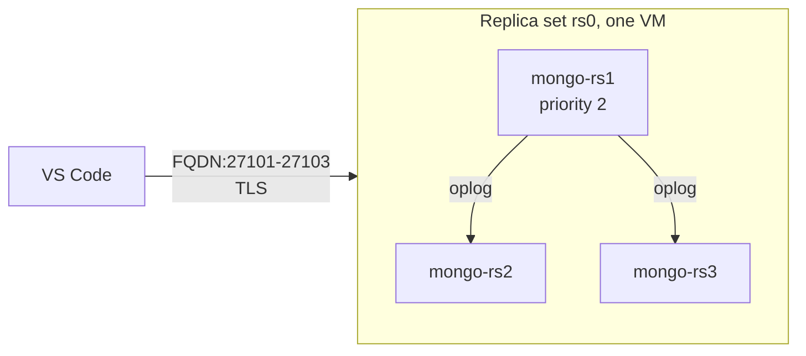

# MongoDB replica set in Docker — Quick guide

Replica set of 3 nodes in containers on the same VM (lab), DNS names for external access, TLS enabled with a rolling procedure, application user, backups with oplog, rolling maintenance. Assumes guides 00 and 01 (CA in `~/mongodb/tls`). Rationale and production scenario: `02-replica-set-complete-guide.md`.

**Verification status:** everything tested on a real installation, except 🧪 (TLS rollback, password change, teardown, weekly/monthly retention over time).

**Placeholders:** `<FQDN>` (DNS label of the public IP, `nome.<regione>.cloudapp.azure.com`), `<IP_PRIVATO_VM>`.

> ⚠️ Two Compose projects on the VM (`~/mongodb` and `~/mongo-lab/02-replica-set`): **check the prompt** before every `docker compose`, especially `down -v`.

| Container | Port (inside = outside) | Member |
|---|---|---|
| `mongo-rs1` | 27101 | `<FQDN>:27101` (`priority: 2`) |
| `mongo-rs2` | 27102 | `<FQDN>:27102` |
| `mongo-rs3` | 27103 | `<FQDN>:27103` |

> 📖 **Commands and symbols** (`sudo`, `chmod`, `|`, `<< EOF`, `docker compose`…): the [command legend](linux-commands-legend.md) explains everything that appears in this guide.



---

## 1. Preparation

- Resources: ~2–3 GB of free RAM (`free -h`); without swap, limit the nodes' memory.
- Azure portal → Public IP → Configuration → **DNS name label**. Check from the PC: `Resolve-DnsName <FQDN>`.
- Session variables (to be set again in every new session):

```bash
FQDN=<FQDN>; PRIV_IP=<IP_PRIVATO_VM>; echo "$FQDN $PRIV_IP"
```

## 2. Folder, password, keyFile

```bash
mkdir -p ~/mongo-lab/02-replica-set && cd ~/mongo-lab/02-replica-set
openssl rand -base64 24 | tr -d '/+=' | sudo tee root_password.txt > /dev/null
sudo chown 999:999 root_password.txt && sudo chmod 600 root_password.txt
openssl rand -base64 756 > keyfile
sudo chown 999:999 keyfile && sudo chmod 400 keyfile      # 400 is mandatory
```

## 3. docker-compose.yml

In two parts (long blocks can get mangled when pasted); unquoted `<< EOF` to expand the variables. Version with placeholders in `config/02-replica-set/docker-compose.yml` (without TLS) and `docker-compose-tls.yml` (final).

```bash
cat > docker-compose.yml << EOF
name: mongo-lab-rs

x-mongo-common: &mongo-common
  image: mongo:8.0
  restart: unless-stopped
  stop_grace_period: 1m
  extra_hosts:
    - "$FQDN:$PRIV_IP"
  mem_limit: 1g
  ulimits:
    nofile:
      soft: 64000
      hard: 64000
  logging:
    driver: json-file
    options:
      max-size: "20m"
      max-file: "3"

services:
  mongo-rs1:
    <<: *mongo-common
    container_name: mongo-rs1
    hostname: mongo-rs1
    command: ["--replSet", "rs0", "--port", "27101", "--keyFile", "/etc/mongo/keyfile", "--wiredTigerCacheSizeGB", "0.25"]
    ports:
      - "127.0.0.1:27101:27101"
      - "$PRIV_IP:27101:27101"
    environment:
      MONGO_INITDB_ROOT_USERNAME: admin
      MONGO_INITDB_ROOT_PASSWORD_FILE: /run/secrets/rs_root_password
    secrets:
      - rs_root_password
    volumes:
      - rs1-data:/data/db
      - ./keyfile:/etc/mongo/keyfile:ro
EOF
```

```bash
cat >> docker-compose.yml << EOF

  mongo-rs2:
    <<: *mongo-common
    container_name: mongo-rs2
    hostname: mongo-rs2
    command: ["--replSet", "rs0", "--port", "27102", "--keyFile", "/etc/mongo/keyfile", "--wiredTigerCacheSizeGB", "0.25"]
    ports:
      - "127.0.0.1:27102:27102"
      - "$PRIV_IP:27102:27102"
    volumes:
      - rs2-data:/data/db
      - ./keyfile:/etc/mongo/keyfile:ro

  mongo-rs3:
    <<: *mongo-common
    container_name: mongo-rs3
    hostname: mongo-rs3
    command: ["--replSet", "rs0", "--port", "27103", "--keyFile", "/etc/mongo/keyfile", "--wiredTigerCacheSizeGB", "0.25"]
    ports:
      - "127.0.0.1:27103:27103"
      - "$PRIV_IP:27103:27103"
    volumes:
      - rs3-data:/data/db
      - ./keyfile:/etc/mongo/keyfile:ro

volumes:
  rs1-data:
  rs2-data:
  rs3-data:

secrets:
  rs_root_password:
    file: ./root_password.txt
EOF
sudo docker compose config --quiet && echo "compose valido"
sudo docker compose config --services; sudo docker compose config --volumes   # 3 + 3
```

Key points:
- same port inside and outside: clients use the addresses registered in the replica set;
- `extra_hosts`: in the containers `<FQDN>` → private IP (the nodes talk to each other inside the VM); from the PC `<FQDN>` → public IP → NSG → private IP;
- admin only on node 1: the others receive it through replication (the secret exists only on node 1);
- 256 MB cache + `mem_limit` to coexist with the development instance;
- `stop_grace_period: 1m`: without it, Docker kills the primary after 10 s during the *quiesce* (~15 s) → `clean shutdown: false`.

## 4. Start and `rs.initiate`

```bash
sudo docker compose up -d && sleep 15
sudo docker compose logs mongo-rs1 | grep -c "init process complete"    # 1
# nodes 2-3: "Did not find local replica set configuration document" = normal

sudo docker exec -it mongo-rs1 mongosh --port 27101 -u admin -p --authenticationDatabase admin --quiet --eval "
rs.initiate({ _id: 'rs0', members: [
  { _id: 0, host: '$FQDN:27101', priority: 2 },
  { _id: 1, host: '$FQDN:27102' },
  { _id: 2, host: '$FQDN:27103' } ] })"
```

Lab function (not for production: the password is visible to the container's processes); `rs_eval 'js' [nodo]`. It is lost at every reconnection: it is worth saving it in a file and loading it with `source` (also from `~/.bashrc`), as in guide 03:

```bash
rs_eval() {
  local node=${2:-1}
  sudo docker exec -i -e RS_PWD="$(sudo cat ~/mongo-lab/02-replica-set/root_password.txt)" mongo-rs$node \
    sh -c 'mongosh --port 2710'"$node"' -u admin -p "$RS_PWD" --authenticationDatabase admin --quiet --eval "$0"' "$1"
}
rs_eval 'rs.status().members.forEach(m => print(m.name, m.stateStr, m.health))'
```

## 5. Usage and failover

```bash
# Write through the replica set string (the driver finds the primary)
sudo docker exec -i -e FQDN="$FQDN" -e RS_PWD="$(sudo cat root_password.txt)" mongo-rs1 \
  sh -c 'mongosh "mongodb://admin:$RS_PWD@$FQDN:27101,$FQDN:27102,$FQDN:27103/labdb?replicaSet=rs0&authSource=admin" --quiet \
    --eval "print(db.hello().primary); printjson(db.prova.insertOne({ msg: \"ciao\" }))"'
rs_eval 'db.getMongo().setReadPref("secondary"); printjson(db.getSiblingDB("labdb").prova.find().toArray())' 3
rs_eval 'db.getSiblingDB("labdb").prova.insertOne({ x: 1 })' 3                 # not primary

# Failover
sudo docker compose stop mongo-rs1                                              # ~16 s
rs_eval 'rs.status().members.forEach(m => print(m.name, m.stateStr))' 2         # new PRIMARY
sudo docker compose start mongo-rs1                                             # rejoins as SECONDARY, then PRIMARY (priority 2)
sudo docker compose logs mongo-rs1 | grep -o '"Startup from clean shutdown?":[a-z]*' | tail -1   # true
```

Default write concern `majority`: `acknowledged: true` = data on ≥ 2 nodes. Sudden failure: election after ~10 s without heartbeat.

## 6. Access from the PC

With the members registered with `<FQDN>`, opening the ports is enough (the public IP alone is not enough: the client then uses the member names). Alternatives ruled out: `directConnection=true` (no failover), `hosts` file on the clients, members registered with the public IP.

- NSG: TCP `27101-27103`, source your own IP only (unencrypted traffic until §7).
- Check: `27101..27103 | % { Test-NetConnection <FQDN> -Port $_ | Select RemotePort, TcpTestSucceeded }`.
- VS Code: `mongodb://admin:PWD@<FQDN>:27101,<FQDN>:27102,<FQDN>:27103/?replicaSet=rs0&authSource=admin`.
- The string goes in the client, not in bash (the `&` sends it to the background; remove it from the history with `history -d`).

## 7. Rolling TLS

**Certificate** (CA from guide 01; the **clientAuth** EKU is essential: the nodes connect to each other as clients):

```bash
cd ~/mongo-lab/02-replica-set && mkdir -p tls && chmod 700 tls && cd tls
cat > server.ext << EOF
basicConstraints=CA:FALSE
keyUsage=digitalSignature,keyEncipherment
extendedKeyUsage=serverAuth,clientAuth
subjectAltName=DNS:$FQDN,DNS:localhost,DNS:mongo-rs1,DNS:mongo-rs2,DNS:mongo-rs3,IP:127.0.0.1,IP:$PRIV_IP
EOF
openssl genrsa -out server.key 2048
openssl req -new -key server.key -subj "/CN=$FQDN" -out server.csr
openssl x509 -req -in server.csr -CA ~/mongodb/tls/ca.pem -CAkey ~/mongodb/tls/ca.key \
  -CAserial ~/mongodb/tls/ca.srl -days 825 -sha256 -extfile server.ext -out server.crt
rm server.csr && cp ~/mongodb/tls/ca.pem . && openssl verify -CAfile ca.pem server.crt
cat server.crt server.key | sudo tee server.pem > /dev/null
sudo chown 999:999 server.pem && sudo chmod 600 server.pem && chmod 600 server.key && cd ..
```

**Phase 1 — `allowTLS`** (compose + rolling recreation):

```bash
cp docker-compose.yml docker-compose.yml.pre-tls
sed -i 's|"--wiredTigerCacheSizeGB", "0.25"\]|"--wiredTigerCacheSizeGB", "0.25", "--tlsMode", "allowTLS", "--tlsCertificateKeyFile", "/etc/mongo/tls/server.pem", "--tlsCAFile", "/etc/mongo/tls/ca.pem", "--tlsAllowConnectionsWithoutCertificates", "--tlsDisabledProtocols", "TLS1_0,TLS1_1"]|' docker-compose.yml
sed -i 's|^      - ./keyfile:/etc/mongo/keyfile:ro$|&\n      - ./tls/server.pem:/etc/mongo/tls/server.pem:ro\n      - ./tls/ca.pem:/etc/mongo/tls/ca.pem:ro|' docker-compose.yml
grep -c allowTLS docker-compose.yml; grep -c "server.pem:ro" docker-compose.yml   # 3 and 3
```

Rolling sequence, **one command at a time**: `up -d mongo-rs3` → wait for `SECONDARY` → `up -d mongo-rs2` → wait → `rs_eval 'rs.stepDown(60)'` → check → `up -d mongo-rs1`. Checks: `getParameter tlsMode` = `allowTLS` ×3; `openssl s_client -connect 127.0.0.1:27101 -CAfile tls/ca.pem` → `Verify return code: 0 (ok)`.

**Phase 2 — `preferTLS`** (live; lost on restart):

```bash
for n in 1 2 3; do rs_eval 'printjson(db.adminCommand({ setParameter: 1, tlsMode: "preferTLS" }).was)' $n; done
rs_eval 'rs.stepDown(30)'; sleep 45
for n in 1 2 3; do rs_eval 'printjson(db.serverStatus().transportSecurity)' $n; done    # '1.3' > 0
```

Move the clients: `rs_eval` with `--tls --tlsCAFile /etc/mongo/tls/ca.pem`; VS Code with `&tls=true&tlsCAFile=C:/Users/<tuo-nome>/mongodb-ca/ca.pem`. Unencrypted clients still work in this phase.

**Phase 3 — `requireTLS`** (live, then permanent):

```bash
for n in 1 2 3; do rs_eval 'printjson(db.adminCommand({ setParameter: 1, tlsMode: "requireTLS" }).was)' $n; done
sudo docker exec mongo-rs2 mongosh --port 27102 --quiet --eval 'db.runCommand({ping:1})'   # must fail
cp docker-compose.yml docker-compose.yml.allowtls
sed -i 's|"--tlsMode", "allowTLS"|"--tlsMode", "requireTLS"|' docker-compose.yml
```

Then the same rolling sequence as phase 1. Check: `requireTLS` ×3 after the restarts. Rollback 🧪: `docker-compose.yml.pre-tls` + rolling sequence.

## 8. Application user

Created through the replica set string (it reaches the primary):

```bash
openssl rand -base64 24 | tr -d '/+=' | sudo tee appuser_password.txt > /dev/null; sudo chmod 600 appuser_password.txt
sudo docker exec -i -e FQDN="$FQDN" -e RS_PWD="$(sudo cat root_password.txt)" -e APP_PWD="$(sudo cat appuser_password.txt)" mongo-rs1 \
  sh -c 'mongosh "mongodb://admin:$RS_PWD@$FQDN:27101,$FQDN:27102,$FQDN:27103/?replicaSet=rs0&authSource=admin&tls=true&tlsCAFile=/etc/mongo/tls/ca.pem" --quiet \
    --eval "db.getSiblingDB(\"labdb\").createUser({ user: \"appuser\", pwd: process.env.APP_PWD, roles: [ { role: \"readWrite\", db: \"labdb\" } ] })"'
```

Application URI: `mongodb://appuser:PWD@<FQDN>:27101,<FQDN>:27102,<FQDN>:27103/labdb?replicaSet=rs0&authSource=labdb&tls=true&tlsCAFile=<ca.pem>`. Encryption is enforced by the server (`requireTLS`); `replicaSet` recommended; `directConnection=true` = no failover.

## 9. Backup and restore

Differences from guide 00: replica set string with `readPreference=secondaryPreferred`, `--oplog` (consistent copy), TLS, execution on the first running node with the password through stdin (the secret is only on node 1). Script in `config/02-replica-set/mongo-rs-backup.sh` (set `LAB` and `FQDN`) → `/usr/local/bin/mongo-rs-backup.sh` (`700`); backups in `/var/backups/mongo-lab-rs` (`700`), retention 7/4/12.

```bash
sudo /usr/local/bin/mongo-rs-backup.sh                     # "Backup completato (mongo-rs1)"
sudo docker compose stop mongo-rs1 && sudo /usr/local/bin/mongo-rs-backup.sh && sudo docker compose start mongo-rs1   # (mongo-rs2)
```

Timer: `config/02-replica-set/mongo-rs-backup.{service,timer}` → `/etc/systemd/system/`, at **03:00 UTC** (after the development one, 02:30); `daemon-reload`, `enable --now mongo-rs-backup.timer`.

Restore (latest daily, through the replica set string):

```bash
F=$(sudo ls -t /var/backups/mongo-lab-rs/daily/ | head -1)
{ sudo cat root_password.txt; sudo cat "/var/backups/mongo-lab-rs/daily/$F"; } | sudo docker exec -i -e FQDN="$FQDN" mongo-rs2 sh -c '
  umask 077; read -r PWD_RS
  printf "uri: mongodb://admin:%s@$FQDN:27101,$FQDN:27102,$FQDN:27103/?replicaSet=rs0&authSource=admin\n" "$PWD_RS" > /tmp/restore.yaml
  mongorestore --config=/tmp/restore.yaml --ssl --sslCAFile=/etc/mongo/tls/ca.pem --oplogReplay --drop --archive --gzip
  status=$?; rm -f /tmp/restore.yaml; exit $status'
```

`don't know what to do with subdirectory` = harmless; `applied N oplog entries` can be > 0 even without application writes. The replica set is not a backup: a `drop` replicates everywhere in an instant.

## 10. Rolling maintenance

One command at a time (each restart ~16 s; commands pasted during a restart can get lost):

```bash
sudo docker compose restart mongo-rs3        # wait for SECONDARY
sudo docker compose restart mongo-rs2        # wait for SECONDARY
rs_eval 'rs.stepDown(60)'                    # check the new PRIMARY
sudo docker compose restart mongo-rs1        # after ~60 s it is PRIMARY again
```

For configuration changes: `up -d <servizio>`; to update MongoDB: change the image tag and follow the same sequence. Clients with the replica set string: no interruption observed.

## 11. Password change 🧪

On the primary (through the replica set string) `db.getSiblingDB("labdb").changeUserPassword("appuser", nuova)`; it replicates by itself. For `admin`, update `root_password.txt` only after the change has succeeded (the backup script uses it).

## 12. Troubleshooting

| Symptom | Solution |
|---|---|
| Compose incomplete after pasting (`compose valido` is misleading) | Two parts or `nano`; check `--services`/`--volumes` |
| `rs_eval: command not found` / `$FQDN` empty | New session: define them again |
| `container ... is not running` | Query another node: `rs_eval '...' 2` |
| `not primary` | Write through the replica set string / wait for node 1 to rejoin |
| Stop ~11 s, `clean shutdown: false` | `stop_grace_period: 1m` |
| External client fails after the first contact | Member names not resolvable: FQDN |
| `Test-NetConnection` `False` | NSG 27101–27103, ports on the private IP |
| Replication broken after TLS | Certificate without `clientAuth` |
| No client can log in with a password | `--tlsAllowConnectionsWithoutCertificates` is missing |
| `connection ... closed` | Client without `tls=true` |
| TLS mode reverted after a restart | Changed only live: update the compose |
| `/run/secrets/...` missing on nodes 2–3 | Password through stdin |

## 13. Lab vs production

| | Lab | Production |
|---|---|---|
| Nodes | 3 containers, 1 VM | 3 VMs, different zones |
| Names / ports | 1 FQDN, 27101–27103, `extra_hosts` | 1 DNS name per node, 27017 |
| Client network | Internet + NSG on one IP | Private network |
| Certificates | 1 for all, private CA | 1 per node, corporate CA |
| Internal auth | keyFile | keyFile or x.509 |
| Secrets | Files + `rs_eval` | Key Vault |
| Backup | Local script | Scheduled, external copy, hidden secondary |

Options not tested: x.509 for the members, hidden secondary, horizons, members in another region with `priority: 0`.

## 14. Teardown 🧪

```bash
cd ~/mongo-lab/02-replica-set && pwd && sudo docker compose down -v
sudo systemctl disable --now mongo-rs-backup.timer
sudo rm /etc/systemd/system/mongo-rs-backup.{service,timer} /usr/local/bin/mongo-rs-backup.sh && sudo systemctl daemon-reload
```

Then: NSG rule `mongo-lab-rs`, DNS label (if no longer needed), folders and backups, VS Code connections.
