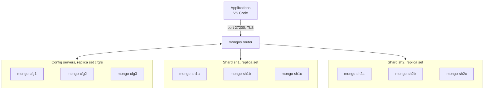
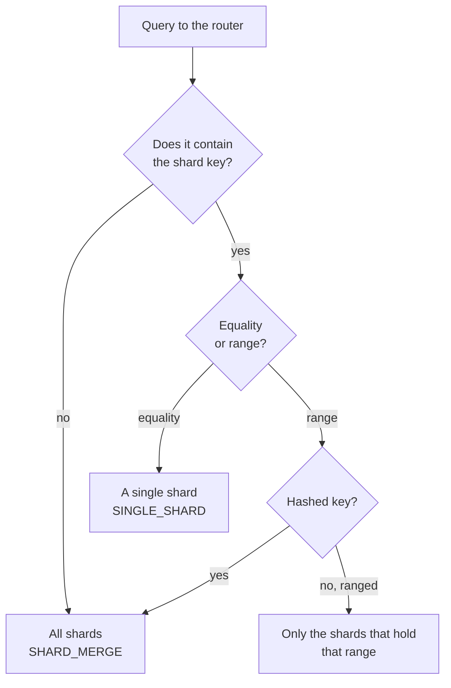
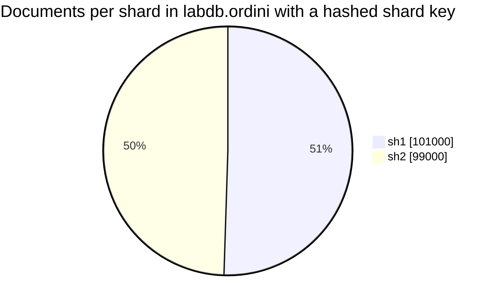
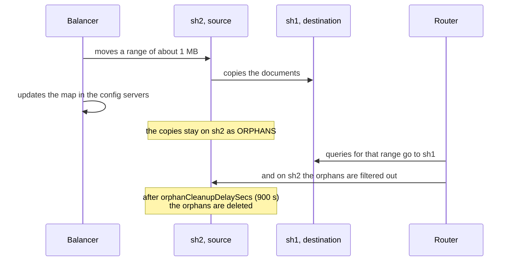
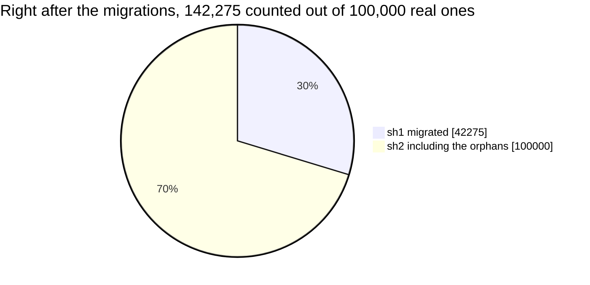
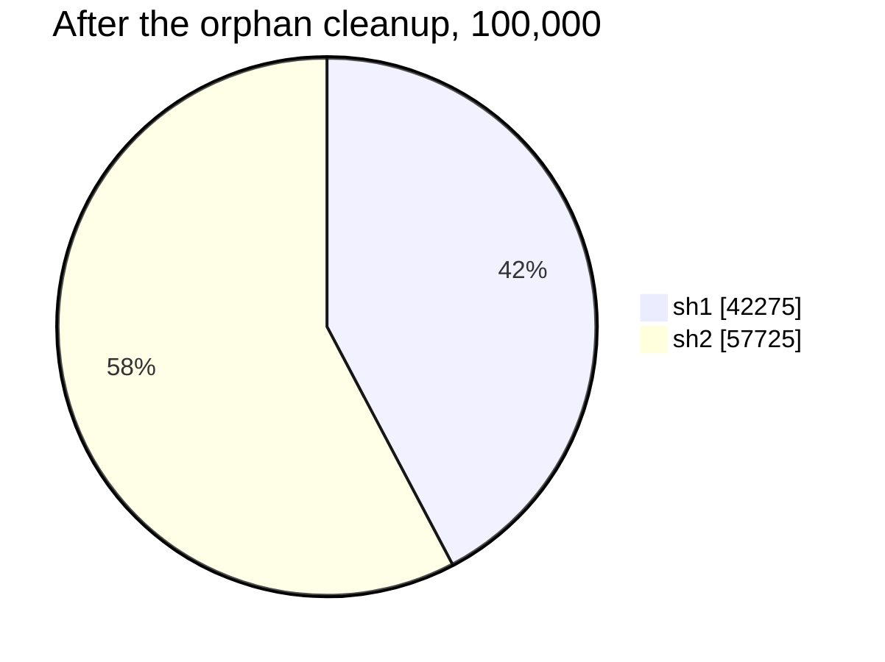
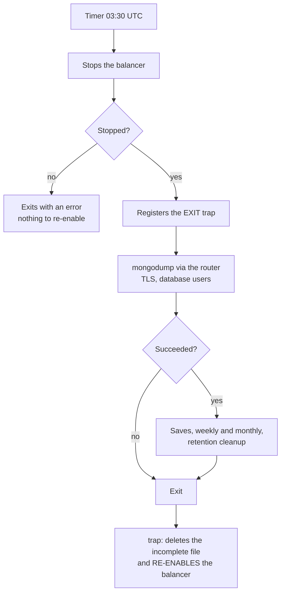

# MongoDB Sharding in Docker — Complete step-by-step guide

**Who this guide is for:** anyone who has followed guides 00–02 and wants to learn how to build and use a **sharded cluster**: routers, config servers, shards, shard keys, the balancer, backups. As in the previous guides, every step explains **what to do**, **what the command does** and **what you should see**, and every choice comes with a 🧭 box that separates what we do **in the lab** from what you would choose **in production**.

**What you will have at the end:**

- a complete cluster of ten processes: three config servers, two shards of three nodes each, one router;
- two sharded collections, one with a hashed shard key and one with a ranged shard key, so you can see the strengths and weaknesses of each with your own eyes;
- the balancer at work, queries targeted at a single shard and queries that ask all of them;
- TLS on all communications, access from VS Code through a single port, an application user;
- automatic nightly backups and a tested restore procedure.

**Estimated time:** 3 hours.

**Prerequisites:** guide 00 (Docker, kernel settings), guide 01 (the private CA in `~/mongodb/tls`), guide 02 recommended (replica sets are the building block of this cluster, and they are explained in detail there).

**Verification status:** every step has been run and tested on a real installation, except the ones marked with 🧪 (restoring users from the backup, weekly/monthly retention over a real period of time).

> 📖 **Commands and symbols** (`sudo`, `chmod`, `|`, `<< EOF`, `docker compose`…): the [command legend](linux-commands-legend.md) explains everything that appears in this guide.

---

## Contents

- [Part 0 — Concepts](#part-0--concepts)
- [Part 1 — The lab and the real scenario](#part-1--the-lab-and-the-real-scenario)
- [Part 2 — Preparing the VM](#part-2--preparing-the-vm)
- [Part 3 — Building the cluster](#part-3--building-the-cluster)
- [Part 4 — Initializing the replica sets](#part-4--initializing-the-replica-sets)
- [Part 5 — Users and helper functions](#part-5--users-and-helper-functions)
- [Part 6 — Registering the shards](#part-6--registering-the-shards)
- [Part 7 — Chunk size](#part-7--chunk-size)
- [Part 8 — Hashed shard key](#part-8--hashed-shard-key)
- [Part 9 — Targeted queries and queries on all shards](#part-9--targeted-queries-and-queries-on-all-shards)
- [Part 10 — Ranged shard key and the hot shard](#part-10--ranged-shard-key-and-the-hot-shard)
- [Part 11 — The balancer](#part-11--the-balancer)
- [Part 12 — A failure inside a shard](#part-12--a-failure-inside-a-shard)
- [Part 13 — TLS](#part-13--tls)
- [Part 14 — Access from your PC](#part-14--access-from-your-pc)
- [Part 15 — Application user](#part-15--application-user)
- [Part 16 — Backup and restore](#part-16--backup-and-restore)
- [Part 17 — Everyday use](#part-17--everyday-use)
- [Part 18 — Turning the other instances back on or dismantling the lab](#part-18--turning-the-other-instances-back-on-or-dismantling-the-lab)
- [Part 19 — When something goes wrong](#part-19--when-something-goes-wrong)
- [Part 20 — Lab and production](#part-20--lab-and-production)
- [Appendix A — Where everything is](#appendix-a--where-everything-is)
- [Appendix B — Command cheat sheet](#appendix-b--command-cheat-sheet)
- [The 10 golden rules of sharding](#the-10-golden-rules-of-sharding)

> **Conventions:** the same as in the previous guides (📍 where to run it, ✅ what you should see, `<< EOF` blocks to paste in full, `<...>` placeholders to replace, removing the `<` and `>` as well). Placeholders in this guide: `<IP_PRIVATO_VM>` (e.g. `10.0.0.4`), `<FQDN>` (the VM's DNS name, guide 02, Part 2.2), `<tuo-nome>` (your Windows user).

> **The 🧭 boxes** always have the same structure: **in the lab** (what we do), **why** (almost always a constraint of the lab: a single VM, little memory, other instances to preserve), **if you don't**, **in production** (what to choose in a real environment). **Do not copy the lab choices into production.**

---

## Part 0 — Concepts

### 0.1 Why sharding

A replica set (guide 02) **copies** the same data onto several servers: it protects you from failures, but every server has to hold **all** the data and handle **all** the writes. When the data or the writes exceed what a single server can manage, sharding **splits** a collection's data across several groups of servers, called **shards**. The application still sees a single collection.

### 0.2 The components

| Component | What it does | In our cluster |
|---|---|---|
| **Shard** | Holds one part of the data. It is always a replica set | `sh1` and `sh2`, three nodes each |
| **Config server** | Holds the map of the cluster: which data is on which shard, and the cluster's users. It is a replica set | `cfgrs`, three nodes |
| **Router (`mongos`)** | The only point applications connect to. It reads the map and sends each request to the right shards. It holds no data | `mongo-router` |

**Every shard and the config servers are replica sets:** everything you saw in guide 02 (elections, failover, keyFile) applies to each of them.



### 0.3 Replication and sharding: what sets them apart and how they combine

They are two different mechanisms that solve different problems:

- **replication** keeps **several copies of the same data** on different servers: its purpose is to avoid losing service and data when a server fails. Every copy holds **everything**;
- **sharding** **splits the data** across different groups of servers: you need it when the data or the writes are too much for a single server. Every group holds **only one part**.

A helpful picture is an encyclopedia: replication is photocopying the whole work and putting the copies in different rooms, so that if one room floods the other copies are still there; sharding is splitting the volumes across several shelves, because they don't fit on just one. In this guide we do both: we split the volumes across the shelves, and we keep three copies of every shelf.

**Does sharding "contain" replication?** Structurally, yes: in modern versions of MongoDB every shard **must** be a replica set, and so are the config servers. Replication happens **inside each shard, separately**: the nodes of shard 1 copy shard 1's data among themselves, those of shard 2 copy shard 2's data; nothing is copied between different shards, because they hold different data.

But a replica set can also have **a single member**: in that case the structure is there, the copies are not. If that server fails, the part of the data it held becomes unreachable, and so does every query that needs it.

| Configuration | Does it survive the failure of one server? | Does it handle more data than one server? |
|---|---|---|
| 3-node replica set (guide 02) | Yes | No: every node has all the data |
| Sharding with 1-node shards | **No**: every failure makes one part of the data unreachable | Yes |
| Sharding with 3-node shards (this guide) | Yes, one node per shard | Yes |

Two details complete the picture:

- **the router is not replicated**: with a single router, if it stops, applications cannot reach the cluster, even though all the data is safe. In production you use at least two;
- **the two techniques do not replace each other**: replication doesn't help when the data grows too large, and sharding without replication is more fragile than a single server, because it increases the number of machines that, by failing, block one part of the data.

In Part 12 you will see this in practice: when you shut down the primary of a shard, the replication inside that shard elects a new primary, and the router keeps working.

### 0.4 Shard key and chunks

To decide where each document goes, MongoDB uses a field chosen for each collection: the **shard key**. The values of the shard key are divided into **ranges**, called **chunks**, and each range is assigned to a shard.

There are two strategies:

- **Hashed:** MongoDB applies a hash to the value of the key, and distributes based on the hash. Documents are spread evenly, but neighboring values end up on different shards.
- **Ranged:** neighboring values stay on the same shard. Excellent for range queries, but risky with keys that always grow (dates, counters): all the new writes end up in the last range, that is, on a single shard (*hot shard*).

We will see this concretely in Parts 8–10.

> **A clarification about chunks.** It is easy to picture them as fixed-size "containers". In recent versions of MongoDB it is more accurate to think of them as **ranges of values assigned to a shard**: they are no longer split automatically as they grow, the balancer splits them when it needs to move data, and an automatic mechanism merges contiguous ranges that belong to the same shard. Their number changes over time and matters little: what matters is **how much data** each shard has.

### 0.5 The balancer

An internal process continuously checks whether the shards hold similar amounts of data. If the difference exceeds a threshold (about three times the reference chunk size), it moves ranges from the fullest shard to the emptiest one: this is a **migration**. After the migration, the source shard does not delete the moved documents right away: it keeps them for a while as **orphaned documents** (Part 10).

### 0.6 Targeted queries and queries on all shards

The router looks at the query: if it contains the shard key, the router knows which shard holds the data and asks **only that one** (*targeted query*). If it does not, the router has to ask **all** the shards and merge the results (*scatter-gather*). With two shards the difference is small; with fifty shards, every query without the shard key involves the whole cluster. **You choose the shard key by looking at the application's most frequent queries.**



### 0.7 When you really need it

Sharding has a high cost: in production you need around ten servers, and backups, monitoring and maintenance become more complex. You adopt it when a single, well-sized replica set is no longer enough. Before getting there, it is worth considering a bigger server, better indexes, or a managed service.

---

## Part 1 — The lab and the real scenario

### 1.1 The topology

| Component | Replica set | Container | Port |
|---|---|---|---|
| Config server | `cfgrs` | `mongo-cfg1`, `mongo-cfg2`, `mongo-cfg3` | 27201–27203 |
| Shard 1 | `sh1` | `mongo-sh1a`, `mongo-sh1b`, `mongo-sh1c` | 27211–27213 |
| Shard 2 | `sh2` | `mongo-sh2a`, `mongo-sh2b`, `mongo-sh2c` | 27221–27223 |
| Router | — | `mongo-router` | 27200 (the only published port) |

> 🧭 **Full topology on a single VM**
>
> **In the lab:** the ten processes of a production cluster, in ten containers on the same VM.
>
> **Alternatives considered:** A) a reduced cluster with single-node replica sets (4 containers, ~2 GB): cheap, but far from production; B) a full cluster after freeing up memory (**chosen**); C) a full cluster on a larger VM (cost and a reboot).
>
> **Why:** it is the only way to see the real structure at no extra cost. With a reduced cache, ten processes use 1.2 GB at rest and about 2.5 GB after loading the test data (measured values).
>
> **In production:** each process on a dedicated server. **Config servers:** three small VMs (they only hold metadata), in different availability zones. **Shards:** three VMs per shard, sized for the data (RAM for the *working set*, fast XFS disks), in different zones. **Routers:** usually one for each application server, or a group behind a load balancer: they are lightweight and stateless. Consider a managed service if the operational cost is too high.

### 1.2 Three projects on the same VM

The VM now holds three Docker Compose projects: `~/mongodb` (development), `~/mongo-lab/02-replica-set` and `~/mongo-lab/03-sharding`.

> ⚠️ **Look at the prompt before every `docker compose`**: it acts on the project in the current folder, and a `down -v` in the wrong folder deletes another project's data.

---

## Part 2 — Preparing the VM

> 📍 **On the VM.**

### 2.1 Shutting down the other instances

The development MongoDB (up to ~3.5 GB) and the replica set from guide 02 (up to 3 GB) leave no room for ten processes. We **shut them down without deleting them**, and we suspend their nightly backups, which would otherwise fail because they could not find the containers:

```bash
cd ~/mongodb && sudo docker compose stop
sudo systemctl disable --now mongo-backup.timer
cd ~/mongo-lab/02-replica-set && sudo docker compose stop
sudo systemctl disable --now mongo-rs-backup.timer
sudo docker ps
```

✅ `docker ps` lists no running containers. In the test run the development instance stopped in 1 second, the replica set nodes in about 16 (the *quiesce* phase from guide 02).

> 🧭 **Shut down, don't delete**
>
> **Why:** data, users, certificates and configuration stay in the volumes; you turn it back on with one command (Part 18). The development instance holds the application's data.
>
> **Consequences:** the application and the VS Code connections to development do not work for as long as it stays off. With `restart: unless-stopped`, a container stopped by hand **stays off even after the VM reboots**.
>
> **In production:** a sharded cluster never shares its servers with other databases; no instance has to be shut down to make room for it.

### 2.2 Swap: a safety net

**What it is.** When RAM runs out, without swap Linux triggers the **OOM killer** (*Out Of Memory*), which forcibly terminates a process: with ten MongoDB nodes, almost certainly one of them, shut down abruptly as if by a power cut. With **swap**, Linux moves the least recently used parts of memory to disk: the system slows down, but no process gets killed.

**It is not extra RAM.** Disk is much slower than memory: if a system uses swap all the time, performance collapses. Its purpose is to absorb **peaks**, such as loading the data or the balancer's migrations.

```bash
sudo fallocate -l 4G /swapfile
sudo chmod 600 /swapfile
sudo mkswap /swapfile
sudo swapon /swapfile
echo '/swapfile none swap sw 0 0' | sudo tee -a /etc/fstab
free -h
sudo swapon --show
```

| Command | What it does |
|---|---|
| `fallocate -l 4G /swapfile` | Creates a 4 GB file, reserving the space on disk |
| `chmod 600 /swapfile` | Only root can read it: swap can contain data from memory, including passwords |
| `mkswap /swapfile` | Prepares it as a swap area |
| `swapon /swapfile` | Turns it on right away |
| Line in `/etc/fstab` | Turns it back on at every boot |

✅ In `free -h` the line `Swap: 4.0Gi`, and `swapon --show` lists `/swapfile` (the `PRIO -2` column is the automatic priority: ignore it).

> ⚠️ `swapon --show` **without `sudo`** answers `command not found`: on Debian the administration commands live in `/usr/sbin`, outside the path of normal users. The same goes for `mkswap` and `swapoff`.

> 🧭 **4 GB of swap on the system disk**
>
> **Why:** 4 GB is enough for the peaks and takes up 4 of the roughly 58 GB free. In the test run, after loading 300,000 documents, swap stayed at **zero**: the safety net was never needed.
>
> **Alternative on Azure:** the VM's temporary disk (`/mnt`), which is faster, but is wiped when the VM is moved or deallocated, and is more involved to configure.
>
> **In production:** RAM is sized for the *working set* (the data and indexes used frequently); swap stays small, as protection only, and if its usage grows it is a sign of undersizing that you should monitor.

---

## Part 3 — Building the cluster

### 3.1 Folder, keyFile and password

```bash
mkdir -p ~/mongo-lab/03-sharding
cd ~/mongo-lab/03-sharding

openssl rand -base64 756 > keyfile
sudo chown 999:999 keyfile && sudo chmod 400 keyfile

openssl rand -base64 24 | tr -d '/+=' | sudo tee root_password.txt > /dev/null
sudo chmod 600 root_password.txt

PRIV_IP=<IP_PRIVATO_VM>
echo "IP privato: $PRIV_IP"
ls -l
```

✅ `keyfile` with `-r--------` owned by user 999; `root_password.txt` with `-rw-------` owned by root.

> 🧭 **One keyFile shared by all ten processes**
>
> **Why:** router, config servers and shards have to recognize one another, exactly like the members of a replica set (guide 02). The password, this time, is **not** mounted into the containers: we will pass it when we create the users.
>
> **In production:** the keyFile distributed securely to all the servers, or (preferable on large clusters) x.509 certificates for member authentication.

### 3.2 The docker-compose.yml, in four parts

The file is long: we write it in four short parts (the first one, with `>`, creates the file, the others, with `>>`, complete it). The first three use `<< 'EOF'` (copied literally), the last one `<< EOF` (it inserts the value of `$PRIV_IP`, set in the previous step in the same session).

**Part A — common settings and config servers:**

```bash
cat > docker-compose.yml << 'EOF'
name: mongo-lab-sh

x-mongod: &mongod
  image: mongo:8.0
  restart: unless-stopped
  stop_grace_period: 1m
  mem_limit: 640m
  ulimits:
    nofile:
      soft: 64000
      hard: 64000
  logging:
    driver: json-file
    options:
      max-size: "20m"
      max-file: "3"

services:
  mongo-cfg1:
    <<: *mongod
    container_name: mongo-cfg1
    hostname: mongo-cfg1
    command: ["mongod", "--configsvr", "--replSet", "cfgrs", "--port", "27201", "--keyFile", "/etc/mongo/keyfile", "--wiredTigerCacheSizeGB", "0.25", "--bind_ip_all"]
    volumes:
      - cfg1-data:/data/configdb
      - ./keyfile:/etc/mongo/keyfile:ro

  mongo-cfg2:
    <<: *mongod
    container_name: mongo-cfg2
    hostname: mongo-cfg2
    command: ["mongod", "--configsvr", "--replSet", "cfgrs", "--port", "27202", "--keyFile", "/etc/mongo/keyfile", "--wiredTigerCacheSizeGB", "0.25", "--bind_ip_all"]
    volumes:
      - cfg2-data:/data/configdb
      - ./keyfile:/etc/mongo/keyfile:ro

  mongo-cfg3:
    <<: *mongod
    container_name: mongo-cfg3
    hostname: mongo-cfg3
    command: ["mongod", "--configsvr", "--replSet", "cfgrs", "--port", "27203", "--keyFile", "/etc/mongo/keyfile", "--wiredTigerCacheSizeGB", "0.25", "--bind_ip_all"]
    volumes:
      - cfg3-data:/data/configdb
      - ./keyfile:/etc/mongo/keyfile:ro
EOF
```

> With `--configsvr` MongoDB saves its data in `/data/configdb` instead of `/data/db`: that is why the config servers' volumes are mounted there.

**Part B — shard 1:**

```bash
cat >> docker-compose.yml << 'EOF'

  mongo-sh1a:
    <<: *mongod
    container_name: mongo-sh1a
    hostname: mongo-sh1a
    command: ["mongod", "--shardsvr", "--replSet", "sh1", "--port", "27211", "--keyFile", "/etc/mongo/keyfile", "--wiredTigerCacheSizeGB", "0.25", "--bind_ip_all"]
    volumes:
      - sh1a-data:/data/db
      - ./keyfile:/etc/mongo/keyfile:ro

  mongo-sh1b:
    <<: *mongod
    container_name: mongo-sh1b
    hostname: mongo-sh1b
    command: ["mongod", "--shardsvr", "--replSet", "sh1", "--port", "27212", "--keyFile", "/etc/mongo/keyfile", "--wiredTigerCacheSizeGB", "0.25", "--bind_ip_all"]
    volumes:
      - sh1b-data:/data/db
      - ./keyfile:/etc/mongo/keyfile:ro

  mongo-sh1c:
    <<: *mongod
    container_name: mongo-sh1c
    hostname: mongo-sh1c
    command: ["mongod", "--shardsvr", "--replSet", "sh1", "--port", "27213", "--keyFile", "/etc/mongo/keyfile", "--wiredTigerCacheSizeGB", "0.25", "--bind_ip_all"]
    volumes:
      - sh1c-data:/data/db
      - ./keyfile:/etc/mongo/keyfile:ro
EOF
```

**Part C — shard 2:**

```bash
cat >> docker-compose.yml << 'EOF'

  mongo-sh2a:
    <<: *mongod
    container_name: mongo-sh2a
    hostname: mongo-sh2a
    command: ["mongod", "--shardsvr", "--replSet", "sh2", "--port", "27221", "--keyFile", "/etc/mongo/keyfile", "--wiredTigerCacheSizeGB", "0.25", "--bind_ip_all"]
    volumes:
      - sh2a-data:/data/db
      - ./keyfile:/etc/mongo/keyfile:ro

  mongo-sh2b:
    <<: *mongod
    container_name: mongo-sh2b
    hostname: mongo-sh2b
    command: ["mongod", "--shardsvr", "--replSet", "sh2", "--port", "27222", "--keyFile", "/etc/mongo/keyfile", "--wiredTigerCacheSizeGB", "0.25", "--bind_ip_all"]
    volumes:
      - sh2b-data:/data/db
      - ./keyfile:/etc/mongo/keyfile:ro

  mongo-sh2c:
    <<: *mongod
    container_name: mongo-sh2c
    hostname: mongo-sh2c
    command: ["mongod", "--shardsvr", "--replSet", "sh2", "--port", "27223", "--keyFile", "/etc/mongo/keyfile", "--wiredTigerCacheSizeGB", "0.25", "--bind_ip_all"]
    volumes:
      - sh2c-data:/data/db
      - ./keyfile:/etc/mongo/keyfile:ro
EOF
```

**Part D — router and volumes** (`<< EOF` without quotes):

```bash
cat >> docker-compose.yml << EOF

  mongo-router:
    image: mongo:8.0
    container_name: mongo-router
    hostname: mongo-router
    restart: unless-stopped
    stop_grace_period: 1m
    mem_limit: 384m
    user: "999:999"
    command: ["mongos", "--configdb", "cfgrs/mongo-cfg1:27201,mongo-cfg2:27202,mongo-cfg3:27203", "--port", "27200", "--keyFile", "/etc/mongo/keyfile", "--bind_ip_all"]
    ports:
      - "127.0.0.1:27200:27200"
      - "$PRIV_IP:27200:27200"
    volumes:
      - ./keyfile:/etc/mongo/keyfile:ro
    depends_on:
      - mongo-cfg1
      - mongo-cfg2
      - mongo-cfg3

volumes:
  cfg1-data:
  cfg2-data:
  cfg3-data:
  sh1a-data:
  sh1b-data:
  sh1c-data:
  sh2a-data:
  sh2b-data:
  sh2c-data:
EOF
```

### 3.3 Checking the file

```bash
sudo docker compose config --quiet && echo "compose valido"
sudo docker compose config --services | wc -l
sudo docker compose config --volumes | wc -l
sudo docker compose config | grep -c "target: /etc/mongo/keyfile"
grep -A2 "ports:" docker-compose.yml
```

✅ `compose valido`, **10** services, **9** volumes, **10** keyFile mounts, and under `ports` the lines with `127.0.0.1` and with your real private IP.

> ⚠️ **Lines jumbled during the paste.** In the test run, at the end of Part A lines like `EOF   - ./keyfile:/etc/mongo/keyfile:ro` appeared, which suggested a damaged file. It was only a **display** glitch in the terminal: the file was intact. In guide 02, on the other hand, in a similar case the file really was incomplete. So trust neither how it looks nor `compose valido`: the count of keyFile mounts checks **every** service, while the count of volumes does not (the volumes are declared at the bottom of the file). To check a specific service: `grep -n -A6 "container_name: mongo-cfg3" docker-compose.yml`. As an alternative to pasting, `nano` avoids the problem.

| Element | Meaning |
|---|---|
| `--configsvr` | The node is a config server |
| `--shardsvr` | The node is part of a shard |
| `mongos --configdb cfgrs/...` | The router, with the address of the config servers |
| `mem_limit` 640m / 384m, 256 MB cache | Lab limits to fit in the VM's memory |
| `user: "999:999"` on the router | The router runs as an unprivileged user; it has no data of its own |
| Ports only for the router | Config servers and shards cannot be reached from outside Docker |

> 🧭 **Members registered with the container names, a single published port**
>
> **Why (difference from guide 02):** clients talk **only to the router**, which contacts config servers and shards inside the Docker network. The problem of member names that cannot be reached from outside, which in guide 02 required the DNS name and `extra_hosts`, does not exist here.
>
> **In production:** the nodes still have **stable internal DNS names**, chosen before initialization, because the config servers store the addresses of the shards. Config servers and shards sit in a subnet reachable only by the routers and the administration tools; the routers only by the application servers.

### 3.4 Startup

```bash
cd ~/mongo-lab/03-sharding
sudo docker compose up -d
sleep 20
sudo docker compose ps --format "table {{.Name}}\t{{.Status}}"
sudo docker stats --no-stream --format "table {{.Name}}\t{{.MemUsage}}"
sudo docker compose logs mongo-router --tail 5
```

✅ Ten running containers, about **110 MiB** per node and 86 MiB for the router (values from the test run).

The router's logs show messages such as `Could not find host matching read preference ... for set cfgrs` and `Error loading global settings from config server. Sleeping for 2 seconds and retrying`. **This is normal:** the router is looking for the primary of the config servers, which does not exist yet, and it retries every two seconds. It does not fail and it does not restart: it will connect by itself after Part 4.

---

## Part 4 — Initializing the replica sets

As long as no user exists, MongoDB accepts administration commands when you connect **from the same machine**: this is the *localhost exception*. That is why the following commands don't ask for a password.

**Config servers** (note `configsvr: true`):

```bash
sudo docker exec mongo-cfg1 mongosh --port 27201 --quiet --eval '
rs.initiate({ _id: "cfgrs", configsvr: true, members: [
  { _id: 0, host: "mongo-cfg1:27201" },
  { _id: 1, host: "mongo-cfg2:27202" },
  { _id: 2, host: "mongo-cfg3:27203" } ] })'
```

**Shard 1:**

```bash
sudo docker exec mongo-sh1a mongosh --port 27211 --quiet --eval '
rs.initiate({ _id: "sh1", members: [
  { _id: 0, host: "mongo-sh1a:27211" },
  { _id: 1, host: "mongo-sh1b:27212" },
  { _id: 2, host: "mongo-sh1c:27213" } ] })'
```

**Shard 2:**

```bash
sudo docker exec mongo-sh2a mongosh --port 27221 --quiet --eval '
rs.initiate({ _id: "sh2", members: [
  { _id: 0, host: "mongo-sh2a:27221" },
  { _id: 1, host: "mongo-sh2b:27222" },
  { _id: 2, host: "mongo-sh2c:27223" } ] })'
```

✅ `{ ok: 1 }` three times.

**Check** (after about twenty seconds; `db.hello()` works even without authentication):

```bash
for c in "mongo-cfg1 27201" "mongo-sh1a 27211" "mongo-sh2a 27221"; do
  set -- $c
  sudo docker exec $1 mongosh --port $2 --quiet --eval 'print(db.hello().setName, "- primario:", db.hello().primary)'
done
sudo docker compose logs mongo-router --tail 3
```

✅ The primary of each replica set, usually the node you ran `rs.initiate` on. The router's logs show `Updating the shard registry with confirmed replica set ... cfgrs/...`: it has found the config servers.

---

## Part 5 — Users and helper functions

### 5.1 Two kinds of users

| Kind | Where you create it | Where it lives | What it is for |
|---|---|---|---|
| **Cluster users** | Through the router | In the config servers | Everything that goes through the router: administration, applications |
| **Shard-local users** | On the primary of each shard | Only in the nodes of that shard | Direct maintenance of a shard's nodes |

### 5.2 Shard-local administrators

On the primary of each shard, using the localhost exception (if the primary is not node `a`, change the container and the port):

```bash
cd ~/mongo-lab/03-sharding
for c in "mongo-sh1a 27211" "mongo-sh2a 27221"; do
  set -- $c
  sudo docker exec -i -e P="$(sudo cat root_password.txt)" $1 \
    sh -c 'mongosh --port '"$2"' --quiet --eval "db.getSiblingDB(\"admin\").createUser({ user: \"admin\", pwd: process.env.P, roles: [\"root\"] })"'
done
```

✅ `{ ok: 1 }` twice.

### 5.3 Cluster administrator

```bash
sudo docker exec -i -e P="$(sudo cat root_password.txt)" mongo-router \
  sh -c 'mongosh --port 27200 --quiet --eval "db.getSiblingDB(\"admin\").createUser({ user: \"admin\", pwd: process.env.P, roles: [\"root\"] })"'
```

✅ `{ ok: 1, ... }`.

> 🧭 **Users created with the localhost exception, no `MONGO_INITDB_*`**
>
> **Why:** in a cluster you create users through the router; the Docker image's automatic initialization only works for a `mongod`. The localhost exception closes by itself as soon as a user exists.
>
> **In the lab** the three administrators have the same password, for simplicity. **In production:** different passwords, in a secrets manager, and application users with minimal roles.

### 5.4 Helper functions, saved in a file

Like `rs_eval` in guide 02, two functions save you from typing the password with every command. This time we save them in a **file**, because functions disappear every time you reconnect to the VM:

```bash
cat > ~/mongo-lab/03-sharding/funzioni-lab.sh << 'EOF'
# Funzioni di comodo del laboratorio 03 (caricare con: source ~/mongo-lab/03-sharding/funzioni-lab.sh)
sh_eval() {
  sudo docker exec -i -e P="$(sudo cat ~/mongo-lab/03-sharding/root_password.txt)" mongo-router \
    sh -c 'mongosh --port 27200 -u admin -p "$P" --authenticationDatabase admin --quiet --eval "$0"' "$1"
}
node_eval() {
  sudo docker exec -i -e P="$(sudo cat ~/mongo-lab/03-sharding/root_password.txt)" "$1" \
    sh -c 'mongosh --port '"$2"' -u admin -p "$P" --authenticationDatabase admin --quiet --eval "$0"' "$3"
}
EOF
source ~/mongo-lab/03-sharding/funzioni-lab.sh

sh_eval 'print("Collegato al router, versione", db.version())'
node_eval mongo-sh1a 27211 'rs.status().members.forEach(m => print(m.name, m.stateStr))'
node_eval mongo-cfg1 27201 'rs.status().members.forEach(m => print(m.name, m.stateStr))'
```

✅ The server version (8.0.x), then one `PRIMARY` and two `SECONDARY` for shard 1 and for the config servers. The last command is instructive: we never created the `admin` user directly on the config servers, but through the router, which saved it there.

Usage: `sh_eval 'js'` on the router; `node_eval <container> <porta> 'js'` on a specific node.

**After every reconnection** (otherwise: `sh_eval: command not found`):

```bash
source ~/mongo-lab/03-sharding/funzioni-lab.sh
```

**To load them automatically** at every login, add the line to `~/.bashrc`, the file bash runs when it opens each session:

```bash
echo 'source ~/mongo-lab/03-sharding/funzioni-lab.sh' >> ~/.bashrc
```

When you dismantle the lab, it has to be removed (Part 18). The functions file does not contain the password: it reads it from `root_password.txt` every time. **Lab only:** the password is visible for an instant to the container's processes.

---

## Part 6 — Registering the shards

```bash
sh_eval 'printjson(sh.addShard("sh1/mongo-sh1a:27211,mongo-sh1b:27212,mongo-sh1c:27213"))'
sh_eval 'printjson(sh.addShard("sh2/mongo-sh2a:27221,mongo-sh2b:27222,mongo-sh2c:27223"))'
sh_eval 'db.adminCommand({ listShards: 1 }).shards.forEach(s => print(s._id, s.host, "stato:", s.state))'
sh_eval 'sh.status()'
```

✅ `shardAdded` with `ok: 1` twice, the two shards with `stato: 1`, and `sh.status()` working: in guide 02 the same command failed, because there we were talking to a replica set.

**How to read `sh.status()`:**

| Section | Content |
|---|---|
| `shards` | The registered shards, with their members |
| `active mongoses` | The active routers and their version |
| `autosplit` | Shown for compatibility; in recent versions splitting is handled by the balancer |
| `balancer` | Enabled, running, outcomes of the latest migrations |
| `shardedDataDistribution` | Data per shard for the sharded collections |
| `databases` | Databases and their primary shard |

---

## Part 7 — Chunk size

The balancer moves data when the difference between the shards exceeds about **three times** the reference chunk size, which by default is 128 MB. With the few MB of the lab we would never see a migration. We reduce it to 1 MB:

```bash
sh_eval 'db.getSiblingDB("config").settings.updateOne({ _id: "chunksize" }, { $set: { value: 1 } }, { upsert: true }); printjson(db.getSiblingDB("config").settings.findOne({ _id: "chunksize" }))'
```

✅ `{ _id: 'chunksize', value: 1 }`.

> 🧭 **1 MB chunks — lab only.** In production you leave the default value: small values mean constant migrations and a pointless load on the cluster.

---

## Part 8 — Hashed shard key

```bash
sh_eval 'sh.enableSharding("labdb"); printjson(sh.shardCollection("labdb.ordini", { clienteId: "hashed" }))'
```

✅ `collectionsharded: 'labdb.ordini'`.

**200,000 test orders** (about one minute):

```bash
sh_eval '
const c = db.getSiblingDB("labdb").ordini;
for (let b = 0; b < 20; b++) {
  const docs = [];
  for (let i = 0; i < 10000; i++) {
    const n = b * 10000 + i;
    docs.push({ clienteId: n % 5000, ordine: n, importo: Math.round(Math.random() * 1000),
                data: new Date(Date.now() - n * 60000), note: "x".repeat(50) });
  }
  c.insertMany(docs, { ordered: false });
}
print("Documenti:", c.countDocuments());'
```

✅ `Documenti: 200000`.

**Memory after the load**, the moment of peak usage:

```bash
free -h
sudo docker stats --no-stream --format "table {{.Name}}\t{{.MemUsage}}"
```

✅ In the test run: 2.5 GB used out of 7.8, shard nodes at around 230 MiB, config servers at 165, **swap at zero**.

**Distribution:**

```bash
sh_eval 'db.getSiblingDB("labdb").ordini.getShardDistribution()'
```

✅ In the test run **50.5% / 49.5%** (101,000 and 99,000 documents): the hash spreads the customers evenly.



<details>
<summary>📋 Real output from the test run (excerpt)</summary>

```
Totals
{
  data: '26.12MiB',
  docs: 200000,
  chunks: 2,
  'Shard sh2': [ '49.5 % data', '49.5 % docs in cluster', '137B avg obj size on shard' ],
  'Shard sh1': [ '50.5 % data', '50.5 % docs in cluster', '137B avg obj size on shard' ]
}
```

</details>

You will notice **a single chunk per shard**, of about 13 MB, despite the 1 MB reference size. It is not an error: a hashed collection is born already split into one range per shard, and the balancer does not split what is already balanced. See the clarification in Part 0.4.

---

## Part 9 — Targeted queries and queries on all shards

```bash
sh_eval 'const e = db.getSiblingDB("labdb").ordini.find({ clienteId: 42 }).explain(); print("Con la shard key    ->", e.queryPlanner.winningPlan.stage, "- shard interrogati:", e.queryPlanner.winningPlan.shards.length)'
sh_eval 'const e = db.getSiblingDB("labdb").ordini.find({ importo: { $gt: 990 } }).explain(); print("Senza la shard key  ->", e.queryPlanner.winningPlan.stage, "- shard interrogati:", e.queryPlanner.winningPlan.shards.length)'
sh_eval 'const e = db.getSiblingDB("labdb").ordini.find({ clienteId: { $gte: 100, $lt: 110 } }).explain(); print("Intervallo su hashed ->", e.queryPlanner.winningPlan.stage, "- shard interrogati:", e.queryPlanner.winningPlan.shards.length)'
```

✅ Results from the test run:

| Query | Result | Why |
|---|---|---|
| `{ clienteId: 42 }` | `SINGLE_SHARD`, 1 shard | It contains the shard key |
| `{ importo: { $gt: 990 } }` | `SHARD_MERGE`, 2 shards | It does not contain the shard key |
| `{ clienteId: { $gte: 100, $lt: 110 } }` | `SHARD_MERGE`, 2 shards | With the hash, neighboring values are on different shards |

<details>
<summary>📋 Real output from the test run</summary>

```
Con la shard key    -> SINGLE_SHARD - shard interrogati: 1
Senza la shard key  -> SHARD_MERGE - shard interrogati: 2
Intervallo su chiave hashed -> SHARD_MERGE - shard interrogati: 2
```

</details>

---

## Part 10 — Ranged shard key and the hot shard

A collection sharded by **ranges** of `ts`, a timestamp that always grows, like a creation date:

```bash
sh_eval 'printjson(sh.shardCollection("labdb.eventi", { ts: 1 }))'

sh_eval '
const c = db.getSiblingDB("labdb").eventi;
const base = Date.now();
for (let b = 0; b < 10; b++) {
  const docs = [];
  for (let i = 0; i < 10000; i++) {
    const n = b * 10000 + i;
    docs.push({ ts: new Date(base + n * 1000), tipo: "evento", valore: n, note: "x".repeat(50) });
  }
  c.insertMany(docs, { ordered: true });
}
print("Documenti:", c.countDocuments());'
```

✅ `Documenti: 100000`.

**Where the data is, and where the new data goes:**

```bash
sh_eval 'db.getSiblingDB("labdb").eventi.getShardDistribution()'
sh_eval '
const u = db.getSiblingDB("config").collections.findOne({ _id: "labdb.eventi" }).uuid;
const ch = db.getSiblingDB("config").chunks;
ch.aggregate([ { $match: { uuid: u } }, { $group: { _id: "$shard", chunk: { $sum: 1 } } } ]).forEach(printjson);
ch.find({ uuid: u }).sort({ min: -1 }).limit(1).forEach(c => print("Ultimo chunk, che riceve TUTTI i nuovi inserimenti:", c.shard));'
```

**What happened in the test run:**

1. the data was born **all on one shard** (`sh2`): an empty ranged collection has a single range;
2. the balancer immediately moved **5 ranges of about 1 MB** (`1023KiB` per chunk) to the other shard;
3. the last range, the one that receives every document with a higher timestamp, stayed on `sh2`: **all the new writes go there**. This is the *hot shard*: the balancer evens out the data already written, but it cannot distribute the new writes.

<details>
<summary>📋 Real output from the test run</summary>

```
{ _id: 'sh1', chunk: 5 }
{ _id: 'sh2', chunk: 1 }
Ultimo chunk, che riceve TUTTI i nuovi inserimenti: sh2
```

</details>

### 10.1 The numbers that don't add up: orphaned documents



Right after the load, `getShardDistribution` added up to **142,275 documents** instead of 100,000: `sh1` had received 42,275 of them through the migrations, but `sh2` still counted all 100,000.

**Why:** after a migration, the source shard does **not delete** the copied documents **right away**. It deletes them asynchronously, after a safety delay (by default **15 minutes**), so as not to disturb any reads still in progress. In the meantime they are **orphaned** documents: physically present, but no longer the responsibility of that shard. The per-shard statistics count them; **queries through the router filter them out**, so for the application the data is always correct.

```bash
sh_eval 'print("Documenti visti dal router:", db.getSiblingDB("labdb").eventi.countDocuments())'
node_eval mongo-sh2a 27221 'print("Intervalli in attesa di cancellazione:", db.getSiblingDB("config").rangeDeletions.countDocuments()); print("Ritardo di pulizia (secondi):", db.adminCommand({ getParameter: 1, orphanCleanupDelaySecs: 1 }).orphanCleanupDelaySecs)'
```

✅ In the test run: router `100000`, **5** ranges waiting, a delay of **900** seconds. After 15 minutes the distribution went back to **100,000** (42,275 + 57,725), and the 5 migrated ranges had become **just one**: MongoDB automatically merges contiguous ranges that belong to the same shard.

Documents **counted per shard** by `getShardDistribution`, right after the migrations (on the left, with the orphans) and after 15 minutes (on the right):





<details>
<summary>📋 Real output from the test run</summary>

```
Documenti visti dal router: 100000
Intervalli in attesa di cancellazione: 5
Ritardo di pulizia (secondi): 900
```

</details>

### 10.2 The other side of the coin

A range query on the ranged shard key stays targeted:

```bash
sh_eval 'const t = db.getSiblingDB("labdb").eventi.findOne({}, { ts: 1 }).ts; const e = db.getSiblingDB("labdb").eventi.find({ ts: { $gte: t, $lt: new Date(t.getTime() + 60000) } }).explain(); print(e.queryPlanner.winningPlan.stage, "- shard interrogati:", e.queryPlanner.winningPlan.shards.length)'
```

✅ `SINGLE_SHARD`, 1 shard.

### 10.3 The comparison

| | `ordini` (hashed) | `eventi` (ranged, growing key) |
|---|---|---|
| Initial distribution | Even from the start | Everything on one shard |
| New writes | Distributed | Always in the last range: hot shard |
| Equality query on the key | Targeted | Targeted |
| Range query on the key | All shards | Targeted |

> 🧭 **Choosing the shard key in production.** A good key has **many different values**, **distributes the writes** and appears in the **most frequent queries**. A compound key (for example customer + date) is often used to get both distributed writes and targeted queries. The key can be changed later (*resharding*), but it is a heavy operation: choose it well from the start.

---

## Part 11 — The balancer

```bash
sh_eval 'print("Bilanciatore abilitato:", sh.getBalancerState()); printjson(sh.isBalancerRunning())'
sh_eval 'db.getSiblingDB("config").changelog.find({ what: /moveChunk.commit|moveRange/ }).sort({ time: -1 }).limit(5).forEach(e => print(e.time.toISOString(), e.what, e.ns))'
```

✅ In the test run: enabled, `mode: 'full'`, `inBalancerRound: false`; five `moveChunk.commit` on `labdb.eventi` in about 6 seconds, a little over one second each.

<details>
<summary>📋 Real output from the test run</summary>

```
Bilanciatore abilitato: true
{ mode: 'full', inBalancerRound: false, numBalancerRounds: Long('91'), ... }
2026-09-30T07:27:47.077Z moveChunk.commit labdb.eventi
2026-09-30T07:27:45.677Z moveChunk.commit labdb.eventi
2026-09-30T07:27:44.322Z moveChunk.commit labdb.eventi
2026-09-30T07:27:42.929Z moveChunk.commit labdb.eventi
2026-09-30T07:27:41.429Z moveChunk.commit labdb.eventi
```

</details>

After those five migrations the balancer **stopped while remaining active**: net of the orphans, the difference between the shards had dropped below the threshold.

> 🧭 **In production** migrations, with 128 MB ranges and a real load, take much longer and consume disk and network. They can be restricted to a **time window** (*balancing window*), for example at night, and outside the backup window.

---

## Part 12 — A failure inside a shard

Every shard is a replica set: failover works as in guide 02, and the router finds the new primary by itself.

```bash
node_eval mongo-sh1a 27211 'rs.status().members.forEach(m => print(m.name, m.stateStr))'
sudo docker compose stop mongo-sh1a
```

After about twenty seconds:

```bash
sh_eval 'print("Documenti:", db.getSiblingDB("labdb").ordini.countDocuments()); db.getSiblingDB("labdb").ordini.insertOne({ clienteId: 1, ordine: -1, nota: "durante il guasto" }); print("Scrittura riuscita")'
node_eval mongo-sh1b 27212 'rs.status().members.forEach(m => print(m.name, m.stateStr))'
sudo docker compose start mongo-sh1a
```

✅ In the test run: stopped in 16 seconds (an orderly shutdown), the count and the write succeeded through the router, `mongo-sh1b` the new primary of shard 1.

<details>
<summary>📋 Real output from the test run</summary>

```
✔ Container mongo-sh1a Stopped                                  16.2s
Documenti: 200000
Scrittura riuscita
mongo-sh1a:27211 (not reachable/healthy)
mongo-sh1b:27212 PRIMARY
mongo-sh1c:27213 SECONDARY
```

</details>

---

## Part 13 — TLS

We encrypt **all communications**: from your PC to the router, and between the router, config servers and shards.

> **What it encrypts, and what it doesn't.** TLS protects data **in transit**. Data **saved on disk** is not encrypted by MongoDB Community (encryption of the data files exists only in the Enterprise edition): you protect it at the disk level, for example with Azure disk encryption, which is on by default.

### 13.1 The cluster certificate

One certificate for all ten processes, signed with the CA from guide 01. The SAN holds the names of all the containers (the processes connect to each other using those names), `localhost`, `127.0.0.1`, and the DNS name and private IP for the connection from VS Code. The usage is `serverAuth` **and** `clientAuth`: every process is also a client of the others (guide 02, Part 8.2).

```bash
cd ~/mongo-lab/03-sharding
mkdir -p tls && chmod 700 tls && cd tls
FQDN=<FQDN>
PRIV_IP=<IP_PRIVATO_VM>

cat > server.ext << EOF
basicConstraints=CA:FALSE
keyUsage=digitalSignature,keyEncipherment
extendedKeyUsage=serverAuth,clientAuth
subjectAltName=DNS:$FQDN,DNS:localhost,DNS:mongo-router,DNS:mongo-cfg1,DNS:mongo-cfg2,DNS:mongo-cfg3,DNS:mongo-sh1a,DNS:mongo-sh1b,DNS:mongo-sh1c,DNS:mongo-sh2a,DNS:mongo-sh2b,DNS:mongo-sh2c,IP:127.0.0.1,IP:$PRIV_IP
EOF

openssl genrsa -out server.key 2048
openssl req -new -key server.key -subj "/CN=mongo-lab-sh" -out server.csr
openssl x509 -req -in server.csr -CA ~/mongodb/tls/ca.pem -CAkey ~/mongodb/tls/ca.key \
  -CAserial ~/mongodb/tls/ca.srl -days 825 -sha256 -extfile server.ext -out server.crt
rm server.csr
cp ~/mongodb/tls/ca.pem .
openssl verify -CAfile ca.pem server.crt
openssl x509 -in server.crt -noout -ext subjectAltName,extendedKeyUsage

cat server.crt server.key | sudo tee server.pem > /dev/null
sudo chown 999:999 server.pem && sudo chmod 600 server.pem
chmod 600 server.key && chmod 644 ca.pem server.crt
ls -l
cd ..
```

✅ `server.crt: OK`, all fourteen names and addresses in the SAN, the usage `TLS Web Server Authentication, TLS Web Client Authentication`, `server.pem` owned by user 999 with `-rw-------`.

### 13.2 Cold activation

```bash
cd ~/mongo-lab/03-sharding
cp docker-compose.yml docker-compose.yml.pre-tls
sed -i 's|"--bind_ip_all"\]|"--bind_ip_all", "--tlsMode", "requireTLS", "--tlsCertificateKeyFile", "/etc/mongo/tls/server.pem", "--tlsCAFile", "/etc/mongo/tls/ca.pem", "--tlsAllowConnectionsWithoutCertificates", "--tlsDisabledProtocols", "TLS1_0,TLS1_1"]|' docker-compose.yml
sed -i 's|^      - ./keyfile:/etc/mongo/keyfile:ro$|&\n      - ./tls/server.pem:/etc/mongo/tls/server.pem:ro\n      - ./tls/ca.pem:/etc/mongo/tls/ca.pem:ro|' docker-compose.yml
grep -c "requireTLS" docker-compose.yml
grep -c "server.pem:ro" docker-compose.yml
sudo docker compose config --quiet && echo "compose valido"
```

✅ `10`, `10`, `compose valido`: TLS options and files mounted on the nine nodes and the router.

Update the helper functions, which from now on connect over TLS:

```bash
sed -i 's|mongosh --port |mongosh --tls --tlsCAFile /etc/mongo/tls/ca.pem --port |' funzioni-lab.sh
grep -c "tlsCAFile" funzioni-lab.sh
source funzioni-lab.sh
```

✅ `2`.

Cold restart: `up -d` recreates all the containers, because the configuration has changed.

```bash
sudo docker compose up -d
sleep 45
sudo docker compose ps --format "table {{.Name}}\t{{.Status}}"
```

✅ Ten containers `Up` (in the test run the recreation took about 45 seconds). A second `up -d` does nothing (`Running`): Docker recreates only when the configuration changes.

> 🧭 **Cold TLS**
>
> **In the lab:** the whole cluster stopped and turned back on, about one minute of downtime, straight into `requireTLS`.
>
> **Why:** the only client is whoever is following the lab; doing it live would take two rounds of rotation across ten processes. A single certificate because all the processes are on the same machine.
>
> **In production:** a live migration as in guide 02 (`allowTLS` → `preferTLS` → `requireTLS`), one replica set at a time and then the routers, with several routers behind a load balancer so that the applications are not interrupted; one certificate per server, with its own DNS name.

### 13.3 Checks

```bash
sh_eval 'db.adminCommand({ listShards: 1 }).shards.forEach(s => print(s._id, "stato:", s.state)); print("ordini:", db.getSiblingDB("labdb").ordini.countDocuments(), "- eventi:", db.getSiblingDB("labdb").eventi.countDocuments())'
sh_eval 'print("Router:", db.adminCommand({ getParameter: 1, tlsMode: 1 }).tlsMode)'
node_eval mongo-sh1a 27211 'print("Shard 1:", db.adminCommand({ getParameter: 1, tlsMode: 1 }).tlsMode); printjson(db.serverStatus().transportSecurity)'
openssl s_client -connect 127.0.0.1:27200 -CAfile tls/ca.pem </dev/null 2>/dev/null | grep -E "Verify return code|Protocol"
sudo docker exec mongo-router mongosh --port 27200 --quiet --eval 'db.runCommand({ ping: 1 })'
```

✅ In the test run: shards with state 1 and data intact; router and shards in `requireTLS`; **62 TLS 1.3 connections** received by shard 1 and none with older versions; `Verify return code: 0 (ok)` with TLS 1.3; the last command, without TLS, **fails** with `connection ... closed`.

<details>
<summary>📋 Real output from the test run</summary>

```
sh1 stato: 1
sh2 stato: 1
ordini: 200001 - eventi: 100000
Router: requireTLS
Shard 1: requireTLS
{ '1.0': Long('0'), '1.1': Long('0'), '1.2': Long('0'), '1.3': Long('62'), unknown: Long('0') }
Protocol: TLSv1.3
Verify return code: 0 (ok)
MongoServerSelectionError: connection <monitor> to 127.0.0.1:27200 closed
```

</details>

---

## Part 14 — Access from your PC

Here you see a practical advantage of the router: **a single port**, no names of individual nodes, no `extra_hosts` as in guide 02. To VS Code the cluster is indistinguishable from a single instance.

1. **NSG rule** in the Azure portal: TCP **27200**, source only your public IP, name `mongo-lab-sh`.
2. **From the PC:** `Test-NetConnection <FQDN> -Port 27200` → `TcpTestSucceeded : True`.
3. **VS Code** (the `ca.pem` is the one from guide 01):

```
mongodb://admin:PASSWORD@<FQDN>:27200/?authSource=admin&tls=true&tlsCAFile=C:/Users/<tuo-nome>/mongodb-ca/ca.pem
```

The string has **no** `replicaSet=`: the router is not a replica set.

✅ VS Code shows `labdb` with `ordini` and `eventi`.

> If VS Code does not show the databases after a period of inactivity, the connection has usually gone stale: right-click → *Refresh*, or disconnect and reconnect.

---

## Part 15 — Application user

Created **through the router**, with permissions on `labdb` only:

```bash
cd ~/mongo-lab/03-sharding
openssl rand -base64 24 | tr -d '/+=' | sudo tee appuser_password.txt > /dev/null
sudo chmod 600 appuser_password.txt

sudo docker exec -i -e P="$(sudo cat root_password.txt)" -e APP_PWD="$(sudo cat appuser_password.txt)" mongo-router \
  sh -c 'mongosh --tls --tlsCAFile /etc/mongo/tls/ca.pem --port 27200 -u admin -p "$P" --authenticationDatabase admin --quiet \
    --eval "db.getSiblingDB(\"labdb\").createUser({ user: \"appuser\", pwd: process.env.APP_PWD, roles: [ { role: \"readWrite\", db: \"labdb\" } ] })"'
```

**Checks:**

```bash
sudo docker exec -i -e APP_PWD="$(sudo cat appuser_password.txt)" mongo-router \
  sh -c 'mongosh --tls --tlsCAFile /etc/mongo/tls/ca.pem --port 27200 -u appuser -p "$APP_PWD" --authenticationDatabase labdb --quiet \
    --eval "print(\"ordini:\", db.getSiblingDB(\"labdb\").ordini.countDocuments()); try { db.getSiblingDB(\"config\").chunks.findOne(); print(\"config leggibile\") } catch (e) { print(\"config:\", e.codeName) }"'

node_eval mongo-sh1a 27211 'print("Utenti di labdb sullo shard 1:", db.getSiblingDB("labdb").getUsers().users.length)'
```

✅ `ordini: 200001`, `config: Unauthorized` (no access to the cluster's metadata), and **0** users on the shard: users created through the router live in the config servers.

Connection string for applications and for VS Code:

```
mongodb://appuser:PASSWORD@<FQDN>:27200/labdb?authSource=labdb&tls=true&tlsCAFile=C:/Users/<tuo-nome>/mongodb-ca/ca.pem
```

---

## Part 16 — Backup and restore

### 16.1 What changes compared to a replica set

- The data is on several shards, and the balancer can **move it during the backup**: it has to be stopped first, and **always re-enabled** afterwards.
- Through the router you cannot use `--oplog`: the logical backup is **not a consistent snapshot of a single instant** if the application writes during the dump.
- A restore through the router recreates the collections **without sharding them** (Part 16.5).

> 🧭 **Logical backup through the router**
>
> **In the lab:** `mongodump` via the router with the balancer stopped, nightly and automatic.
>
> **Why:** simple, testable, suitable for small databases and a test environment.
>
> **In production:** **consistent** backups of the whole cluster require coordinated snapshots of all the shards and the config servers, with the balancer stopped, or the tools of a managed service. The logical backup via the router remains useful for exporting individual databases or collections. The balancer is restricted to a time window that does not overlap with the backup.

### 16.2 The script

Compared to the scripts in the previous guides there are three refinements:

- **the balancer is always re-enabled**: a `trap ... EXIT` runs the re-enabling whatever happens, even if the backup fails (verified in a simulation), and deletes any incomplete file;
- **the password does not appear in the arguments**: it arrives from standard input, including for the `mongosh` commands, which read it from an environment variable;
- **the database users** are included in the backup (`--dumpDbUsersAndRoles`).

In **three parts** (the first one inserts the real path of the lab):



```bash
sudo tee /usr/local/bin/mongo-sh-backup.sh > /dev/null << EOF
#!/bin/bash
# Backup del cluster con sharding (guida 03): bilanciatore fermo, backup logico via router, TLS
set -euo pipefail
umask 077

LAB=$HOME/mongo-lab/03-sharding
EOF
```

```bash
sudo tee -a /usr/local/bin/mongo-sh-backup.sh > /dev/null << 'EOF'
DB=labdb
DEST=/var/backups/mongo-lab-sh
KEEP_DAILY=7      # giorni
KEEP_WEEKLY=4     # settimane
KEEP_MONTHLY=12   # mesi

# Esegue JavaScript sul router come admin; la password arriva dallo standard input
mongo_admin() {
  cat "$LAB/root_password.txt" | docker exec -i mongo-router sh -c '
    read -r P; export P
    mongosh --tls --tlsCAFile /etc/mongo/tls/ca.pem --port 27200 --quiet \
      --eval "db.getSiblingDB(\"admin\").auth(\"admin\", process.env.P); $0"' "$1"
}

mkdir -p "$DEST/daily" "$DEST/weekly" "$DEST/monthly"
FILE="$DEST/daily/$DB-$(date +%Y%m%d-%H%M%S).archive.gz"

# 1. Ferma il bilanciatore; qualunque cosa succeda dopo, all'uscita viene riattivato
mongo_admin 'sh.stopBalancer(); if (sh.getBalancerState()) { quit(1) }' > /dev/null
trap 'rm -f "$FILE.tmp"; mongo_admin "sh.startBalancer()" > /dev/null || echo "ATTENZIONE: riattivare il bilanciatore a mano" >&2' EXIT
EOF
```

```bash
sudo tee -a /usr/local/bin/mongo-sh-backup.sh > /dev/null << 'EOF'

# 2. Backup logico attraverso il router, con gli utenti del database
cat "$LAB/root_password.txt" | docker exec -i mongo-router sh -c '
  umask 077
  read -r P
  printf "uri: mongodb://admin:%s@localhost:27200/?authSource=admin\n" "$P" > /tmp/dump.yaml
  mongodump --config=/tmp/dump.yaml --ssl --sslCAFile=/etc/mongo/tls/ca.pem \
    --db '"$DB"' --dumpDbUsersAndRoles --archive --gzip --quiet
  status=$?
  rm -f /tmp/dump.yaml
  exit $status' > "$FILE.tmp"
mv "$FILE.tmp" "$FILE"

# 3. Copie settimanali e mensili, pulizia
[ "$(date +%u)" = "7" ]  && ln -f "$FILE" "$DEST/weekly/"
[ "$(date +%d)" = "01" ] && ln -f "$FILE" "$DEST/monthly/"
find "$DEST/daily"   -name "$DB-*.archive.gz" -mtime +$((KEEP_DAILY - 1))        -delete
find "$DEST/weekly"  -name "$DB-*.archive.gz" -mtime +$((KEEP_WEEKLY * 7 - 1))  -delete
find "$DEST/monthly" -name "$DB-*.archive.gz" -mtime +$((KEEP_MONTHLY * 31 - 1)) -delete

echo "Backup completato: $FILE ($(du -h "$FILE" | cut -f1))"
EOF
```

**Check:**

```bash
sudo mkdir -p /var/backups/mongo-lab-sh && sudo chmod 700 /var/backups/mongo-lab-sh
sudo chmod 700 /usr/local/bin/mongo-sh-backup.sh
sudo bash -n /usr/local/bin/mongo-sh-backup.sh && echo "sintassi ok"
sudo grep -n "^LAB=" /usr/local/bin/mongo-sh-backup.sh
sudo tail -1 /usr/local/bin/mongo-sh-backup.sh
```

✅ `sintassi ok`, `LAB=` with the real path, and as the last line the `echo "Backup completato..."` (if it is missing, the last part was not pasted in full).

### 16.3 Manual test

```bash
sudo /usr/local/bin/mongo-sh-backup.sh
sudo ls -lh /var/backups/mongo-lab-sh/daily
sh_eval 'print("Bilanciatore abilitato:", sh.getBalancerState())'
```

✅ `Backup completato` (3.6 MB in the test run), the file with **`-rw-------`**, and the balancer back to `true`.

<details>
<summary>📋 Real output from the test run</summary>

```
Backup completato: /var/backups/mongo-lab-sh/daily/labdb-20260930-185231.archive.gz (3.6M)
-rw------- 1 root root 3.6M Sep 30 18:52 labdb-20260930-185231.archive.gz
Bilanciatore abilitato: true
```

</details>

> **File permissions.** In an earlier version of the manual commands, the backup was written on the host with `sudo tee`, and it was created as `-rw-r--r--`: the `umask 077` inside the container does not apply to files created on the host. The script writes the file from the host with `umask 077`, so it is created protected.

### 16.4 The timer

At **03:30 UTC**, after the backups of guides 00 (02:30) and 02 (03:00), even though they are suspended:

```bash
sudo tee /etc/systemd/system/mongo-sh-backup.service > /dev/null << 'EOF'
[Unit]
Description=Backup MongoDB cluster con sharding di laboratorio
Requires=docker.service
After=docker.service

[Service]
Type=oneshot
ExecStart=/usr/local/bin/mongo-sh-backup.sh
EOF

sudo tee /etc/systemd/system/mongo-sh-backup.timer > /dev/null << 'EOF'
[Unit]
Description=Backup notturno MongoDB cluster con sharding di laboratorio

[Timer]
OnCalendar=*-*-* 03:30:00
Persistent=true

[Install]
WantedBy=timers.target
EOF

sudo systemctl daemon-reload
sudo systemctl enable --now mongo-sh-backup.timer
systemctl list-timers 'mongo*'
sudo systemctl start mongo-sh-backup.service && sudo journalctl -u mongo-sh-backup.service -n 3 --no-pager
```

✅ The timer at 03:30 and `Backup completato` in the journal.

### 16.5 Test restore

Into a different database, so as not to touch the original:

```bash
cd ~/mongo-lab/03-sharding
F=$(sudo ls -t /var/backups/mongo-lab-sh/daily/ | head -1); echo "Archivio: $F"
{ sudo cat root_password.txt; sudo cat "/var/backups/mongo-lab-sh/daily/$F"; } | sudo docker exec -i mongo-router sh -c '
  umask 077
  read -r P
  printf "uri: mongodb://admin:%s@localhost:27200/?authSource=admin\n" "$P" > /tmp/restore.yaml
  mongorestore --config=/tmp/restore.yaml --ssl --sslCAFile=/etc/mongo/tls/ca.pem --nsFrom "labdb.*" --nsTo "labdb_ripristino.*" --archive --gzip
  status=$?
  rm -f /tmp/restore.yaml
  exit $status'

sh_eval 'const d = db.getSiblingDB("labdb_ripristino"); print("ordini:", d.ordini.countDocuments(), "- eventi:", d.eventi.countDocuments()); print("ordini distribuita?", db.getSiblingDB("config").collections.findOne({ _id: "labdb_ripristino.ordini" }) !== null); d.dropDatabase(); print("database di prova eliminato")'
```

✅ In the test run: **300,001 documents** restored in about 11 seconds, correct counts, and **`ordini distribuita? false`**.

<details>
<summary>📋 Real output from the test run (excerpt)</summary>

```
finished restoring `labdb_ripristino.eventi` (100000 documents, 0 failures)
finished restoring `labdb_ripristino.ordini` (200001 documents, 0 failures)
restoring indexes for collection `labdb_ripristino.ordini` from metadata
index: ... Key:bson.D{bson.E{Key:"clienteId", Value:"hashed"}} ...
index: ... Key:bson.D{bson.E{Key:"ts", Value:1}} ...
300001 document(s) restored successfully. 0 document(s) failed to restore.
ordini: 200001 - eventi: 100000
ordini distribuita? false
```

</details>

**What it means:** a restore through the router recreates the collections **unsharded**, all on the database's primary shard. The shard key **indexes** are restored, though (`clienteId_hashed` and `ts_1` appear in the `mongorestore` output): you can shard the collection again afterwards with `sh.shardCollection`, or you can create and shard it **before** the restore.

**Users** 🧪: the backup contains them (`--dumpDbUsersAndRoles`), but they are restored only with `--restoreDbUsersAndRoles` and only into the database with the **same name**, so not in a test on a different database. This restore has not been tested.

---

## Part 17 — Everyday use

| Operation | Command (from `~/mongo-lab/03-sharding`) |
|---|---|
| Load the functions | `source funzioni-lab.sh` |
| Cluster status | `sh_eval 'sh.status()'` |
| Status of a shard | `node_eval mongo-sh1a 27211 'rs.status().members.forEach(m => print(m.name, m.stateStr))'` |
| Distribution of a collection | `sh_eval 'db.getSiblingDB("labdb").ordini.getShardDistribution()'` |
| Balancer | `sh_eval 'print(sh.getBalancerState())'` |
| Memory of the nodes | `sudo docker stats --no-stream --format "table {{.Name}}\t{{.MemUsage}}"` |
| Stop / restart the cluster | `sudo docker compose stop` / `sudo docker compose start` |
| Backup now / outcomes | `sudo /usr/local/bin/mongo-sh-backup.sh` / `sudo journalctl -u mongo-sh-backup.service -n 5` |

**Restarting after a complete shutdown:** in the test run, after `docker compose start`, within 30 seconds the router had found the config servers and shards again, with the data intact. With `restart: unless-stopped` the cluster also restarts by itself after a VM reboot (unless you stopped it yourself).

---

## Part 18 — Turning the other instances back on or dismantling the lab

### 18.1 Going back to the development MongoDB and the replica set

```bash
cd ~/mongo-lab/03-sharding && sudo docker compose stop
sudo systemctl disable --now mongo-sh-backup.timer

cd ~/mongodb && sudo docker compose start
sudo systemctl enable --now mongo-backup.timer

cd ~/mongo-lab/02-replica-set && sudo docker compose start
sudo systemctl enable --now mongo-rs-backup.timer

sudo docker ps --format "table {{.Names}}\t{{.Status}}"
systemctl list-timers 'mongo*'
```

✅ Tested: the cluster stops in about 18 seconds per container, the other instances restart and their timers are back on schedule.

To keep the cluster running together with the development instance, there is enough memory (in the test run: 2.4 GB used, 5.4 available); the replica set from guide 02 has to stay off.

### 18.2 Removing the swap (optional)

Tested:

```bash
sudo swapoff /swapfile
sudo sed -i '\|^/swapfile none swap sw 0 0$|d' /etc/fstab
sudo rm /swapfile
free -h
```

✅ `Swap: 0B`. The swap can also stay: it costs nothing until it is needed.

### 18.3 Dismantling the cluster

```bash
cd ~/mongo-lab/03-sharding
pwd                                     # must be the cluster folder!
sudo docker compose down -v
sudo systemctl disable --now mongo-sh-backup.timer
sudo rm /etc/systemd/system/mongo-sh-backup.{service,timer} /usr/local/bin/mongo-sh-backup.sh
sudo systemctl daemon-reload
sed -i '\|source ~/mongo-lab/03-sharding/funzioni-lab.sh|d' ~/.bashrc
```

Then, as you prefer: the `~/mongo-lab/03-sharding` folder, the backups in `/var/backups/mongo-lab-sh`, the NSG rule `mongo-lab-sh`, the connections in VS Code.

---

## Part 19 — When something goes wrong

### Preparation and building

| Symptom | Cause | Solution |
|---|---|---|
| `swapon: command not found` | The command is in `/usr/sbin`, outside the user's path | `sudo swapon --show` |
| Lines jumbled during the paste (`EOF   - ./keyfile...`) | A display glitch in the terminal, or a file that really is incomplete | Check with `config \| grep -c "target: /etc/mongo/keyfile"` (10) and `grep -n -A6` on the suspect service |
| The router in the logs: `Could not find host ... for set cfgrs` | Config servers not initialized yet | Normal until Part 4 |
| A config server does not start | Volume mounted on `/data/db` instead of `/data/configdb`, or missing keyFile | Check the service's compose |

### Usage

| Symptom | Cause | Solution |
|---|---|---|
| `sh_eval: command not found` | New session | `source funzioni-lab.sh` (or the line in `~/.bashrc`) |
| `sh.status()` fails | Connected to a node instead of the router | Use `sh_eval` |
| `getShardDistribution` totals higher than the real documents | Orphaned documents after a migration | Normal for ~15 minutes; the router filters them out (Part 10.1) |
| A single chunk per shard despite a small `chunksize` | No automatic splitting: the collection is already balanced | Normal (Part 0.4) |
| The balancer moves nothing | Data difference below the threshold (~3 × chunk size) | Normal; check `changelog` |
| Writes concentrated on one shard | Growing ranged shard key | Choose a hashed or compound key (Part 10.3) |
| VS Code does not show the databases | Connection gone stale | *Refresh* or reconnect |

### TLS

| Symptom | Cause | Solution |
|---|---|---|
| `connection ... closed` | Client without TLS | `--tls --tlsCAFile` / `tls=true&tlsCAFile=` |
| Certificate errors between the processes | Certificate without `clientAuth`, or container name missing from the SAN | Regenerate it with all the names and `serverAuth,clientAuth` |
| `IP address mismatch` / `altnames` from VS Code | FQDN or IP not in the SAN | Use `<FQDN>`, or renew the certificate |

### Backup

| Symptom | Cause | Solution |
|---|---|---|
| Balancer left stopped | Backup interrupted without re-enabling | The script always re-enables it; by hand: `sh_eval 'sh.startBalancer()'` |
| Backup with `-rw-r--r--` | Written on the host without `umask 077` | Use the script; `sudo chmod 600` on the old files |
| Restored collections not sharded | Normal behavior of a restore via the router | Shard them before or after the restore |

---

## Part 20 — Lab and production

### 20.1 The differences

| Aspect | Lab | Production |
|---|---|---|
| Servers | 10 containers on one VM | ~10 VMs: 3 small config servers, 3 per shard; routers on the application servers |
| Availability zones | None | Members of each replica set in different zones |
| Memory | 256 MB cache, per-container limits, 4 GB of swap as a safety net | RAM sized for the working set, small swap, monitoring |
| Other instances | Shut down to free up resources | Dedicated servers |
| Names | Docker container names | Stable internal DNS names |
| Exposure | Only the router, NSG on one IP | Only the routers, only on a private network |
| Chunk size | 1 MB | Default (128 MB) |
| Users | Localhost exception; same password for the admins | Same scheme, secrets in a dedicated manager |
| Internal authentication | keyFile | keyFile or x.509 |
| TLS | Cold, single certificate | Rolling, one certificate per server |
| Backup | Logical via the router, nightly, balancer stopped | Coordinated snapshots or a managed service; balancer window |
| Router | One | Several routers, for availability |

### 20.2 Production checklist

- [ ] Verified that a single, well-sized replica set is not enough.
- [ ] Shard key chosen on the real queries: many values, distributed writes, targeted queries.
- [ ] Config servers and shards on dedicated VMs, in different availability zones.
- [ ] At least two routers, close to the applications.
- [ ] Stable internal DNS names, chosen before initialization.
- [ ] No exposure to the internet; a dedicated subnet for config servers and shards.
- [ ] Mandatory TLS with per-server certificates; keyFile or x.509.
- [ ] Consistent backups (coordinated snapshots or a managed service), restore tested.
- [ ] Balancer window outside peak hours and outside the backup.
- [ ] Monitoring: data distribution, migrations, replica set status, memory usage.

### 20.3 Advanced topics (not tested in the lab)

- **Zones** (*zone sharding*): tying ranges of data to specific shards, for example by country.
- **Resharding**: changing the shard key of an existing collection.
- **Adding and removing shards** in a running cluster.
- **x.509 authentication** of the members instead of the keyFile.

---

## Appendix A — Where everything is

| What | Where |
|---|---|
| Cluster folder | `~/mongo-lab/03-sharding` |
| Configuration | `docker-compose.yml` (copy without TLS: `docker-compose.yml.pre-tls`) |
| keyFile, passwords | `keyfile` (`400`, 999), `root_password.txt`, `appuser_password.txt` |
| Certificates | `tls/` (`server.pem` 999 `600`, `ca.pem`, `server.crt`, `server.key`, `server.ext`) |
| Helper functions | `funzioni-lab.sh` (optional line in `~/.bashrc`) |
| Data | 9 volumes `mongo-lab-sh_*-data` |
| Swap | `/swapfile`, line in `/etc/fstab` |
| Backup script | `/usr/local/bin/mongo-sh-backup.sh` |
| Backups | `/var/backups/mongo-lab-sh/daily`, `weekly`, `monthly` |
| Timer | `/etc/systemd/system/mongo-sh-backup.{service,timer}` (03:30 UTC) |
| Azure | NSG rule `mongo-lab-sh` (27200) |

---

## Appendix B — Command cheat sheet

```bash
cd ~/mongo-lab/03-sharding && source funzioni-lab.sh

sh_eval 'sh.status()'
sh_eval 'db.adminCommand({ listShards: 1 }).shards.forEach(s => print(s._id, "stato:", s.state))'
sh_eval 'db.getSiblingDB("labdb").ordini.getShardDistribution()'
sh_eval 'const e = db.getSiblingDB("labdb").ordini.find({ clienteId: 42 }).explain(); print(e.queryPlanner.winningPlan.stage)'
sh_eval 'print(sh.getBalancerState()); printjson(sh.isBalancerRunning())'
node_eval mongo-sh1a 27211 'rs.status().members.forEach(m => print(m.name, m.stateStr))'
node_eval mongo-sh2a 27221 'print(db.getSiblingDB("config").rangeDeletions.countDocuments())'

sudo /usr/local/bin/mongo-sh-backup.sh
sudo journalctl -u mongo-sh-backup.service -n 5 --no-pager
free -h
```

---

## The 10 golden rules of sharding

1. **Before sharding, try scaling the replica set**: sharding is expensive.
2. **You choose the shard key based on the queries**, and changing it later is heavy.
3. **Growing ranged keys = hot shard**: prefer hashed or compound keys.
4. **Applications talk only to the routers.**
5. **Every shard and the config servers are replica sets**: all the rules from guide 02 apply.
6. **Per-shard totals can include orphans**: trust the router.
7. **Stop the balancer during the backup, and always re-enable it.**
8. **A restore via the router does not re-shard the collections.**
9. **TLS encrypts data in transit, not on disk.**
10. **Look at the prompt**: several projects on the same VM, a single wrong `down -v`.
