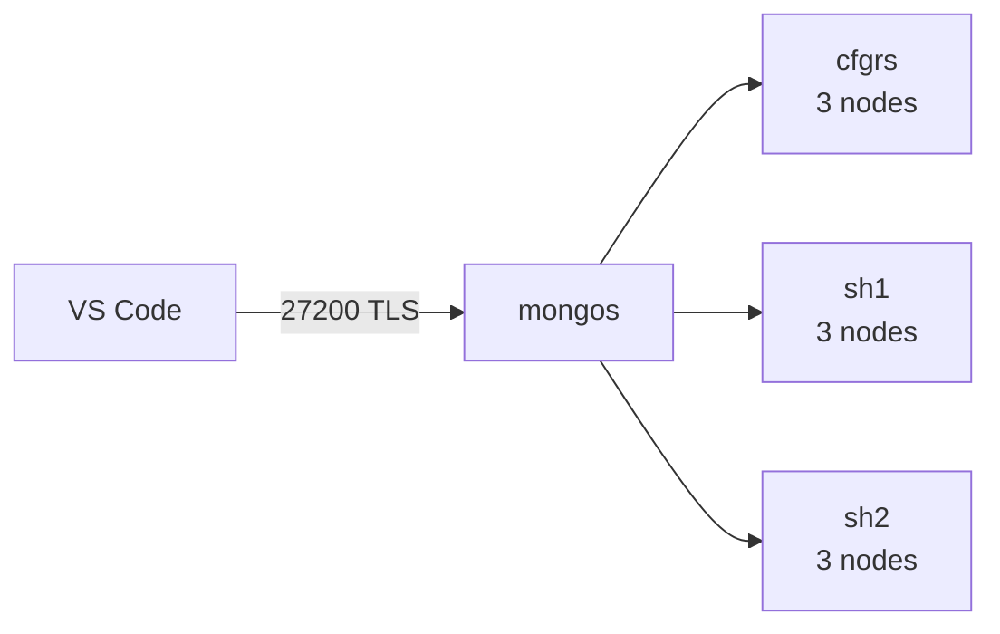

# MongoDB sharding in Docker — Quick guide

Full cluster on one VM (lab): 3 config servers, 2 shards × 3 nodes, 1 router; hashed and ranged shard keys, balancer, cold TLS switch, application user, nightly backup through the router. Assumes guides 00–01 (CA in `~/mongodb/tls`); guide 02 is recommended. Rationale and production scenario: `03-sharding-complete-guide.md`.

**Verification status:** tested on a real installation, except 🧪 (restoring users, weekly/monthly retention over time).

**Placeholders:** `<IP_PRIVATO_VM>`, `<FQDN>`, `<tuo-nome>`.

> 📖 Commands and symbols: [command legend](linux-commands-legend.md).

> ⚠️ Several Compose projects on the VM: check the prompt before every `docker compose`. The lab choices (memory, 1 MB chunks, cold TLS switch, single certificate) must **not** be copied to production.

**Replication and sharding:** replication keeps **copies of the same data** (fault tolerance), sharding **splits the data** across groups of servers (capacity). Each shard and the config servers are replica sets, and replication happens inside each shard; but with single-node shards there are no copies, and any failure makes part of the data unreachable. Here: 3-node shards → both properties. The single router is not replicated (in production ≥ 2).



| Component | RS | Container | Ports |
|---|---|---|---|
| Config server | `cfgrs` | `mongo-cfg1..3` | 27201–27203 |
| Shard 1 | `sh1` | `mongo-sh1a..c` | 27211–27213 |
| Shard 2 | `sh2` | `mongo-sh2a..c` | 27221–27223 |
| Router | — | `mongo-router` | 27200 (the only one published) |

---

## 1. Preparing the VM

```bash
# Stop (do not remove) the development instance and replica set 02, suspend their backups
cd ~/mongodb && sudo docker compose stop && sudo systemctl disable --now mongo-backup.timer
cd ~/mongo-lab/02-replica-set && sudo docker compose stop && sudo systemctl disable --now mongo-rs-backup.timer

# 4 GB swap: safety net against the OOM killer (not extra RAM)
sudo fallocate -l 4G /swapfile && sudo chmod 600 /swapfile && sudo mkswap /swapfile && sudo swapon /swapfile
echo '/swapfile none swap sw 0 0' | sudo tee -a /etc/fstab
free -h; sudo swapon --show          # without sudo: command not found (/usr/sbin)
```

## 2. Folder, keyFile, passwords

```bash
mkdir -p ~/mongo-lab/03-sharding && cd ~/mongo-lab/03-sharding
openssl rand -base64 756 > keyfile && sudo chown 999:999 keyfile && sudo chmod 400 keyfile
openssl rand -base64 24 | tr -d '/+=' | sudo tee root_password.txt > /dev/null && sudo chmod 600 root_password.txt
PRIV_IP=<IP_PRIVATO_VM>
```

## 3. Compose

Given in four parts (A config servers, B shard 1, C shard 2, D router + volumes): see the complete guide, Part 3.2, or `config/03-sharding/docker-compose.yml`. Key points:

- config servers: `--configsvr`, volume on **`/data/configdb`**;
- shards: `--shardsvr`; all: `--replSet`, own `--port`, `--keyFile`, 0.25 GB cache, `mem_limit: 640m`, `stop_grace_period: 1m`;
- router: `mongos --configdb cfgrs/mongo-cfg1:27201,...`, `user: "999:999"`, `mem_limit: 384m`, ports on `127.0.0.1` and `$PRIV_IP` for 27200;
- members registered with the container names: clients only see the router.

```bash
sudo docker compose config --quiet && echo "compose valido"
sudo docker compose config --services | wc -l                          # 10
sudo docker compose config --volumes | wc -l                           # 9
sudo docker compose config | grep -c "target: /etc/mongo/keyfile"      # 10 (checks every service)
```

Lines that look scrambled on screen while pasting may be a display effect only: check the content, not the appearance.

## 4. Startup and initialization

```bash
sudo docker compose up -d
# Router waiting ("Could not find host ... for set cfgrs", "Sleeping for 2 seconds"): normal

sudo docker exec mongo-cfg1 mongosh --port 27201 --quiet --eval 'rs.initiate({ _id: "cfgrs", configsvr: true, members: [
  { _id: 0, host: "mongo-cfg1:27201" }, { _id: 1, host: "mongo-cfg2:27202" }, { _id: 2, host: "mongo-cfg3:27203" } ] })'
sudo docker exec mongo-sh1a mongosh --port 27211 --quiet --eval 'rs.initiate({ _id: "sh1", members: [
  { _id: 0, host: "mongo-sh1a:27211" }, { _id: 1, host: "mongo-sh1b:27212" }, { _id: 2, host: "mongo-sh1c:27213" } ] })'
sudo docker exec mongo-sh2a mongosh --port 27221 --quiet --eval 'rs.initiate({ _id: "sh2", members: [
  { _id: 0, host: "mongo-sh2a:27221" }, { _id: 1, host: "mongo-sh2b:27222" }, { _id: 2, host: "mongo-sh2c:27223" } ] })'
```

(Localhost exception: no password until users exist.)

## 5. Users and functions

```bash
# Local shard admins (on the primaries): direct maintenance only
for c in "mongo-sh1a 27211" "mongo-sh2a 27221"; do set -- $c
  sudo docker exec -i -e P="$(sudo cat root_password.txt)" $1 \
    sh -c 'mongosh --port '"$2"' --quiet --eval "db.getSiblingDB(\"admin\").createUser({ user: \"admin\", pwd: process.env.P, roles: [\"root\"] })"'
done
# Cluster admin, through the router (stored in the config servers)
sudo docker exec -i -e P="$(sudo cat root_password.txt)" mongo-router \
  sh -c 'mongosh --port 27200 --quiet --eval "db.getSiblingDB(\"admin\").createUser({ user: \"admin\", pwd: process.env.P, roles: [\"root\"] })"'
```

Functions `sh_eval 'js'` (router) and `node_eval <container> <porta> 'js'` in `funzioni-lab.sh` (copy in `config/03-sharding/`), to be loaded with `source funzioni-lab.sh` in every session, or automatically with a line in `~/.bashrc`.

## 6. Shards, chunks, collections

```bash
sh_eval 'sh.addShard("sh1/mongo-sh1a:27211,mongo-sh1b:27212,mongo-sh1c:27213"); sh.addShard("sh2/mongo-sh2a:27221,mongo-sh2b:27222,mongo-sh2c:27223")'
sh_eval 'sh.status()'
sh_eval 'db.getSiblingDB("config").settings.updateOne({ _id: "chunksize" }, { $set: { value: 1 } }, { upsert: true })'   # lab ONLY
sh_eval 'sh.enableSharding("labdb"); sh.shardCollection("labdb.ordini", { clienteId: "hashed" }); sh.shardCollection("labdb.eventi", { ts: 1 })'
```

Loading test data and queries: complete guide, Parts 8–10. Test run results:

| | `ordini` (hashed) | `eventi` (ranged, increasing `ts`) |
|---|---|---|
| Distribution | 50.5% / 49.5% from the start | Everything on one shard, then 5 migrations of ~1 MB |
| New writes | Distributed | Always on the last chunk (hot shard) |
| Equality on the key | `SINGLE_SHARD` | `SINGLE_SHARD` |
| Range on the key | `SHARD_MERGE` (2 shards) | `SINGLE_SHARD` |
| Query without the key | `SHARD_MERGE` | `SHARD_MERGE` |

- Chunk = range assigned to a shard; no automatic splitting, contiguous ranges on the same shard merge by themselves.
- **Orphaned documents:** after a migration the source shard deletes them after `orphanCleanupDelaySecs` (900 s); in the meantime `getShardDistribution` counts them (142,275 out of 100,000), the router does not. Check: `config.rangeDeletions` on the source shard.
- Balancer: it stops below a difference of ~3 × chunk size; in production, a time window.
- Measured memory: 1.2 GB at rest, 2.5 GB after 300,000 documents, swap 0.

## 7. Cold TLS switch

Single certificate (CA from guide 01), EKU `serverAuth,clientAuth`, SAN with the 10 container names, `localhost`, `127.0.0.1`, `<FQDN>`, `<IP_PRIVATO_VM>` (example: `config/03-sharding/server.ext.example`; commands: complete guide, Part 13.1).

```bash
cp docker-compose.yml docker-compose.yml.pre-tls
sed -i 's|"--bind_ip_all"\]|"--bind_ip_all", "--tlsMode", "requireTLS", "--tlsCertificateKeyFile", "/etc/mongo/tls/server.pem", "--tlsCAFile", "/etc/mongo/tls/ca.pem", "--tlsAllowConnectionsWithoutCertificates", "--tlsDisabledProtocols", "TLS1_0,TLS1_1"]|' docker-compose.yml
sed -i 's|^      - ./keyfile:/etc/mongo/keyfile:ro$|&\n      - ./tls/server.pem:/etc/mongo/tls/server.pem:ro\n      - ./tls/ca.pem:/etc/mongo/tls/ca.pem:ro|' docker-compose.yml
grep -c requireTLS docker-compose.yml; grep -c "server.pem:ro" docker-compose.yml     # 10 and 10
sed -i 's|mongosh --port |mongosh --tls --tlsCAFile /etc/mongo/tls/ca.pem --port |' funzioni-lab.sh && source funzioni-lab.sh
sudo docker compose up -d        # recreates everything (~45 s)
```

Checks: `requireTLS` on router and shards; `transportSecurity` `'1.3'` > 0; `openssl s_client -connect 127.0.0.1:27200 -CAfile tls/ca.pem` → `0 (ok)`; `mongosh` without TLS → `connection ... closed`. TLS encrypts data **in transit**, not data on disk (Azure disk encryption).

In production: live switch, as in guide 02, one certificate per server.

## 8. Access from the PC and application user

NSG: TCP 27200 from your own IP only. VS Code (no `replicaSet=`):

```
mongodb://admin:PWD@<FQDN>:27200/?authSource=admin&tls=true&tlsCAFile=C:/Users/<tuo-nome>/mongodb-ca/ca.pem
```

```bash
openssl rand -base64 24 | tr -d '/+=' | sudo tee appuser_password.txt > /dev/null && sudo chmod 600 appuser_password.txt
sudo docker exec -i -e P="$(sudo cat root_password.txt)" -e APP_PWD="$(sudo cat appuser_password.txt)" mongo-router \
  sh -c 'mongosh --tls --tlsCAFile /etc/mongo/tls/ca.pem --port 27200 -u admin -p "$P" --authenticationDatabase admin --quiet \
    --eval "db.getSiblingDB(\"labdb\").createUser({ user: \"appuser\", pwd: process.env.APP_PWD, roles: [ { role: \"readWrite\", db: \"labdb\" } ] })"'
```

URI: `mongodb://appuser:PWD@<FQDN>:27200/labdb?authSource=labdb&tls=true&tlsCAFile=...`. Verified: `config` → `Unauthorized`; 0 users on the shards (they live in the config servers).

## 9. Nightly backup

`config/03-sharding/mongo-sh-backup.sh` (set `LAB`) → `/usr/local/bin/mongo-sh-backup.sh` (`700`); backups in `/var/backups/mongo-lab-sh` (`700`), retention 7/4/12; timer `mongo-sh-backup.{service,timer}` at **03:30 UTC**.

- Stops the balancer and **always re-enables it** (`trap ... EXIT`, even on error); deletes the incomplete file.
- Password via stdin, for `mongosh` too (environment variable, not arguments).
- `mongodump` through the router with TLS and `--dumpDbUsersAndRoles`; file written on the host with `umask 077` (→ `-rw-------`).

```bash
sudo /usr/local/bin/mongo-sh-backup.sh && sh_eval 'print(sh.getBalancerState())'     # true
```

Trial restore into `labdb_ripristino` with `--nsFrom/--nsTo` (complete guide, Part 16.5): 300,001 documents in ~11 s, but **collections not sharded** (shard key indexes restored: they can be sharded again). Users: only with `--restoreDbUsersAndRoles` into the same database 🧪.

Limits: no `--oplog` through the router → not point-in-time consistent while writes are in progress. Production: coordinated snapshots or a managed service.

## 10. Operations

- Restart after a full stop: router operational in ~30 s, data intact.
- Going back to development/replica set 02: `stop` the cluster and its timer, `start` the other instances and `enable --now` their timers (tested).
- Removing the swap: `sudo swapoff /swapfile`, `sudo sed -i '\|^/swapfile none swap sw 0 0$|d' /etc/fstab`, `sudo rm /swapfile` (tested).
- Teardown: `down -v` **in the right folder**, remove timer/script, the line in `~/.bashrc`, NSG.

## 11. Troubleshooting

| Symptom | Solution |
|---|---|
| `swapon: command not found` | `sudo` |
| `sh_eval: command not found` | `source funzioni-lab.sh` |
| Per-shard totals > real documents | Orphans: wait ~15 min, the router filters them out |
| One chunk per shard with chunksize 1 MB | Normal: no automatic splitting |
| Writes on a single shard | Increasing ranged key: hashed or compound |
| TLS errors between the processes | `clientAuth` and all the container names in the SAN |
| VS Code shows no databases | Refresh / reconnect |
| Balancer stopped after a backup | `sh_eval 'sh.startBalancer()'` (the script does it by itself) |

## 12. Lab vs production

| | Lab | Production |
|---|---|---|
| Servers | 10 containers, 1 VM | ~10 VMs in different zones, routers on the app servers |
| Memory | 256 MB cache, limits, 4 GB swap | RAM sized on the working set, minimal swap |
| Chunk size | 1 MB | 128 MB (default) |
| TLS | Cold switch, single certificate | Rolling, one certificate per server |
| Backup | Logical through the router, nightly | Coordinated snapshots / managed service |
| Router | 1 | ≥ 2 |
