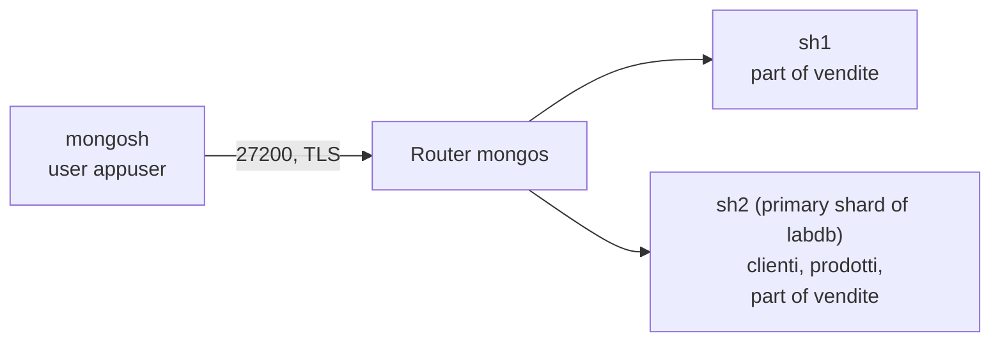
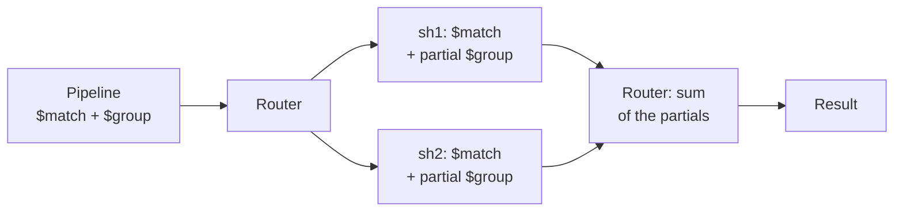
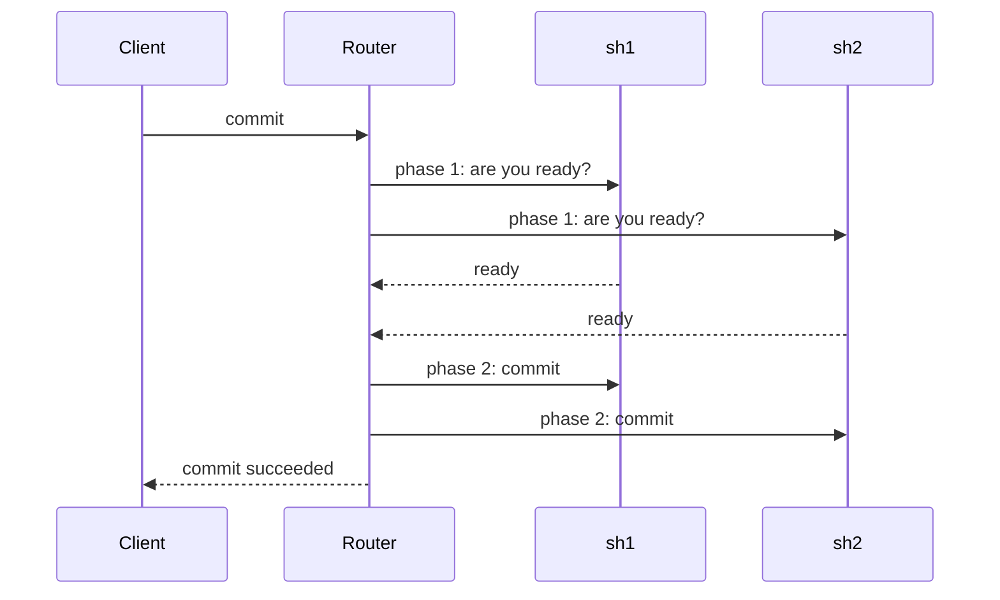

# CRUD with mongosh on a MongoDB cluster — Complete step-by-step guide

**Who this guide is for:** anyone who has built the cluster from guide 03 and wants to learn how to **use it**: inserting, reading, modifying and deleting documents with the `mongosh` shell, and then indexes, aggregations, transactions, validation, text search, change streams, import and export. As in the previous guides, every step explains **what to do**, **what the command does** and **what you should see**, and the 🧭 boxes separate what we do **in the lab** from what you would choose **in production**.

**What you will have at the end:**

- familiarity with the interactive shell and with the four basic operations (Create, Read, Update, Delete);
- the ability to read an execution plan and to choose an index;
- aggregation pipelines with grouping, `$lookup`, `$facet` and `$merge`;
- transactions across several documents and several shards, with a demonstration of what happens when they fail;
- validation rules, a text index in Italian, a change stream that watches writes in real time;
- import and export in JSON and CSV without losing the data types.

In every part you will also see **what changes on a sharded collection**: that is why this guide uses the cluster from guide 03 and not a single instance.

**Estimated time:** 3–4 hours. The parts are grouped into six blocks that can be done on different days.

**Prerequisites:** the complete cluster from guide 03, **with TLS**, with the user `appuser` (guide 03, Part 15) and the database `labdb` with the collections `ordini` and `eventi`.

**Verification status:** all the commands have been run and tested on a real installation (MongoDB 8.0.32, mongosh 2.11.1).

> 📖 **Commands and symbols** (`sudo`, `source`, `|`, `>`, `<`, `docker exec`…): the [command legend](linux-commands-legend.md) explains everything that appears in this guide.

---

## Contents

- [Part 0 — Concepts](#part-0--concepts)
- [Part 1 — Preparation](#part-1--preparation)
- [Part 2 — Sample data](#part-2--sample-data)
- [Part 3 — Create: inserting documents](#part-3--create-inserting-documents)
- [Part 4 — Read: reading documents](#part-4--read-reading-documents)
- [Part 5 — Update: modifying documents](#part-5--update-modifying-documents)
- [Part 6 — Delete: deleting documents](#part-6--delete-deleting-documents)
- [Part 7 — Indexes and explain](#part-7--indexes-and-explain)
- [Part 8 — Aggregation](#part-8--aggregation)
- [Part 9 — Transactions](#part-9--transactions)
- [Part 10 — bulkWrite and write concern](#part-10--bulkwrite-and-write-concern)
- [Part 11 — Schema validation](#part-11--schema-validation)
- [Part 12 — Text search](#part-12--text-search)
- [Part 13 — Change streams](#part-13--change-streams)
- [Part 14 — Import and export](#part-14--import-and-export)
- [Part 15 — Cleanup](#part-15--cleanup)
- [Part 16 — When something goes wrong](#part-16--when-something-goes-wrong)
- [Part 17 — Lab and production](#part-17--lab-and-production)
- [Appendix A — Where everything is](#appendix-a--where-everything-is)
- [Appendix B — Command cheat sheet](#appendix-b--command-cheat-sheet)
- [The 10 golden rules of CRUD](#the-10-golden-rules-of-crud)

| Block | Parts | Content |
|---|---|---|
| **A** | 1–3 | Preparation, sample data, Create |
| **B** | 4 | Read |
| **C** | 5–7 | Update, Delete, indexes |
| **D** | 8–10 | Aggregation, transactions, bulkWrite |
| **E** | 11–13 | Validation, text search, change streams |
| **F** | 14–15 | Import/export, cleanup |

> **Conventions:** as in the previous guides (📍 where to run it, ✅ what you should see, placeholders `<...>` to be replaced, removing the `<` and `>` as well). Placeholders in this guide: `<utente>` (the VM user) and `<FQDN>` (the DNS name of the VM).

> **Two ways of running commands.** This is the most important thing to keep in mind in this guide:
>
> - **`js`** blocks must be pasted **inside the interactive shell** opened with `app_shell`. You are in the shell when the prompt ends with `labdb>`. Every line is a command;
> - **`bash`** blocks must be run **on the VM**, outside the shell, when the prompt ends with `$`.
>
> If you paste JavaScript at the VM prompt you get `-bash: syntax error near unexpected token`: nothing has happened, open the shell with `app_shell` and try again.

> **Expected errors.** Some steps cause an error on purpose, to show you what it looks like. When a pasted command fails, mongosh **does not run the following lines** of the same paste: if the block had more lines, paste them again.

> **The sample data is deterministic:** every load produces exactly the same documents, so the numbers in the ✅ lines must match yours. They only match, however, if you run the parts **in order and only once**: many parts modify the data used by the later ones. If a number does not add up, see Part 16.

---

## Part 0 — Concepts

### 0.1 Documents, collections, databases

MongoDB stores **documents**: structures similar to JSON objects, with fields and values. Documents live in **collections** (the equivalent of tables), and collections live in **databases**.

```js
{
  _id: 7,
  nome: "Matteo",
  indirizzo: { citta: "Milano", provincia: "MI" },   // a document inside the document
  interessi: ["sport", "cucina", "lettura"],         // an array
  punti: 108
}
```

Three differences from a relational table:

- **there is no mandatory schema**: two documents in the same collection can have different fields (you can still enforce a schema: Part 11);
- **values can be nested**: documents inside documents, and arrays, which you query with *dot notation* (`"indirizzo.citta"`);
- **every document has an `_id` field**, unique within the collection. If you do not provide one, an `ObjectId` is generated.

### 0.2 CRUD

| Operation | Meaning | Main commands |
|---|---|---|
| **C**reate | Insert | `insertOne`, `insertMany` |
| **R**ead | Read | `find`, `findOne`, `countDocuments`, `distinct`, `aggregate` |
| **U**pdate | Modify | `updateOne`, `updateMany`, `replaceOne`, `findOneAndUpdate` |
| **D**elete | Delete | `deleteOne`, `deleteMany`, `findOneAndDelete`, `drop` |

Almost all commands have the same shape: `db.<collezione>.<comando>(<filtro>, <altro>)`. The **filter** is a document that describes which documents you are interested in: `{}` means "all of them", `{ citta: "Milano" }` means "those where `citta` is Milano".

### 0.3 The types: BSON

Documents are saved in **BSON**, a binary format that has more types than JSON: 32-bit and 64-bit integers, exact decimals, dates, `ObjectId`. The type matters: `0.1 + 0.2` with floating-point numbers does not give `0.3` (you will see it in Part 3.4), and that is why amounts of money are saved as **Decimal128**.

### 0.4 mongosh

`mongosh` is the MongoDB shell: a JavaScript interpreter connected to the database. You can use it in two ways:

- **interactively**: you type a command, see the result, and keep variables from one command to the next;
- **with `--eval`**: it runs the JavaScript passed on the command line and exits. This is what the `sh_eval` and `app_eval` functions do.

### 0.5 What changes on a sharded cluster

In this guide you work through the **router** of the cluster from guide 03, with three collections:

| Collection | Documents | Sharded? | Where it lives |
|---|---|---|---|
| `clienti` | 50 | No | On the primary shard of the database |
| `prodotti` | 30 | No | On the primary shard of the database |
| `vendite` | 5,000 | **Yes**, shard key `{ clienteId: "hashed" }` | Split between `sh1` and `sh2` |



For the application, the three collections are used in the same way. But on `vendite` some operations behave differently, and the guide points them out:

- queries with the shard key go to **a single shard**, the others go to all of them (Part 4.6);
- the shard key can be modified, but only one document at a time (Part 5.6);
- a `unique` index must contain the shard key (Part 7.2);
- aggregations are **split** between the shards and the router (Part 8.5);
- a transaction that touches several shards uses a two-phase commit (Part 9.4);
- the events of a change stream carry the shard key with them (Part 13).

---

# Block A

## Part 1 — Preparation

### 1.1 Is the cluster running?

📍 VM

```bash
cd ~/mongo-lab/03-sharding
sudo docker compose start        # if it was stopped; otherwise it does nothing
source ~/mongo-lab/03-sharding/funzioni-lab.sh
sh_eval 'db.adminCommand({ listShards: 1 }).shards.forEach(s => print(s._id, "stato:", s.state)); print("bilanciatore:", sh.getBalancerState()); print("collezioni di labdb:", db.getSiblingDB("labdb").getCollectionNames().sort().join(", "))'
sudo test -f appuser_password.txt && echo "password di appuser presente"
```

**What it does:** it starts the cluster's containers again, loads the `sh_eval` function from guide 03 (which runs JavaScript on the router as the administrator), then asks the router for the status of the shards and of the balancer, and for the list of collections. The last line checks that the file with the `appuser` password exists.

✅ `sh1 stato: 1`, `sh2 stato: 1`, `bilanciatore: true`, `collezioni di labdb: eventi, ordini`, `password di appuser presente`.

### 1.2 Lab folder and files

📍 VM

```bash
mkdir -p ~/mongo-lab/04-crud
```

The three lab files are in the repository, in `config/04-crud/`:

| File | What it is for |
|---|---|
| `funzioni-crud.sh` | Convenience functions: `app_shell`, `app_eval`, `app_export`, `app_import` |
| `dati-crud.js` | Loads the sample data: 30 products, 50 customers, 5,000 sales |
| `prodotti.csv` | Five products to import in Part 14 |

📍 PC (PowerShell), from the repository folder:

```powershell
scp config\04-crud\funzioni-crud.sh config\04-crud\dati-crud.js config\04-crud\prodotti.csv <utente>@<FQDN>:~/mongo-lab/04-crud/
```

📍 VM

```bash
cd ~/mongo-lab/04-crud
ls -l
file funzioni-crud.sh dati-crud.js prodotti.csv
source ~/mongo-lab/04-crud/funzioni-crud.sh
app_eval 'print("database:", db.getName(), "- utente:", db.runCommand({ connectionStatus: 1 }).authInfo.authenticatedUsers[0].user)'
```

✅ Three files. `file` must **never** report `with CRLF line terminators` (Windows line endings would break the scripts: the repository forces them to LF with `.gitattributes`). Then: `database: labdb - utente: appuser`.

<details>
<summary>📋 Real output from the test run</summary>

```
funzioni-crud.sh: ASCII text
dati-crud.js:     Unicode text, UTF-8 text
prodotti.csv:     CSV ASCII text
database: labdb - utente: appuser
```

</details>

**The convenience functions.** They all connect to the router with TLS as `appuser`, reading the password from the file without showing it:

| Function | What it does | Example |
|---|---|---|
| `app_shell` | Opens the interactive shell on `labdb` | `app_shell` |
| `app_eval 'js'` | Runs JavaScript and exits | `app_eval 'print(db.clienti.countDocuments())'` |
| `app_export ...` | `mongoexport`; the result goes to standard output | `app_export --collection=prodotti > prodotti.json` |
| `app_import ...` | `mongoimport`; the data comes from standard input | `app_import --collection=x < file.json` |
| `sh_eval 'js'` | Like `app_eval`, but as the **administrator** (guide 03) | `sh_eval 'sh.status()'` |

> ⚠️ The functions only last for the session in which you loaded them. **At every new SSH connection** repeat the two `source` commands (or add them to `~/.bashrc`, as described in guide 03):
>
> ```bash
> source ~/mongo-lab/03-sharding/funzioni-lab.sh
> source ~/mongo-lab/04-crud/funzioni-crud.sh
> ```

> 🧭 **Why `appuser` and not the administrator**
>
> - **In the lab:** almost all the commands run as `appuser`, which only has the `readWrite` role on `labdb`. The administrator is needed in just three places: sharding a collection, changing its options, reading the router's counters.
> - **Why:** this is how an application works. By using the right user you find out straight away which operations need extra permissions.
> - **If you don't:** as the administrator everything works, and you do not notice that your application will not be able to do the same thing.
> - **In production:** one user per application, with the minimum role; administrative operations are done by a different user, at controlled times.

### 1.3 The interactive shell

```bash
app_shell
```

✅ mongosh opens with a prompt similar to `[direct: mongos] labdb>`: you are connected to the router (`mongos`), in the `labdb` database.

```js
db
show dbs
show collections
db.ordini.findOne({}, { _id: 0, clienteId: 1, ordine: 1, importo: 1 })
db.ordini.find({}, { _id: 0, ordine: 1 }).sort({ ordine: 1 })
it
exit
```

**What they do:** `db` shows the current database; `show dbs` and `show collections` list the databases and the collections; `findOne` returns one document, `find` a list; `it` (*iterate*) asks for the next results; `exit` closes the shell.

✅ `db` → `labdb`. `show dbs` → **only `labdb`**: `appuser` does not see the other databases. `show collections` → `eventi`, `ordini`. `find` shows 20 documents and then `Type "it" for more`; `it` shows the next 20.

**Shell conveniences:**

| Key or command | Effect |
|---|---|
| Arrow ↑ | Recalls the previous commands |
| `Tab` | Completes collection and command names |
| `Ctrl+L` or `cls` | Clears the screen |
| `Ctrl+C` | Cancels the line, or interrupts a running command; the shell stays open |
| `.editor` | Opens a multi-line editor; `Ctrl+D` runs it |
| `exit` | Closes the shell |

> **Pasting long commands.** When you paste a line longer than the window, the terminal sometimes shows a few characters **repeated** (for example `$roun$round` or `cognomcognome`). It is only a display glitch: the command that runs is the correct one, as the result confirms.

---

## Part 2 — Sample data

### 2.1 Sharding `vendite` before loading it

`appuser` cannot shard collections: the administrator does it, with `sh_eval`.

📍 VM

```bash
sh_eval 'printjson(sh.shardCollection("labdb.vendite", { clienteId: "hashed" }))'
```

✅ `collectionsharded: 'labdb.vendite'`, `ok: 1`.

Try the same thing as `appuser`, to see it refused:

```bash
app_eval 'try { sh.shardCollection("labdb.prova", { x: "hashed" }) } catch (e) { print("appuser:", e.codeName) }'
```

✅ `appuser: Unauthorized`.

### 2.2 Loading

```bash
cd ~/mongo-lab/04-crud
time app_eval "$(cat dati-crud.js)"
```

**What it does:** `$(cat dati-crud.js)` passes the contents of the file to `app_eval`, which runs it as `appuser`. The script recreates `prodotti` and `clienti` and **empties** `vendite` without dropping it (so it stays sharded), then inserts the documents. `time` measures how long it takes.

✅ `prodotti: 30 - clienti: 50 - vendite: 5000`, in about twenty seconds.

```bash
sh_eval 'db.getSiblingDB("labdb").vendite.getShardDistribution()'
sh_eval 'const d = db.getSiblingDB("config"); ["clienti", "prodotti", "vendite"].forEach(n => print(n, d.collections.findOne({ _id: "labdb." + n }) ? "distribuita" : "non distribuita")); print("shard primario di labdb:", d.databases.findOne({ _id: "labdb" }).primary)'
```

✅ `vendite` split between `sh1` and `sh2`; `clienti` and `prodotti` **non distribuite** (not sharded), `vendite` **distribuita** (sharded); finally the name of the primary shard of `labdb`, the one that hosts the unsharded collections.

<details>
<summary>📋 Real output from the test run (excerpt)</summary>

```
prodotti: 30 - clienti: 50 - vendite: 5000

real    0m20.200s

Totals
{
  data: '1.19MiB',
  docs: 5000,
  chunks: 2,
  'Shard sh2': [ '37.65 % data', '37.52 % docs in cluster', '251B avg obj size on shard' ],
  'Shard sh1': [ '62.34 % data', '62.48 % docs in cluster', '249B avg obj size on shard' ]
}

clienti non distribuita
prodotti non distribuita
vendite distribuita
shard primario di labdb: sh2
```

</details>

**Why 62% and 38%, and not half and half?** In guide 03 the same hashed shard key gave 50.5% and 49.5%, but there the customers were 5,000. Here there are **50**: the hash distributes the *values* of the key, and with few distinct values it only takes a few extra customers landing on one shard to unbalance the total. It is a concrete reminder: a shard key works well when it has **many distinct values**.

**What a `vendite` document looks like:**

```js
{
  _id: ObjectId('...'),
  clienteId: 7,                                     // shard key, reference to clienti._id
  data: ISODate('2026-01-02T12:00:00.000Z'),
  stato: 'consegnata',                              // consegnata, spedita, in lavorazione, annullata
  canale: 'web',                                    // web, negozio, telefono
  righe: [                                          // 1 to 3 lines
    { prodottoId: 'P005', qta: 2, prezzo: Decimal128('45.90') },
    { prodottoId: 'P002', qta: 1, prezzo: Decimal128('24.90') }
  ],
  totale: Decimal128('116.70')
}
```

---

## Part 3 — Create: inserting documents

```bash
app_shell
```

> **Only if you are repeating Part 3** (otherwise the inserts fail with `E11000`, because the documents already exist), put things back to how they were before this part:
>
> ```js
> db.clienti.deleteOne({ _id: 51 })
> db.prove.drop()
> ```

### 3.1 `insertOne`, with and without `_id`

```js
db.clienti.insertOne({ _id: 51, nome: "Anna", cognome: "Verdi", email: "anna.verdi51@esempio.it", tipo: "privato", indirizzo: { citta: "Genova", provincia: "GE", cap: "16121" }, interessi: ["musica"], punti: 0, newsletter: true, iscritto: new Date() })
db.prove.insertOne({ testo: "documento senza _id" })
const doc = db.prove.findOne({ testo: "documento senza _id" })
doc._id
doc._id.getTimestamp()
```

**What they do:** the first one inserts a customer, choosing the `_id`; the second inserts a document without an `_id` into a collection, `prove`, that **does not exist yet**. The last three lines read that document back and look at its `_id`.

✅ The first: `insertedId: 51`. The second: `insertedId: ObjectId('...')`, generated by the shell. `getTimestamp()` returns the moment of creation: an `ObjectId` contains the date on which it was generated. The `prove` collection was **created by the first insert**: in MongoDB you do not need to create it beforehand.

### 3.2 Duplicate `_id`

```js
db.clienti.insertOne({ _id: 51, nome: "Doppione" })
```

✅ `MongoServerError: E11000 duplicate key error collection: labdb.clienti index: _id_ dup key: { _id: 51 }`. The code **`E11000`** is the one for every uniqueness violation: you will see it again often.

### 3.3 Ordered and unordered `insertMany`

Paste the blocks **one at a time**: every `insertMany` gives an error, and after an error mongosh does not run the rest of the paste.

```js
db.prove.insertMany([{ _id: 1 }, { _id: 1 }, { _id: 2 }])
```

```js
db.prove.find({ _id: { $type: "number" } })
```

```js
db.prove.insertMany([{ _id: 3 }, { _id: 3 }, { _id: 4 }], { ordered: false })
```

```js
db.prove.find({ _id: { $type: "number" } })
```

✅ First `insertMany`: `E11000` error on `index: 1`, `insertedCount: 1`; the `find` shows only `{ _id: 1 }`. Second: error on `index: 1`, but `insertedCount: 2`. At the end: `[ { _id: 1 }, { _id: 3 }, { _id: 4 } ]`.

| Mode | At the first error | When to use it |
|---|---|---|
| **Ordered** (default) | It stops: the following documents are **not** inserted | When the order matters, or an error must stop everything |
| **Unordered** (`ordered: false`) | It carries on and reports all the errors at the end | Bulk loads, where the rejects are dealt with afterwards |

<details>
<summary>📋 Real output from the test run (ordered insertMany)</summary>

```
Uncaught:
MongoBulkWriteError: E11000 duplicate key error collection: labdb.prove index: _id_ dup key: { _id: 1 }
Result: BulkWriteResult {
  insertedCount: 1,
  matchedCount: 0,
  modifiedCount: 0,
  deletedCount: 0,
  upsertedCount: 0,
  upsertedIds: {},
  insertedIds: { '0': 1 }
}
Write Errors: [
  WriteError {
    err: {
      index: 1,
      code: 11000,
      errmsg: 'E11000 duplicate key error collection: labdb.prove index: _id_ dup key: { _id: 1 }',
      errInfo: undefined,
      op: { _id: 1 }
    }
  }
]
```

</details>

> **Note from the test run:** re-running the unordered `insertMany` with the documents already present gives **three** errors (`index` 0, 1 and 2) and `insertedCount: 0`: the unordered mode still attempts every document.

### 3.4 The types

```js
db.prove.insertOne({ _id: "tipi", intero: 42, grande: NumberLong("9007199254740993"), decimale: NumberDecimal("0.1"), doppio: 0.1, data: new Date("2026-10-01T10:00:00Z"), vero: true, nullo: null, lista: [1, "a", { b: 2 }], annidato: { a: { b: 1 } } })
db.prove.aggregate([{ $match: { _id: "tipi" } }, { $project: { _id: 0, intero: { $type: "$intero" }, grande: { $type: "$grande" }, decimale: { $type: "$decimale" }, doppio: { $type: "$doppio" }, data: { $type: "$data" }, vero: { $type: "$vero" }, nullo: { $type: "$nullo" }, lista: { $type: "$lista" }, annidato: { $type: "$annidato" } } }])
db.prove.aggregate([{ $match: { _id: "tipi" } }, { $project: { _id: 0, conDouble: { $add: [0.1, 0.2] }, conDecimal: { $add: [NumberDecimal("0.1"), NumberDecimal("0.2")] } } }])
db.prodotti.findOne({ _id: "P002" })
exit
```

**What they do:** the first one inserts a document with one field for each type; the second asks MongoDB for the type of each field; the third adds `0.1 + 0.2` in two ways.

✅ Types: `int`, `long`, `decimal`, `double`, `date`, `bool`, `null`, `array`, `object`. Then `conDouble: 0.30000000000000004` and `conDecimal: Decimal128('0.3')`. In `P002` the price appears as `Decimal128('24.90')`.

| In mongosh you type | BSON type | Notes |
|---|---|---|
| `42` | `int` | An integer that fits in 32 bits |
| `NumberLong("...")` | `long` | 64-bit integers; in quotes so as not to lose precision |
| `0.1` | `double` | Floating point: fast, but **not exact** |
| `NumberDecimal("0.1")` | `decimal` | Exact decimal (Decimal128): for amounts of money |
| `new Date()`, `ISODate("...")` | `date` | Always in UTC |

> 🧭 **Amounts of money in Decimal128**
>
> - **In the lab:** prices and totals are `NumberDecimal`.
> - **Why:** with `double` values, `0.1 + 0.2` gives `0.30000000000000004`. Over thousands of sale lines the errors add up.
> - **If you don't:** totals that are off by a cent, and equality comparisons that fail for no apparent reason.
> - **In production:** Decimal128, or integers in cents. Never `double` for money.

---

# Block B

## Part 4 — Read: reading documents

```bash
app_shell
```

### 4.1 Equality, dot notation, projection

```js
db.clienti.find({ "indirizzo.citta": "Milano" }, { _id: 0, nome: 1, cognome: 1 })
db.clienti.findOne({ _id: 7 })
db.clienti.findOne({ _id: 7 }, { email: 1, "indirizzo.citta": 1 })
db.clienti.findOne({ _id: 7 }, { interessi: 0, indirizzo: 0 })
```

**What they do:** the first argument of `find` is the **filter**, the second is the **projection**, that is, which fields to return. `"indirizzo.citta"` is *dot notation*: it goes into the nested document (the quotes are mandatory).

✅ **12** customers in Milano. A projection with `1` **includes** only the fields listed (plus `_id`, unless you write `_id: 0`); one with `0` **excludes** the fields listed and returns all the others. The two forms cannot be mixed, with the sole exception of `_id`.

### 4.2 Comparison and logical operators

```js
db.clienti.find({ punti: { $gte: 400 } }, { nome: 1, punti: 1 }).sort({ punti: -1 })
db.clienti.countDocuments({ tipo: "azienda", newsletter: true })
db.clienti.countDocuments({ $or: [ { "indirizzo.citta": "Roma" }, { punti: { $lt: 20 } } ] })
db.clienti.countDocuments({ "indirizzo.provincia": { $in: ["TO", "VE"] } })
db.clienti.countDocuments({ telefono: { $exists: false } })
db.clienti.countDocuments({ iscritto: { $type: "date" } })
db.clienti.find({ email: { $regex: /^giulia\./ } }, { _id: 0, email: 1 })
db.prodotti.find({ prezzo: { $gt: 200 } }, { nome: 1, prezzo: 1 }).sort({ prezzo: -1 })
db.prodotti.find({ categoria: { $ne: "Libri" }, tags: "ufficio" }, { nome: 1 })
```

✅ In order:

| Query | Result |
|---|---|
| `punti` at least 400, in descending order | **13** customers; the first is `_id: 19` with 490 points |
| Companies subscribed to the newsletter | **7** |
| In Roma **or** with fewer than 20 points | **6** (Anna has 0 points) |
| Province of Torino or Venezia | **14** |
| Without the `telefono` field | **15** (Anna too) |
| `iscritto` of type date | **51**, that is, all of them |
| Email starting with `giulia.` | **4** |
| Products above 200 € | **5**: P001, P023, P012, P004, P029 |
| Not books, with the tag `ufficio` | **5**: P001, P004, P011, P029, P030 |

| Operator | Meaning |
|---|---|
| `$eq`, `$ne` | Equal, not equal |
| `$gt`, `$gte`, `$lt`, `$lte` | Greater than, greater than or equal, less than, less than or equal |
| `$in`, `$nin` | Included (or not included) in a list |
| `$and`, `$or`, `$nor`, `$not` | Logical operators |
| `$exists` | The field exists (or does not exist) |
| `$type` | The field is of a certain type |
| `$regex` | Regular expression |

Several conditions in the same filter, separated by commas, work as **AND**: `{ tipo: "azienda", newsletter: true }`.

Two observations from the test run:

- the comparison between `200`, an integer, and the `Decimal128` prices works: MongoDB compares numbers **by value**, even when they are of different types;
- `tags: "ufficio"` on an array field means "the array **contains** `ufficio`".

### 4.3 Arrays

```js
db.clienti.countDocuments({ interessi: "montagna" })
db.clienti.find({ interessi: { $all: ["sport", "viaggi"] } }, { _id: 1, interessi: 1 })
db.clienti.countDocuments({ interessi: { $size: 3 } })
db.vendite.countDocuments({ "righe.prodottoId": "P001", "righe.qta": { $gte: 2 } })
db.vendite.countDocuments({ righe: { $elemMatch: { prodottoId: "P001", qta: { $gte: 2 } } } })
db.vendite.findOne({ righe: { $elemMatch: { prodottoId: "P001", qta: { $gte: 2 } } } }, { _id: 0, clienteId: 1, righe: 1 })
```

✅ **12** customers interested in mountains (`montagna`); **6** with both interests (9, 11, 16, 17, 42, 44), in any order; **29** with exactly three interests; then **278** versus **208**.

**Why 278 and 208?** This is the most common trap with arrays of documents:

- **without `$elemMatch`** it is enough that **one** line is P001 and that **any** line, even a different one, has `qta ≥ 2`;
- **with `$elemMatch`** both conditions must hold for **the same** line.

When the conditions concern the same element of an array, always use `$elemMatch`.

### 4.4 Sorting, pagination, counts, `distinct`

```js
db.prodotti.find({}, { nome: 1 }).sort({ _id: 1 }).skip(10).limit(5)
db.prodotti.find({ _id: { $gt: "P015" } }, { nome: 1 }).sort({ _id: 1 }).limit(5)
db.vendite.estimatedDocumentCount()
db.vendite.countDocuments()
db.vendite.countDocuments({ data: { $gte: ISODate("2026-03-01"), $lt: ISODate("2026-04-01") } })
db.clienti.distinct("indirizzo.citta")
db.vendite.distinct("stato")
```

✅ P011–P015; then P016–P020; **5000** and **5000**; **496** sales in March; 9 cities (the 8 in the data plus `Genova`); 4 statuses.

**Two ways to paginate:**

| Way | How | Pros and cons |
|---|---|---|
| `skip` and `limit` | Skips N documents | Simple, but the server still walks through the skipped documents: slow on distant pages |
| **By key** | Starts again from the last value seen: `{ _id: { $gt: "P015" } }` | Constant on any page; requires sorting on an indexed field |

**Two ways to count:** `estimatedDocumentCount()` reads the metadata (immediate, but with no filter and approximate); `countDocuments(filtro)` really counts. For a date range always use `$gte` on the start and `$lt` on the start of the following period.

### 4.5 Cursors

```js
const cur = db.vendite.find({ clienteId: 7 }, { _id: 0, data: 1, totale: 1 }).sort({ data: 1 })
cur.hasNext()
cur.next()
cur.toArray().length
let somma = 0; db.vendite.find({ clienteId: 7 }).forEach(v => { somma += 1 }); somma
```

**What they do:** `find` does not return the documents but a **cursor**, which hands them over in batches. The shell shows 20 at a time (that is the reason for `it`); by assigning it to a variable, you control it yourself.

✅ `true`; the first sale of customer 7; then **92** (the remaining ones: the cursor had already handed over one, and there are 93 in total); finally **93**.

### 4.6 Targeted queries and queries on all shards

```js
db.vendite.find({ clienteId: 7 }).explain().queryPlanner.winningPlan.stage
db.vendite.find({ stato: "annullata" }).explain().queryPlanner.winningPlan.stage
db.vendite.find().sort({ data: -1 }).limit(5).explain().queryPlanner.winningPlan.stage
db.clienti.find({ _id: 7 }).explain().queryPlanner.winningPlan.stage
exit
```

**What they do:** `explain()` does not run the query: it asks the router **how** it would run it.

✅

| Query | Result | Why |
|---|---|---|
| `vendite`, `{ clienteId: 7 }` | `SINGLE_SHARD` | It contains the shard key |
| `vendite`, `{ stato: "annullata" }` | `SHARD_MERGE` | No shard key: all the shards |
| `vendite`, sorted by date | `SHARD_MERGE_SORT` | All the shards; the router merges the already sorted results |
| `clienti`, `{ _id: 7 }` | `SINGLE_SHARD` | Unsharded collection: it lives on the primary shard |

---

# Block C

## Part 5 — Update: modifying documents

```bash
app_shell
```

Every update has two parts: a **filter** (which documents) and a **modification** expressed with operators (`$set`, `$inc`…). The result always reports two counters: `matchedCount` (documents found by the filter) and `modifiedCount` (documents actually changed).

### 5.1 Field operators

```js
db.clienti.updateOne({ _id: 51 }, { $set: { telefono: "+39 3331234567", "indirizzo.cap": "16122" } })
db.clienti.updateOne({ _id: 51 }, { $set: { telefono: "+39 3331234567", "indirizzo.cap": "16122" } })
db.clienti.updateOne({ _id: 51 }, { $inc: { punti: 50 }, $currentDate: { aggiornato: true } })
db.clienti.updateOne({ _id: 51 }, { $unset: { newsletter: "" }, $rename: { telefono: "cellulare" } })
db.clienti.findOne({ _id: 51 })
```

The second line is **deliberately identical** to the first.

✅ First: `matchedCount: 1, modifiedCount: 1`. Second: `matchedCount: 1, modifiedCount: 0`: the document was found, but the values were already those. At the end Anna has `punti: 50`, `aggiornato` with the current date, `cellulare` in place of `telefono`, no `newsletter` field, cap `16122`.

| Operator | Effect |
|---|---|
| `$set` | Sets a field (creates it if it does not exist) |
| `$unset` | Removes a field |
| `$inc` | Adds a value (which can be negative) |
| `$rename` | Renames a field |
| `$currentDate` | Sets the server's date and time |

> ⚠️ Without operators, that is, writing `updateOne({ _id: 51 }, { punti: 50 })`, mongosh refuses the command: to **replace** the whole document there is `replaceOne` (Part 5.5).

### 5.2 Array operators

```js
db.clienti.updateOne({ _id: 51 }, { $push: { interessi: "viaggi" } })
db.clienti.updateOne({ _id: 51 }, { $addToSet: { interessi: "viaggi" } })
db.clienti.updateOne({ _id: 51 }, { $push: { interessi: { $each: ["cucina", "lettura"] } } })
db.clienti.updateOne({ _id: 51 }, { $pull: { interessi: "musica" } })
db.clienti.findOne({ _id: 51 }, { interessi: 1 })
```

✅ `$addToSet` with a value already present: `modifiedCount: 0`. At the end: `[ 'viaggi', 'cucina', 'lettura' ]`.

| Operator | Effect |
|---|---|
| `$push` | Appends to the end, even if the value is already there |
| `$addToSet` | Adds only if the value is not there |
| `$each` | With `$push` or `$addToSet`: adds several values |
| `$pull` | Removes all the elements equal to the value |

### 5.3 `updateMany`, update with a pipeline, `upsert`

```js
db.prodotti.updateMany({ giacenza: 0 }, { $set: { disponibile: false } })
db.prodotti.updateMany({ categoria: "Libri" }, [ { $set: { prezzo: { $round: [ { $multiply: ["$prezzo", NumberDecimal("0.9")] }, 2 ] } } } ])
db.prodotti.find({ categoria: "Libri" }, { prezzo: 1 })
db.prodotti.updateOne({ _id: "P099" }, { $set: { nome: "Prodotto di prova", categoria: "Prove" }, $setOnInsert: { giacenza: 0, creato: new Date() } }, { upsert: true })
db.prodotti.updateOne({ _id: "P099" }, { $set: { nome: "Prodotto di prova", categoria: "Prove" }, $setOnInsert: { giacenza: 0, creato: new Date() } }, { upsert: true })
```

**What they do:**

- the first one marks **all** the out-of-stock products as unavailable;
- the second is an **update with a pipeline**: the modification is in square brackets and can use the current value of the fields (`"$prezzo"`). Here it takes 10% off the books, rounding to two decimals;
- the last two are **upserts** (*update or insert*): if the document does not exist, it is created. `$setOnInsert` applies only at the moment of creation.

✅ **3** out-of-stock products (P007, P014, P026). Discounted books: `12.60`, `10.80`, `35.10`, `22.50`, `17.10`, `26.10`, shown as `Decimal128('12.60')`. First upsert: `insertedId: 'P099', matchedCount: 0, upsertedCount: 1`. Second: `insertedId: null, matchedCount: 1, modifiedCount: 0, upsertedCount: 0`.

### 5.4 Elements of an array: `$` and `arrayFilters`

```js
db.vendite.countDocuments({ clienteId: 7, "righe.prodottoId": "P002" })
db.vendite.updateMany({ clienteId: 7, "righe.prodottoId": "P002" }, { $set: { "righe.$[r].sconto": NumberDecimal("2.00") } }, { arrayFilters: [ { "r.prodottoId": "P002" } ] })
db.vendite.findOne({ clienteId: 7, "righe.sconto": { $exists: true } }, { _id: 0, righe: 1 })
const v7 = db.vendite.findOne({ clienteId: 7, "righe.prodottoId": "P002" })
db.vendite.updateOne({ _id: v7._id, clienteId: 7, "righe.prodottoId": "P002" }, { $inc: { "righe.$.qta": 1 } })
db.vendite.findOne({ _id: v7._id }, { _id: 0, righe: 1 })
```

✅ **13** sales; `updateMany`: `matchedCount: 13, modifiedCount: 13`; the discount appears **only** in the P002 lines. Then the `qta` of P002 in that sale goes up by 1.

| Syntax | What it modifies |
|---|---|
| `"righe.$.qta"` | **The first** line that matches the query filter |
| `"righe.$[r].sconto"` with `arrayFilters` | **All** the lines that satisfy the condition on `r` |
| `"righe.$[].sconto"` | All the lines, with no condition |

<details>
<summary>📋 Real output from the test run (after the updateMany)</summary>

```
{
  righe: [
    { prodottoId: 'P005', qta: 2, prezzo: Decimal128('45.90') },
    {
      prodottoId: 'P002',
      qta: 1,
      prezzo: Decimal128('24.90'),
      sconto: Decimal128('2.00')
    },
    { prodottoId: 'P020', qta: 1, prezzo: Decimal128('29.00') }
  ]
}
```

</details>

### 5.5 `replaceOne` and `findOneAndUpdate`

```js
db.prove.replaceOne({ _id: 1 }, { testo: "documento sostituito" })
db.prove.findOne({ _id: 1 })
db.prodotti.findOneAndUpdate({ _id: "P002" }, { $inc: { giacenza: -1 } }, { projection: { giacenza: 1 } })
db.prodotti.findOneAndUpdate({ _id: "P002" }, { $inc: { giacenza: -1 } }, { projection: { giacenza: 1 }, returnDocument: "after" })
```

✅ After `replaceOne` the document has only `_id` and `testo`: everything else has been replaced. The first `findOneAndUpdate` returns `giacenza: 140`, that is, the document **before** the modification; the second, with `returnDocument: "after"`, returns `giacenza: 138`.

`findOneAndUpdate` modifies and reads **in a single atomic operation**: it is the right tool for counters and reservations, where another client could slip in between a separate read and write.

### 5.6 Updates on a sharded collection

```js
db.vendite.updateOne({ stato: "annullata", canale: "telefono" }, { $set: { nota: "verificata" } })
db.vendite.insertOne({ _id: "prova-sk", clienteId: 99, stato: "prova", totale: NumberDecimal("1.00") })
db.vendite.updateOne({ _id: "prova-sk", clienteId: 99 }, { $set: { clienteId: 98 } })
db.vendite.findOne({ _id: "prova-sk" })
db.vendite.updateMany({ clienteId: 98 }, { $set: { clienteId: 97 } })
exit
```

✅

| Command | Result |
|---|---|
| `updateOne` without the shard key in the filter | It works: `matchedCount: 1, modifiedCount: 1` (allowed since MongoDB 7.1) |
| `updateOne` that changes the **value** of the shard key | It works; the `findOne` shows `clienteId: 98`. The document may move to another shard |
| `updateMany` that changes the shard key | **Refused**: `MongoServerError: Multi-update operations are not allowed when updating the shard key field.` |

> 🧭 **Modifying the shard key**
>
> - **In the lab:** we do it on a test document, to see that it is possible.
> - **Why:** changing the value of the shard key can mean **moving the document to another shard**: that is why it is allowed only one document at a time.
> - **If you don't:** nothing; it is a rare operation.
> - **In production:** the shard key should be a value that does not change (an identifier). If it changes often, it was chosen badly.

---

## Part 6 — Delete: deleting documents

```bash
app_shell
```

```js
db.vendite.deleteOne({ _id: "prova-sk", clienteId: 97 })
db.vendite.deleteOne({ _id: "prova-sk" })
db.prove.deleteOne({ _id: 3 })
db.vendite.countDocuments({ stato: "annullata", data: { $lt: ISODate("2026-02-01") } })
db.vendite.deleteMany({ stato: "annullata", data: { $lt: ISODate("2026-02-01") } })
db.prodotti.findOneAndDelete({ _id: "P099" })
db.prove.deleteMany({})
show collections
db.prove.drop()
show collections
exit
```

✅ In order:

| Command | Result |
|---|---|
| `deleteOne` with `clienteId: 97` | `deletedCount: 0`: `prova-sk` has `clienteId: 98`, because the `updateMany` in 5.6 was refused |
| `deleteOne` with `_id` only | `deletedCount: 1`: it works even without the shard key in the filter |
| `deleteOne` on `prove` | `deletedCount: 1` |
| `countDocuments` | **83** sales canceled in January |
| `deleteMany` | `deletedCount: 83` |
| `findOneAndDelete` | Returns the deleted document, `P099` |
| `deleteMany({})` on `prove` | `deletedCount: 4`; the collection **still exists**, empty |
| `drop()` | `true`; `prove` no longer appears in `show collections` |

**Three ways to empty a collection, three different effects:**

| Command | Documents | Collection and indexes |
|---|---|---|
| `deleteMany({ filtro })` | Deletes the ones that match | They stay |
| `deleteMany({})` | Deletes them all, one by one | They stay |
| `drop()` | They disappear with the collection | Removed; on a sharded collection the sharding metadata disappears too (Part 15) |

> ⚠️ **Count before you delete.** The pattern of `countDocuments(filtro)` followed by `deleteMany(lo stesso filtro)` (the same filter) is a habit worth getting into: a wrong filter deletes without asking for confirmation, and there is no "undo".

---

## Part 7 — Indexes and explain

An **index** is a sorted structure that lets the server find documents without reading them all. Every collection has the index on `_id`; sharded collections also have the one on the shard key.

```bash
app_shell
```

A small function for reading `explain`. **It must be redefined every time you open `app_shell`**, because the shell's variables do not survive when it is closed:

```js
const piano = e => print("restituiti:", e.executionStats.nReturned, "| documenti esaminati:", e.executionStats.totalDocsExamined, "| chiavi esaminate:", e.executionStats.totalKeysExamined, "| stadi:", [...new Set(JSON.stringify(e.queryPlanner.winningPlan).match(/\b(COLLSCAN|IXSCAN|SORT|FETCH)\b/g))].join(" "))
```

**What it does:** it sums up in one line the four pieces of information that matter in an `explain("executionStats")`.

| Item | Meaning |
|---|---|
| Returned (`restituiti`) | Documents in the result |
| Documents examined (`documenti esaminati`) | Documents read to get there |
| Keys examined (`chiavi esaminate`) | Index entries read |
| `COLLSCAN` | Scan of the whole collection: no index used |
| `IXSCAN` | Scan of an index |
| `FETCH` | Reading of the documents pointed to by the index |
| `SORT` | In-memory sort: the index did not already provide the order |

**The goal:** documents examined close to documents returned, and no `SORT`.

### 7.1 Compound index (ESR rule)

```js
db.vendite.getIndexes()
piano(db.vendite.find({ stato: "spedita", canale: "web" }).sort({ data: -1 }).explain("executionStats"))
db.vendite.createIndex({ stato: 1, canale: 1, data: -1 })
piano(db.vendite.find({ stato: "spedita", canale: "web" }).sort({ data: -1 }).explain("executionStats"))
piano(db.vendite.find({ canale: "web" }).sort({ data: -1 }).explain("executionStats"))
```

✅ Initial indexes: `_id_` and `clienteId_hashed`. `createIndex` answers `stato_1_canale_1_data_-1`.

| Moment | Returned | Examined | Keys | Stages |
|---|---|---|---|---|
| Before the index | 418 | **4917** | 0 | `SORT COLLSCAN` |
| After the index | 418 | **418** | 418 | `FETCH IXSCAN` |
| Query without `stato` | 2450 | 4917 | 0 | `SORT COLLSCAN` |

With the index the server reads 418 documents instead of 4917, and does not have to sort anything.

**The ESR rule** for the order of the fields in a compound index:

1. **E**quality: first the fields compared for equality (`stato`, `canale`);
2. **S**ort: then the fields used for sorting (`data`);
3. **R**ange: last, the fields compared by range (`$gt`, `$lt`).

**The prefix.** The last query does not use the index because it lacks `stato`, the **first** field. A compound index only serves queries that use its fields starting from the first: `{ stato, canale, data }` helps searches on `stato` and on `stato` + `canale`, not those on `canale` alone.

### 7.2 Unique index

Paste the lines **one at a time**: the second and the third give an expected error.

```js
db.clienti.createIndex({ email: 1 }, { unique: true })
```

```js
db.clienti.insertOne({ _id: 52, nome: "Copia", email: "anna.verdi51@esempio.it" })
```

```js
db.vendite.createIndex({ data: 1 }, { unique: true })
```

```js
db.vendite.createIndex({ clienteId: 1, data: 1 }, { unique: true })
```

✅

| Command | Result |
|---|---|
| Unique index on `clienti.email` | Created: `email_1` |
| Insert with an email already in use | `E11000 duplicate key error ... index: email_1` |
| Unique index `{ data: 1 }` on `vendite` | **Refused**: `MongoServerError[CannotCreateIndex]: ... cannot create index with 'unique' or 'prepareUnique' option over { data: 1 } with shard key pattern { clienteId: "hashed" }` |
| Unique index `{ clienteId: 1, data: 1 }` on `vendite` | Created: `clienteId_1_data_1` |

**Why is the first index on `vendite` refused and the second one not?** In a sharded collection every shard knows only its own documents: it cannot know whether another sale with the same `data` exists on another shard. A unique index must therefore **contain the shard key**: that way all the documents that could be duplicates end up on the same shard, which can do the check.

> ⚠️ The `clienteId_1_data_1` index stays on `vendite` until the cleanup: from here on there cannot be two sales with the same `clienteId` and the same `data`, nor two sales of the same customer that both have no `data`.

### 7.3 TTL index

```js
db.sessioni.createIndex({ creata: 1 }, { expireAfterSeconds: 120 })
db.sessioni.insertMany([ { utente: "anna", creata: new Date() }, { utente: "marco", creata: new Date(Date.now() - 3600 * 1000) } ])
db.sessioni.countDocuments()
```

**What it does:** a **TTL** (*time to live*) index automatically deletes documents when the date in the indexed field is older than the time given. Here: 120 seconds. The session of `marco` is born already an hour old.

✅ `2`. Carry on with 7.4 and check again in a couple of minutes (step 7.5).

### 7.4 Partial index

```js
db.prodotti.createIndex({ nome: 1 }, { partialFilterExpression: { giacenza: { $gt: 0 } } })
piano(db.prodotti.find({ nome: "Mouse senza fili", giacenza: { $gt: 0 } }).explain("executionStats"))
piano(db.prodotti.find({ nome: "Mouse senza fili" }).explain("executionStats"))
db.prodotti.getIndexes().map(i => i.name)
```

**What it does:** a **partial** index contains only the documents that satisfy a condition, here the products with positive stock. It is smaller and faster to update.

✅ The first query uses the index: `FETCH IXSCAN`, **1** document examined. The second does not: `COLLSCAN`, **30** documents examined. Indexes: `[ '_id_', 'nome_1' ]`.

The second query cannot use the index because it might have to return an out-of-stock product too, which is not in the index: a partial index is valid only for queries whose filter **guarantees** the same condition.

### 7.5 The TTL at work

```js
db.sessioni.find({}, { _id: 0, utente: 1 })
db.sessioni.drop()
exit
```

✅ Only `anna` is left: `[ { utente: 'anna' } ]`. The expiry check runs **every 60 seconds**, so the deletion is not instantaneous. After another two minutes she would disappear too.

> 🧭 **How many indexes**
>
> - **In the lab:** we create indexes to see the effect, without worrying about the cost.
> - **Why:** on 5,000 documents every index is built in an instant.
> - **If you overdo it:** every index has to be updated on **every write** and takes up memory. Too many indexes slow down inserts and updates.
> - **In production:** one index for every frequent query, checked with `explain`; indexes that are never used get removed. On large collections, index creation must be planned outside peak hours.

---

# Block D

## Part 8 — Aggregation

An **aggregation pipeline** is a sequence of stages: every stage receives the documents from the previous one, transforms them and passes them on to the next.

| Stage | What it does |
|---|---|
| `$match` | Filters, like `find` |
| `$group` | Groups and calculates (sums, counts, averages) |
| `$sort`, `$limit` | Sorts, limits |
| `$project` | Chooses and calculates the output fields |
| `$unwind` | Turns every element of an array into a document |
| `$lookup` | Joins documents from another collection |
| `$facet` | Runs several pipelines on the same documents |
| `$bucket` | Groups by ranges of values |
| `$merge` | Writes the result into a collection |

```bash
app_shell
```

### 8.1 Grouping

```js
db.vendite.aggregate([ { $group: { _id: "$stato", vendite: { $sum: 1 }, incasso: { $sum: "$totale" } } }, { $sort: { vendite: -1 } } ])
db.vendite.aggregate([ { $match: { stato: "consegnata" } }, { $group: { _id: { $dateToString: { format: "%Y-%m", date: "$data" } }, incasso: { $sum: "$totale" } } }, { $sort: { _id: 1 } } ])
```

**What they do:** in `$group`, `_id` is the field to group by (`"$stato"`, with the dollar sign: "the value of the `stato` field"). `{ $sum: 1 }` counts, `{ $sum: "$totale" }` adds up. The second pipeline groups by month, derived from the date.

✅

| Status | Sales | Revenue |
|---|---|---|
| consegnata | **2493** | 1,195,049.30 |
| spedita | **881** | 433,230.00 |
| in lavorazione | **800** | 392,134.10 |
| annullata | **743** | 360,623.50 |

The canceled ones (`annullata`) are 743 because in Part 6 you deleted 83 of them. Then eleven months, from `2026-01` (102,826.40) to `2026-11` (34,394.20). The sums stay `Decimal128`, exact to the cent.

<details>
<summary>📋 Real output from the test run (revenue by month)</summary>

```
[
  { _id: '2026-01', incasso: Decimal128('102826.40') },
  { _id: '2026-02', incasso: Decimal128('105804.70') },
  { _id: '2026-03', incasso: Decimal128('134028.90') },
  { _id: '2026-04', incasso: Decimal128('104699.40') },
  { _id: '2026-05', incasso: Decimal128('133419.90') },
  { _id: '2026-06', incasso: Decimal128('105824.60') },
  { _id: '2026-07', incasso: Decimal128('103145.70') },
  { _id: '2026-08', incasso: Decimal128('122446.50') },
  { _id: '2026-09', incasso: Decimal128('126184.00') },
  { _id: '2026-10', incasso: Decimal128('122275.00') },
  { _id: '2026-11', incasso: Decimal128('34394.20') }
]
```

</details>

### 8.2 `$unwind` and `$lookup`

```js
db.vendite.aggregate([ { $unwind: "$righe" }, { $group: { _id: "$righe.prodottoId", pezzi: { $sum: "$righe.qta" } } }, { $sort: { pezzi: -1, _id: 1 } }, { $limit: 5 }, { $lookup: { from: "prodotti", localField: "_id", foreignField: "_id", as: "prodotto" } }, { $project: { _id: 0, prodotto: { $first: "$prodotto.nome" }, pezzi: 1 } } ])
db.vendite.aggregate([ { $group: { _id: "$clienteId", speso: { $sum: "$totale" } } }, { $sort: { speso: -1 } }, { $limit: 3 }, { $lookup: { from: "clienti", localField: "_id", foreignField: "_id", as: "c" } }, { $unwind: "$c" }, { $project: { _id: 0, cliente: { $concat: ["$c.nome", " ", "$c.cognome"] }, citta: "$c.indirizzo.citta", speso: 1 } } ])
```

**What they do:**

- the first one finds the five best-selling products: `$unwind` turns every sale line into a document of its own, `$group` adds up the pieces per product, `$lookup` goes and gets the name from `prodotti`;
- the second finds the three customers who have spent the most, with name and city taken from `clienti`.

✅ Products: Atlante del cielo (**739**), Zaino da trekking (**714**), Bollitore elettrico (**708**), Aspirapolvere robot (**692**), Guida alle Dolomiti (**692**). Customers: Andrea Rossi, Napoli (76,399.70); Luca Colombo, Milano (65,122.40); Francesca Marino, Milano (60,443.60).

**Two details:**

- the last two products are in a **tie**. Without a second criterion the order between them would not be guaranteed: that is why the sort is `{ pezzi: -1, _id: 1 }`. When you sort by a value that can repeat, always add a field that breaks the tie;
- the `$lookup` is placed **after** `$limit`: it joins 5 documents, not 30. In a pipeline, filter and reduce first, enrich afterwards.

### 8.3 `$facet` and `$bucket`

```js
db.vendite.aggregate([ { $facet: { perCanale: [ { $group: { _id: "$canale", n: { $sum: 1 } } }, { $sort: { n: -1 } } ], perFascia: [ { $bucket: { groupBy: "$totale", boundaries: [0, 50, 100, 250, 500, 1000, 5000], default: "altro", output: { n: { $sum: 1 } } } } ] } } ])
```

**What it does:** `$facet` runs two pipelines on the same documents and returns both results in a single document. `$bucket` divides the sales into ranges of amount: every range is identified by its lower bound.

✅ Channels: web **2450**, telefono **1241**, negozio **1226**. Ranges: from 0 → 507, from 50 → 565, from 100 → 1124, from 250 → 1141, from 500 → 976, from 1000 → 604.

### 8.4 `$merge`: saving the result

```js
db.vendite.aggregate([ { $match: { stato: "consegnata" } }, { $group: { _id: { $dateToString: { format: "%Y-%m", date: "$data" } }, incasso: { $sum: "$totale" }, vendite: { $sum: 1 } } }, { $merge: { into: "riepilogo_mensile", whenMatched: "replace", whenNotMatched: "insert" } } ])
db.riepilogo_mensile.find().sort({ _id: 1 }).limit(3)
```

**What it does:** `$merge` returns nothing: it writes the result into the `riepilogo_mensile` collection, creating it if it does not exist. If you run it again, the months already present are replaced and the new ones are added: it is the way to keep a summary table up to date.

✅ The aggregation prints nothing. `riepilogo_mensile` contains 11 documents; the first three: January (246 sales), February (211), March (260).

### 8.5 How the router splits a pipeline

```js
const e = db.vendite.explain().aggregate([ { $match: { stato: "consegnata" } }, { $group: { _id: "$canale", n: { $sum: 1 } } } ])
print("fusione:", e.mergeType); print("su ogni shard:", JSON.stringify(e.splitPipeline.shardsPart)); print("fusione finale:", JSON.stringify(e.splitPipeline.mergerPart))
const e2 = db.vendite.explain().aggregate([ { $match: { clienteId: 7 } }, { $group: { _id: "$canale", n: { $sum: 1 } } } ])
print("con la shard key:", e2.splitPipeline === null ? "nessuna divisione" : "divisa", "- shard:", Object.keys(e2.shards).length)
exit
```

✅ Without the shard key: `fusione: mongos`; on every shard the `$match` and a `$group`; in the final merge a `$mergeCursors` followed by a second `$group` that adds up the partial results. With the shard key: `con la shard key: nessuna divisione - shard: 1`.



The router does not have all the documents sent to it: it makes **every shard** do the part of the work it can (filtering and counting its own documents), and then adds up the partial counts. If instead the `$match` contains the shard key, the whole pipeline goes to **a single shard**, with no split.

<details>
<summary>📋 Real output from the test run</summary>

```
fusione: mongos
su ogni shard: [{"$match":{"stato":{"$eq":"consegnata"}}},{"$group":{"_id":"$canale","n":{"$sum":{"$const":1}}}}]
fusione finale: [{"$mergeCursors":{...}},{"$group":{"_id":"$$ROOT._id","n":{"$sum":"$$ROOT.n"},"$doingMerge":true}}]
con la shard key: nessuna divisione - shard: 1
```

</details>

---

## Part 9 — Transactions

In MongoDB the modification of **a single document** is always atomic: either all of it happens or none of it does. A **transaction** extends this guarantee to **several documents**, even in different collections and shards: either all the modifications, or none.

The classic example is a sale: you have to **reduce the stock** of the product and **record the sale**. If the second operation failed after the first, the warehouse would show less stock without a matching sale.

**The router's transaction counters, before.** 📍 VM (not in the shell):

```bash
sh_eval 'const t = db.serverStatus().transactions; print("avviate:", t.totalStarted, "- confermate:", t.totalCommitted, "- annullate:", t.totalAborted); printjson(Object.fromEntries(Object.entries(t.commitTypes).map(([k, v]) => [k, v.successful])))'
```

Write down the values: what counts is the **differences** from the ones you will read at the end. Then open the shell and **stay in it until the end of 9.4**: the session `s` created in the first step is needed by all the others.

```bash
app_shell
```

### 9.1 A successful transaction

```js
const s = db.getMongo().startSession()
const sp = s.getDatabase("labdb").prodotti, sv = s.getDatabase("labdb").vendite
s.withTransaction(() => { const r = sp.updateOne({ _id: "P003", giacenza: { $gte: 2 } }, { $inc: { giacenza: -2 } }); if (r.modifiedCount !== 1) throw new Error("giacenza insufficiente per P003"); sv.insertOne({ clienteId: 12, data: new Date(), stato: "in lavorazione", canale: "web", righe: [ { prodottoId: "P003", qta: 2, prezzo: NumberDecimal("79.90") } ], totale: NumberDecimal("159.80") }) }, { readConcern: { level: "snapshot" }, writeConcern: { w: "majority" } })
db.prodotti.findOne({ _id: "P003" }, { giacenza: 1 })
db.vendite.countDocuments({ clienteId: 12, stato: "in lavorazione", "righe.prodottoId": "P003", data: { $gte: ISODate("2026-10-01") } })
```

**What they do:**

- the first two lines open a **session** and get the collections `sp` and `sv` from it. Only the operations done through `sp` and `sv` are part of the transaction; those on `db.prodotti` are not;
- `withTransaction` runs the function inside a transaction: if it finishes without errors it does the **commit**, if it throws an error it does the **abort**;
- the filter `giacenza: { $gte: 2 }` is the safeguard: if there are not at least two pieces the update modifies nothing, and the `throw` cancels everything.

✅ Stock of P003 from 35 to **33**; the new sale exists: **1**.

### 9.2 An aborted transaction

```js
db.vendite.countDocuments({ clienteId: 13 })
try { s.withTransaction(() => { sv.insertOne({ clienteId: 13, data: new Date(), stato: "in lavorazione", canale: "web", righe: [ { prodottoId: "P007", qta: 1, prezzo: NumberDecimal("59.90") } ], totale: NumberDecimal("59.90") }); const r = sp.updateOne({ _id: "P007", giacenza: { $gte: 1 } }, { $inc: { giacenza: -1 } }); if (r.modifiedCount !== 1) throw new Error("giacenza insufficiente per P007") }) } catch (e) { print("transazione annullata:", e.message) }
db.vendite.countDocuments({ clienteId: 13 })
```

Here the order is deliberately reversed: **first** the sale is inserted, **then** the stock is reduced. But P007 is out of stock.

✅ `transazione annullata: giacenza insufficiente per P007`. The count for customer 13 is **the same before and after** (in the test run `90` and `90`): the insert, which had already been executed, was canceled as well.

### 9.3 Isolation: modifications are visible only after the commit

```js
s.startTransaction({ readConcern: { level: "snapshot" }, writeConcern: { w: "majority" } })
sp.updateOne({ _id: "P004" }, { $inc: { giacenza: -1 } })
print("dentro la transazione:", sp.findOne({ _id: "P004" }).giacenza, "- fuori:", db.prodotti.findOne({ _id: "P004" }).giacenza)
s.commitTransaction()
print("dopo il commit:", db.prodotti.findOne({ _id: "P004" }).giacenza)
s.startTransaction()
sp.updateOne({ _id: "P004" }, { $set: { giacenza: 0 } })
s.abortTransaction()
print("dopo l'abort:", db.prodotti.findOne({ _id: "P004" }).giacenza)
```

Here the transaction is managed **by hand**, with `startTransaction`, `commitTransaction` and `abortTransaction`, so that you can look at what happens halfway through.

✅ `dentro la transazione: 19 - fuori: 20`, then `dopo il commit: 19`, then `dopo l'abort: 19`.

As long as the transaction is open, **anyone outside still sees the old value** (20): the modifications become visible all together at the commit. With the abort, setting the stock to zero never happened.

### 9.4 A transaction on both shards

```js
db.vendite.find({ clienteId: { $in: [1, 2, 3, 4, 5, 6] } }).explain().queryPlanner.winningPlan.shards.length
s.withTransaction(() => { sv.updateMany({ clienteId: { $in: [1, 2, 3, 4, 5, 6] } }, { $set: { verificata: true } }); sp.updateOne({ _id: "P001" }, { $set: { ultimaVerifica: new Date() } }) })
db.vendite.countDocuments({ verificata: true })
s.endSession()
exit
```

✅ `2` shards involved; **603** sales marked.

**Counters, after.** 📍 VM:

```bash
sh_eval 'const t = db.serverStatus().transactions; print("avviate:", t.totalStarted, "- confermate:", t.totalCommitted, "- annullate:", t.totalAborted); printjson(Object.fromEntries(Object.entries(t.commitTypes).map(([k, v]) => [k, v.successful])))'
```

✅ In the test run:

| Counter | Before | After | What happened |
|---|---|---|---|
| Started (`avviate`) | 1298 | 1313 | |
| Committed (`confermate`) | 1298 | 1311 | |
| Aborted (`annullate`) | 0 | **2** | 9.2 and the `abortTransaction` in 9.3 |
| `singleShard` | 1297 | 1309 | Commits that involved a single shard |
| `twoPhaseCommit` | 0 | **1** | 9.4 |

Your starting values will be different (they depend on the router's history), and the router also counts internal transactions: look at the **aborted** ones and at **`twoPhaseCommit`**.



When a transaction writes to **several shards**, the commit happens in **two phases**: first all the shards declare themselves ready, then they all commit. That way it cannot happen that one shard commits and the other does not. It is slower than a commit on a single shard.

> 🧭 **When to use transactions**
>
> - **In the lab:** we use them to see the guarantees they give.
> - **Why:** they are needed when several documents must change together.
> - **If you overuse them:** every transaction keeps resources tied up, has a time limit (60 seconds by default) and, on several shards, pays for the two-phase commit.
> - **In production:** first you try to **model the data** so that what changes together lives in the **same document** (the lines inside the sale, as here): the modification of one document is already atomic. Transactions are left for the cases where that is not possible. Applications must be ready to **retry** a transaction that failed because of a temporary conflict: `withTransaction` does this by itself.

---

## Part 10 — bulkWrite and write concern

```bash
app_shell
```

### 10.1 `bulkWrite`: several operations in one request

```js
db.prodotti.bulkWrite([ { insertOne: { document: { _id: "P100", nome: "Prodotto bulk", categoria: "Prove", prezzo: NumberDecimal("1.00"), giacenza: 10 } } }, { updateOne: { filter: { _id: "P002" }, update: { $inc: { giacenza: 10 } } } }, { updateMany: { filter: { categoria: "Ufficio" }, update: { $set: { reparto: "B" } } } }, { replaceOne: { filter: { _id: "P100" }, replacement: { nome: "Prodotto bulk sostituito", categoria: "Prove", prezzo: NumberDecimal("2.00"), giacenza: 5 } } }, { deleteOne: { filter: { _id: "P100" } } } ])
```

**What it does:** it sends five different operations to the server in **a single request**. It is not a transaction: the operations are independent.

✅ `insertedCount: 1`, `matchedCount: 6`, `modifiedCount: 6` (P002, the four Ufficio products, the replacement), `deletedCount: 1`.

Paste the next two blocks **one at a time**: both give an expected error.

```js
db.prodotti.bulkWrite([ { insertOne: { document: { _id: "P101" } } }, { insertOne: { document: { _id: "P101" } } }, { insertOne: { document: { _id: "P102" } } } ])
```

```js
db.prodotti.bulkWrite([ { insertOne: { document: { _id: "P103" } } }, { insertOne: { document: { _id: "P103" } } }, { insertOne: { document: { _id: "P104" } } } ], { ordered: false })
```

```js
db.prodotti.find({ _id: { $in: ["P101", "P102", "P103", "P104"] } }, { _id: 1 })
db.prodotti.deleteMany({ _id: { $in: ["P101", "P102", "P103", "P104"] } })
```

✅ Ordered: `E11000` error, `insertedCount: 1`, only P101 inserted. Unordered: `E11000` error, `insertedCount: 2`, P103 and P104 inserted. The `find` shows `P101`, `P103`, `P104`; the `deleteMany` deletes **3** of them. It is the same behavior seen with `insertMany` in Part 3.3.

### 10.2 Write concern: how much confirmation to ask for

```js
db.prodotti.insertOne({ _id: "P105" }, { writeConcern: { w: "majority", wtimeout: 5000 } })
```

```js
db.prodotti.insertOne({ _id: "P106" }, { writeConcern: { w: 4, wtimeout: 3000 } })
```

```js
db.prodotti.deleteMany({ _id: { $in: ["P105", "P106"] } })
exit
```

**What it does:** the **write concern** says how many nodes of the shard must have received the write before the server answers "done". `w: "majority"` asks for the majority (2 out of 3); `w: 4` asks for four, but every shard has three nodes.

✅ `w: "majority"`: `acknowledged: true`. `w: 4`: `MongoWriteConcernError[UnsatisfiableWriteConcern]: Not enough data-bearing nodes` (code `100`). The last `deleteMany`: `deletedCount: 2`.

> ⚠️ **Look closely at that `2`.** The `deleteMany` deleted **both P105 and P106**: the P106 document **had been written**, despite the error. The result of the error itself confirms it, since it contains `n: 1`. A write concern error does not mean "the write was canceled": it means "the write happened, but **I did not get the confirmation you asked for**". An application that receives this error cannot take it for granted that the data is not there.

<details>
<summary>📋 Real output from the test run (w: 4)</summary>

```
Uncaught:
MongoWriteConcernError[UnsatisfiableWriteConcern]: UnsatisfiableWriteConcern: Not enough data-bearing nodes; Error details: { writeConcern: { w: 4, wtimeout: 3000, provenance: "clientSupplied" } } at sh2
Additional information: {}
Result: {
  n: 1,
  writeConcernError: {
    code: 100,
    codeName: 'UnsatisfiableWriteConcern',
    errmsg: 'UnsatisfiableWriteConcern: Not enough data-bearing nodes; ...',
    errInfo: {}
  },
  ok: 1,
  ...
}
```

</details>

| Write concern | Meaning | Risk |
|---|---|---|
| `w: 1` | The primary is enough | If the primary goes down right afterwards, the write can be lost |
| `w: "majority"` | The majority of the nodes | It survives a failover; it is the default value |
| `wtimeout` | Maximum time to wait for the confirmation | When it expires an error arrives, but the write is **not** canceled |

---

# Block E

## Part 11 — Schema validation

MongoDB does not enforce a schema, but it can **if you ask it to**: a *validator* is a set of rules that every inserted or modified document must respect.

```bash
app_shell
```

### 11.1 A collection with rules

```js
db.createCollection("recensioni", { validator: { $jsonSchema: { bsonType: "object", required: ["prodottoId", "clienteId", "voto"], properties: { prodottoId: { bsonType: "string", pattern: "^P[0-9]{3}$" }, clienteId: { bsonType: "int" }, voto: { bsonType: "int", minimum: 1, maximum: 5 }, testo: { bsonType: "string", maxLength: 500 } } } }, validationLevel: "strict", validationAction: "error" })
db.recensioni.insertOne({ prodottoId: "P017", clienteId: 3, voto: 5, testo: "Chiaro e pratico" })
```

**The rules:** `prodottoId`, `clienteId` and `voto` are mandatory; `prodottoId` must be a `P` followed by three digits; `voto` is an integer from 1 to 5; `testo`, if present, has at most 500 characters.

✅ `{ ok: 1 }`, then the first review goes in.

### 11.2 Rejected documents

Paste the lines **one at a time**: each one gives an expected error.

```js
db.recensioni.insertOne({ prodottoId: "P017", clienteId: 4, voto: 6 })
```

```js
db.recensioni.insertOne({ prodottoId: "P017", voto: 4 })
```

```js
db.recensioni.insertOne({ prodottoId: "X1", clienteId: 5, voto: 4 })
```

✅ All three: `MongoServerError: Document failed validation`, with a detail (`Additional information`) that says **which** rule was broken:

| Document | Rule broken, in the detail |
|---|---|
| `voto: 6` | `operatorName: 'maximum'`, `consideredValue: 6` |
| Without `clienteId` | `operatorName: 'required'`, `missingProperties: [ 'clienteId' ]` |
| `prodottoId: "X1"` | `operatorName: 'pattern'`, `reason: 'regular expression did not match'` |

<details>
<summary>📋 Real output from the test run (voto out of range)</summary>

```
Uncaught:
MongoServerError: Document failed validation
Additional information: {
  failingDocumentId: ObjectId('...'),
  details: {
    operatorName: '$jsonSchema',
    schemaRulesNotSatisfied: [
      {
        operatorName: 'properties',
        propertiesNotSatisfied: [
          {
            propertyName: 'voto',
            details: [
              {
                operatorName: 'maximum',
                specifiedAs: { maximum: 5 },
                reason: 'comparison failed',
                consideredValue: 6
              }
            ]
          }
        ]
      }
    ]
  }
}
```

</details>

### 11.3 Changing the rules: you need the administrator

```js
db.runCommand({ collMod: "recensioni", validationAction: "warn" })
exit
```

✅ `MongoServerError[Unauthorized]: not authorized on labdb to execute command { collMod: "recensioni", ... }`. The `readWrite` role lets you **create** a collection with a validator, but not **modify** the options of an existing collection.

📍 VM. As the administrator you switch to `warn`, as `appuser` you insert an invalid document, then you go back to `error`:

```bash
sh_eval 'printjson(db.getSiblingDB("labdb").runCommand({ collMod: "recensioni", validationAction: "warn" }))'
app_eval 'db.recensioni.insertOne({ prodottoId: "P017", clienteId: 4, voto: 6 }); print("documenti non validi:", db.recensioni.countDocuments({ $nor: [ db.getCollectionInfos({ name: "recensioni" })[0].options.validator ] }))'
sh_eval 'printjson(db.getSiblingDB("labdb").runCommand({ collMod: "recensioni", validationAction: "error" }))'
```

✅ The two `collMod` commands: `ok: 1`. With `warn` the document with `voto: 6` **goes in**: the violation is only written to the server logs. The last part of the second command looks for the documents that do **not** respect the validator, using the validator itself inside a `$nor`: `documenti non validi: 1`.

> 💡 If you get `2` or more, you have probably run Part 11 more than once: each repetition adds another document with `voto: 6`. Look at the contents with `app_eval 'db.recensioni.find().forEach(d => printjson(d))'`.

| Option | Values | Effect |
|---|---|---|
| `validationAction` | `error` (default) | Invalid documents are rejected |
| | `warn` | They are accepted, with a warning in the logs |
| `validationLevel` | `strict` (default) | The rules apply to inserts and to all updates |
| | `moderate` | Updates to documents that are already invalid are tolerated |

> 🧭 **Introducing a validator on existing data**
>
> - **In the lab:** the collection is born with the rules.
> - **In production**, on a collection that already has data: you start with `warn`, look for the invalid documents with `$nor` as shown above, fix them, and **only then** switch to `error`. Turning on `error` straight away on dirty data blocks updates to the documents already there.

---

## Part 12 — Text search

A **text index** lets you search for words inside texts, taking the language into account: it recognizes the forms of the same word and ignores words with no meaning of their own.

```bash
app_shell
```

```js
db.prodotti.createIndex({ nome: "text", descrizione: "text" }, { default_language: "italian", weights: { nome: 3 }, name: "testo_prodotti" })
db.prodotti.find({ $text: { $search: "montagna" } }, { nome: 1, punteggio: { $meta: "textScore" } }).sort({ punteggio: { $meta: "textScore" } })
db.prodotti.find({ $text: { $search: "cucinare" } }, { nome: 1 })
db.prodotti.find({ $text: { $search: "\"senza fili\"" } }, { nome: 1 })
db.prodotti.find({ $text: { $search: "ufficio -sedia" } }, { nome: 1 })
db.prodotti.find({ $text: { $search: "per" } }, { nome: 1 })
```

**What the index does:** it covers the `nome` and `descrizione` fields, in Italian, and gives `nome` a triple weight: a word found in the name counts more than the same word in the description.

✅ `createIndex` answers `testo_prodotti`. Then:

| Search | Result | What it teaches |
|---|---|---|
| `montagna` | Guida alle Dolomiti (P019), Zaino da trekking (P024), score `0.6` | Borraccia termica does **not** appear: there "montagna" is only in the `tags`, which are not indexed |
| `cucinare` | Cucina regionale (P018), Set di pentole (P013) | It finds "cucina" and "cucinare": same stem (`cucin`) |
| `"senza fili"` | Mouse senza fili (P002) | In quotes it searches for the **exact phrase** |
| `ufficio -sedia` | Stampante laser (P030) | The minus sign **excludes** the documents with that word |
| `per` | No results | It is a *stop word*: the empty words of Italian are not indexed |

Several words without quotes work as **OR**: `$search: "montagna cucina"` finds the documents that contain one or the other.

**Only one text index per collection:**

```js
db.prodotti.createIndex({ tags: "text" })
exit
```

✅ `MongoServerError[IndexOptionsConflict]: An equivalent index already exists with a different name and options`, followed by the details of the two indexes. To index the `tags` as well, you have to drop the existing index and recreate it with all three fields.

> 🧭 **Text index or search engine**
>
> - **In the lab:** the built-in text index, enough for searching for words in a catalog.
> - **Its limits:** only one index per collection, no tolerance for typos, no autocomplete, only basic sorting by relevance.
> - **In production:** for a search aimed at end users you consider a dedicated engine (Atlas Search on the managed service, or an external engine). The text index remains suitable for internal tools and simple searches.

---

## Part 13 — Change streams

A **change stream** is a flow of events: every insert, modification or deletion on a collection reaches, in real time, whoever is listening. It is used to synchronize other systems, update caches, send notifications.

You need **two SSH terminals** open on the VM: one watches, the other writes. With a single terminal it does not work, because the one that watches stays busy.

### 13.1 Watching the writes

📍 **Terminal 2**, the one that watches:

```bash
source ~/mongo-lab/04-crud/funzioni-crud.sh
app_shell
```

```js
let ultimo = null; const cs = db.vendite.watch([], { fullDocument: "updateLookup" })
while (true) { const ev = cs.tryNext(); if (ev) { ultimo = ev._id; print(ev.operationType, JSON.stringify(ev.documentKey), ev.updateDescription ? JSON.stringify(ev.updateDescription.updatedFields) : "") } else { sleep(200) } }
```

**What they do:** the first line opens the change stream on `vendite`. The second is an endless loop: it asks whether there is an event, prints it and keeps its identifier in the variable `ultimo`. The terminal stays waiting, **with no prompt**: this is normal.

📍 **Terminal 1**, the one that writes:

```bash
source ~/mongo-lab/04-crud/funzioni-crud.sh
app_eval 'db.vendite.insertMany([ { clienteId: 1, stato: "prova-cs", totale: NumberDecimal("10.00") }, { clienteId: 2, stato: "prova-cs", totale: NumberDecimal("20.00") } ]); db.vendite.updateOne({ clienteId: 1, stato: "prova-cs" }, { $set: { totale: NumberDecimal("12.00") } }); db.vendite.deleteMany({ stato: "prova-cs" }); print("fatto")'
```

✅ In terminal 1: `fatto`. In **terminal 2** five lines appear: two `insert`, one `update` with the modified field, two `delete`.

<details>
<summary>📋 Real output from the test run (terminal 2)</summary>

```
insert {"clienteId":1,"_id":"6af9cfaccb734b2b0de4496d"}
insert {"clienteId":2,"_id":"6af9cfaccb734b2b0de4496e"}
update {"clienteId":1,"_id":"6af9cfaccb734b2b0de4496d"} {"totale":{"$numberDecimal":"12.00"}}
delete {"clienteId":2,"_id":"6af9cfaccb734b2b0de4496e"}
delete {"clienteId":1,"_id":"6af9cfaccb734b2b0de4496d"}
```

</details>

**Two things to notice:**

- in every event, `documentKey` contains **`clienteId` and `_id`**: in sharded collections the event carries the shard key with it, not just the `_id`;
- the two customers may be on different shards, but the events arrive in **a single ordered flow**: it is the router that merges the flows of the two shards.

### 13.2 Resuming after an interruption

Every event has an identifier, the **resume token**: by keeping it, a watcher that has stopped can resume **from the exact point**, without losing what happened in the meantime.

📍 **Terminal 2:** press `Ctrl+C` **only once**.

✅ `Stopping execution...`, and the `labdb>` prompt comes back. The shell is still open and the variable `ultimo` contains the identifier of the last event seen. (Pressing `Ctrl+C` a second time would ask for confirmation to exit: do not do it.)

> ⚠️ The variable `ultimo` exists only in this shell. If the shell closes or the SSH connection drops, the resume token is lost: start again from 13.1.

📍 **Terminal 1**, **only after stopping the loop** (if the loop is still active the events are seen straight away, and there is nothing left to recover):

```bash
app_eval 'db.vendite.insertOne({ clienteId: 3, stato: "prova-cs2" }); db.vendite.deleteMany({ stato: "prova-cs2" }); print("fatto mentre nessuno guardava")'
```

📍 **Terminal 2:**

```js
const cs2 = db.vendite.watch([], { resumeAfter: ultimo }); for (let i = 0; i < 30; i++) { const ev = cs2.tryNext(); if (ev) print("recuperato:", ev.operationType, JSON.stringify(ev.documentKey)); else sleep(200) }
exit
```

✅ After a few seconds: `recuperato: insert` and `recuperato: delete`, that is, the two events that happened while nobody was watching.

```text
recuperato: insert {"clienteId":3,"_id":"..."}
recuperato: delete {"clienteId":3,"_id":"..."}
```

If nothing shows up, the write from terminal 1 almost always started **before** the `Ctrl+C`: the loop has already seen the events, and there is nothing left to recover.

> 🧭 **Change streams in a real application**
>
> - **In the lab:** a loop in the shell, with the resume token in a variable.
> - **In production:** a dedicated process, written with a driver, that **saves the resume token durably** (in a collection or in a file) after every event it processes: that way it restarts from the right point even after a restart. Resuming is possible as long as the event is still in the **oplog**: a watcher that has been stopped for too long loses its resume point, and has to start over from a full copy of the data.

---

# Block F

## Part 14 — Import and export

`mongoexport` and `mongoimport` exchange data with the outside world in JSON and CSV. They are tools for **exchanging data**, not for backups: for those, use `mongodump` and the scripts from guides 00–03.

📍 VM

```bash
cd ~/mongo-lab/04-crud
source ~/mongo-lab/04-crud/funzioni-crud.sh
```

### 14.1 Export to JSON

```bash
app_export --collection=prodotti --query='{"categoria":"Libri"}' > libri.json
wc -l libri.json; head -1 libri.json
```

✅ `exported 6 records`; `6 libri.json` (one document per line). In the first line the price appears as `{"$numberDecimal":"12.60"}`.

This notation is **Extended JSON**: normal JSON has no "exact decimal" type, so MongoDB annotates it. This is what lets you import the file again **without losing the types**.

### 14.2 Export to CSV

```bash
app_export --collection=clienti --type=csv --fields=_id,nome,cognome,indirizzo.citta,punti --sort='{"_id":1}' > clienti.csv
head -4 clienti.csv
```

✅ `exported 51 records` (the 50 initial customers plus Anna). The first line is the header: `_id,nome,cognome,indirizzo.citta,punti`.

In CSV the fields must be **listed** with `--fields`: a CSV is flat, and you have to say which fields, nested ones included, become columns.

### 14.3 Import from CSV with types

The `prodotti.csv` file declares the type of every column in the header:

```
_id.string(),nome.string(),categoria.string(),prezzo.decimal(),giacenza.int32()
P031,Chiavetta USB 64 GB,Informatica,12.90,250
```

```bash
app_import --collection=prodotti_import --type=csv --headerline --columnsHaveTypes < prodotti.csv
app_eval 'db.prodotti_import.aggregate([ { $project: { nome: 1, prezzo: 1, tipoPrezzo: { $type: "$prezzo" }, tipoGiacenza: { $type: "$giacenza" } } } ]).forEach(p => print(p._id, p.nome, p.prezzo, p.tipoPrezzo, p.tipoGiacenza))'
```

✅ `5 document(s) imported successfully. 0 document(s) failed to import.` Then five lines, all with types `decimal` and `int`.

Without `--columnsHaveTypes` the price would have been imported as a `double` and the `_id` as plain text: the types must be declared.

### 14.4 Importing twice

```bash
app_import --collection=prodotti_import --type=csv --headerline --columnsHaveTypes < prodotti.csv
app_import --collection=prodotti_import --type=csv --headerline --columnsHaveTypes --mode=upsert < prodotti.csv
```

✅ First command: five lines of `continuing through error: E11000 duplicate key error ...`, then `0 document(s) imported successfully. 5 document(s) failed to import.` Second, with `--mode=upsert`: no errors, and `0 document(s) imported successfully. 0 document(s) failed to import.`

| Mode | If the `_id` already exists |
|---|---|
| `insert` (default) | `E11000` error, the document is discarded |
| `upsert` | The existing document is **replaced** |
| `merge` | The fields in the file are **added** to the existing ones |

In the second command the count is zero because the documents in the file are **identical** to the ones already present: there is nothing to change. If you had modified a price in the file, that document would have been updated.

### 14.5 Round trip in JSON

```bash
app_import --collection=libri_copia < libri.json
app_eval 'print("libri_copia:", db.libri_copia.countDocuments(), "- tipo del prezzo:", db.libri_copia.aggregate([ { $limit: 1 }, { $project: { t: { $type: "$prezzo" } } } ]).next().t)'
```

✅ `6 document(s) imported successfully`; then `libri_copia: 6 - tipo del prezzo: decimal`. Thanks to Extended JSON the price has come back as `Decimal128`.

---

## Part 15 — Cleanup

It removes everything this guide has created, leaving `labdb` as it was at the end of guide 03.

📍 VM

```bash
app_eval '["clienti", "prodotti", "vendite", "recensioni", "riepilogo_mensile", "prodotti_import", "libri_copia"].forEach(n => print(n, db.getCollection(n).drop())); print("restano:", db.getCollectionNames().sort().join(", "))'
sh_eval 'print("vendite ancora distribuita?", db.getSiblingDB("config").collections.findOne({ _id: "labdb.vendite" }) !== null)'
rm ~/mongo-lab/04-crud/libri.json ~/mongo-lab/04-crud/clienti.csv
```

✅ `true` seven times; `restano: eventi, ordini`; `vendite ancora distribuita? false`.

The `drop` run by `appuser` also removed the **sharding metadata** of `vendite`: `appuser` is forbidden from sharding a collection, but not from dropping a sharded one. Along with the collections, all the indexes created in Parts 7 and 12 disappear too.

> **To repeat the lab:** after the cleanup start again from Part 2 (shard `vendite`, then load `dati-crud.js`). Reloading the data **without** the cleanup is not enough: `dati-crud.js` empties `vendite` but keeps its indexes, including the unique one from Part 7.2.

---

## Part 16 — When something goes wrong

### Shell and functions

| Symptom | Cause | Solution |
|---|---|---|
| `-bash: syntax error near unexpected token` | JavaScript pasted at the VM prompt | Open the shell with `app_shell` and try again |
| `app_shell: command not found`, `sh_eval: command not found` | New SSH session | Repeat the two `source` commands (Part 1.2) |
| After an error, the following lines are not run | How mongosh behaves on a paste | Paste the remaining lines again |
| Repeated characters in a pasted line (`$roun$round`) | Terminal display glitch | None: the command that ran is correct |
| `ReferenceError: piano is not defined` | Shell reopened: the variables are lost | Redefine the function (Part 7) |
| `ReferenceError: s is not defined`, `sp is not defined` | Shell reopened halfway through Part 9 | Run the first two lines of 9.1 again |
| `ReferenceError: ultimo is not defined` | Terminal 2's shell closed, or command pasted into the wrong terminal | Start again from Part 13.1 |

### Data and numbers

| Symptom | Cause | Solution |
|---|---|---|
| A number different from the ✅ | A part run twice, skipped or out of order | Cleanup (Part 15), then again from Part 2 |
| `E11000` when repeating Part 3 | The documents already exist | Run the reset shown at the start of Part 3 |
| `E11000 ... index: clienteId_1_data_1` | Unique index from Part 7.2: two sales of the same customer with the same `data`, or both without one | Delete the document left over from a previous attempt |
| `documenti non validi` different from `1` | Part 11 run more than once | Look at the contents of `recensioni`, or drop the collection and repeat |

### Errors that are part of the guide

| Message | Where | Meaning |
|---|---|---|
| `Unauthorized` | Parts 2.1 and 11.3 | Operation reserved for the administrator: use `sh_eval` |
| `Multi-update operations are not allowed when updating the shard key field` | Part 5.6 | The shard key is changed one document at a time |
| `CannotCreateIndex ... 'unique'` | Part 7.2 | A unique index must contain the shard key |
| `UnsatisfiableWriteConcern` | Part 10.2 | More nodes requested than the shard has; the write happened anyway |
| `Document failed validation` | Part 11.2 | Document rejected by the validator: read `Additional information` |
| `IndexOptionsConflict` | Part 12 | A text index already exists on the collection |

### Change streams

| Symptom | Cause | Solution |
|---|---|---|
| Terminal 2 sits there with no prompt | The loop is waiting for events | Normal: write from terminal 1 |
| No events in terminal 2 | Writes done in the same terminal, or before starting the loop | Use two terminals; start the loop first |
| The resume prints nothing | The write happened while the loop was still active | Stop the loop **before** writing (Part 13.2) |

---

## Part 17 — Lab and production

### 17.1 The differences

| Aspect | Lab | Production |
|---|---|---|
| Tool | `mongosh`, commands pasted by hand | Applications with a driver; `mongosh` for maintenance and analysis |
| User | `appuser` with `readWrite`; administrator for three operations | One user per application, minimum role; separate administration |
| Data | 5,000 sales, 50 customers | Millions of documents: every `COLLSCAN` is costly |
| Shard key | Hashed `clienteId` on 50 customers: 62% / 38% distribution | A key with many distinct values |
| Indexes | Created on the fly, to see the effect | Decided on the real queries, checked with `explain`, created outside peak hours |
| Amounts of money | `Decimal128` | `Decimal128`, or integers in cents |
| Deletions | Direct `deleteMany` | Count first, recent backup, often a soft delete (an `eliminato` field) |
| Transactions | Used in order to see them | Only where the data model is not enough; code ready to retry them |
| Write concern | Tried by hand | `majority`, with `wtimeout`, and explicit handling of the error |
| Validation | Born with the collection | Introduced in `warn`, then `error` after the clean-up of the data |
| Search | Text index | Dedicated search engine for user-facing search |
| Change streams | Loop in the shell | Dedicated process, resume token saved durably |
| Import/export | For exchanging data | The same; for backups `mongodump` or snapshots |

### 17.2 Checklist for production

- [ ] Every frequent query has an index, checked with `explain("executionStats")`.
- [ ] No frequent query on a sharded collection lacks the shard key.
- [ ] Amounts of money are `Decimal128` or integers, never `double`.
- [ ] Conditions on the same element of an array use `$elemMatch`.
- [ ] Long paginations are by key, not with `skip`.
- [ ] Data that changes together lives, where possible, in the same document.
- [ ] The code handles `E11000` errors and write concern errors.
- [ ] Critical collections have a validator.
- [ ] Mass deletions are preceded by a count and covered by a backup.
- [ ] The application user has only the permissions it needs.

### 17.3 Advanced topics (not tested in the lab)

- **Read concern and read preference**: reading from the secondaries and choosing how "confirmed" the data you read must be.
- **Collation**: sorting and comparisons that take the language into account and ignore upper case and accents.
- **Geospatial, wildcard and hidden indexes.**
- **Time series collections** for measurements over time.
- **Views** and materialized views with a scheduled `$merge`.
- **`$graphLookup`, `$setWindowFields`** and the other analytical aggregation stages.
- **Atlas Search and Vector Search**, available on the managed service.

---

## Appendix A — Where everything is

| What | Where |
|---|---|
| Lab folder | `~/mongo-lab/04-crud` |
| Convenience functions | `funzioni-crud.sh` (`app_shell`, `app_eval`, `app_export`, `app_import`) |
| Administrator functions | `~/mongo-lab/03-sharding/funzioni-lab.sh` (`sh_eval`, `node_eval`) |
| Sample data | `dati-crud.js` |
| CSV to import | `prodotti.csv` |
| `appuser` password | `~/mongo-lab/03-sharding/appuser_password.txt` |
| Copies in the repository | `config/04-crud/` |
| Database | `labdb`, on the cluster from guide 03 (router on port 27200) |
| Collections created by the guide | `clienti`, `prodotti`, `vendite`, and temporarily `prove`, `sessioni`, `recensioni`, `riepilogo_mensile`, `prodotti_import`, `libri_copia` |

---

## Appendix B — Command cheat sheet

```bash
source ~/mongo-lab/03-sharding/funzioni-lab.sh && source ~/mongo-lab/04-crud/funzioni-crud.sh
app_shell                                   # interactive shell as appuser
app_eval 'print(db.vendite.countDocuments())'
```

```js
// Create
db.c.insertOne({ ... })
db.c.insertMany([ ... ], { ordered: false })

// Read
db.c.find({ campo: valore }, { campo: 1, _id: 0 }).sort({ campo: -1 }).limit(10)
db.c.find({ n: { $gte: 10, $lt: 20 }, stato: { $in: ["a", "b"] } })
db.c.find({ lista: { $elemMatch: { x: 1, y: { $gt: 2 } } } })
db.c.countDocuments({ ... })
db.c.distinct("campo")

// Update
db.c.updateOne({ _id: 1 }, { $set: { a: 1 }, $inc: { n: 1 }, $unset: { b: "" } })
db.c.updateMany({ ... }, { $push: { lista: "x" } })
db.c.updateOne({ _id: 1 }, { $set: { a: 1 } }, { upsert: true })
db.c.findOneAndUpdate({ _id: 1 }, { $inc: { n: -1 } }, { returnDocument: "after" })

// Delete
db.c.countDocuments({ ... }); db.c.deleteMany({ ... })
db.c.drop()

// Indexes
db.c.getIndexes()
db.c.createIndex({ a: 1, b: -1 })
db.c.createIndex({ email: 1 }, { unique: true })
db.c.find({ ... }).explain("executionStats")

// Aggregation
db.c.aggregate([ { $match: { ... } }, { $group: { _id: "$campo", n: { $sum: 1 } } }, { $sort: { n: -1 } } ])

// Transaction
const s = db.getMongo().startSession(); const c = s.getDatabase("labdb").c
s.withTransaction(() => { c.updateOne(...); c.insertOne(...) })
s.endSession()
```

```bash
app_export --collection=c --query='{"campo":"valore"}' > file.json
app_export --collection=c --type=csv --fields=a,b,c > file.csv
app_import --collection=c < file.json
app_import --collection=c --type=csv --headerline --columnsHaveTypes --mode=upsert < file.csv
```

---

## The 10 golden rules of CRUD

1. **Look at the prompt:** `labdb>` for JavaScript, `$` for the VM commands.
2. **Money is never saved as `double`:** Decimal128 or integers.
3. **On the same element of an array, `$elemMatch`:** without it, the conditions can be satisfied by different elements.
4. **`matchedCount` is not `modifiedCount`:** found does not mean modified.
5. **Count before you delete:** same filter, first `countDocuments`, then `deleteMany`.
6. **One index for every frequent query, checked with `explain`:** documents examined close to documents returned, no `SORT`.
7. **In a compound index, equality, sort, range:** and remember that the prefix is what counts.
8. **On a sharded collection, put the shard key in the filter:** it is the difference between one shard and all of them.
9. **What changes together lives in the same document:** transactions are for when that is not possible.
10. **A write concern error does not cancel the write:** the data may be there anyway.
