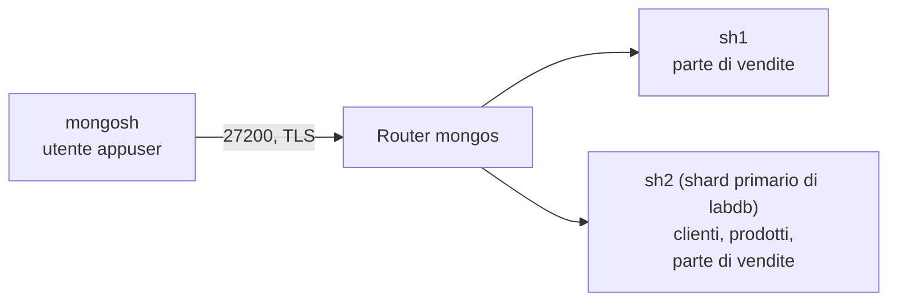
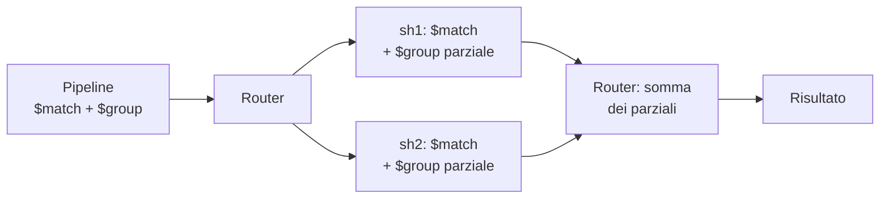
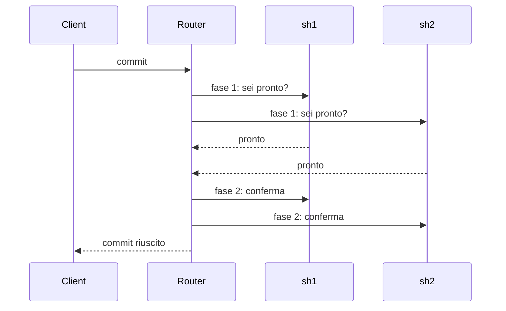

# CRUD con mongosh su un cluster MongoDB — Guida completa passo passo

**Per chi è questa guida:** per chi ha costruito il cluster della guida 03 e vuole imparare a **usarlo**: inserire, leggere, modificare e cancellare documenti con la shell `mongosh`, e poi indici, aggregazioni, transazioni, validazione, ricerca testuale, change stream, import ed export. Come nelle guide precedenti, ogni passaggio spiega **cosa fare**, **cosa fa il comando** e **cosa devi vedere**, e i riquadri 🧭 distinguono ciò che facciamo **nel laboratorio** da ciò che si sceglie **in produzione**.

**Cosa otterrai alla fine:**

- dimestichezza con la shell interattiva e con le quattro operazioni di base (Create, Read, Update, Delete);
- la capacità di leggere un piano di esecuzione e di scegliere un indice;
- pipeline di aggregazione con raggruppamenti, `$lookup`, `$facet` e `$merge`;
- transazioni su più documenti e su più shard, con la prova di cosa succede quando falliscono;
- regole di validazione, un indice testuale in italiano, un change stream che osserva le scritture in tempo reale;
- import ed export in JSON e CSV senza perdere i tipi dei dati.

In ogni parte vedrai anche **cosa cambia su una collezione distribuita**: è il motivo per cui questa guida usa il cluster della 03 e non un'istanza singola.

**Tempo stimato:** 3–4 ore. Le parti sono raggruppate in sei blocchi che si possono fare in giorni diversi.

**Prerequisiti:** cluster della guida 03 completo, **con TLS**, con l'utente `appuser` (guida 03, Parte 15) e il database `labdb` con le collezioni `ordini` ed `eventi`.

**Stato di verifica:** tutti i comandi sono stati eseguiti e collaudati su un'installazione reale (MongoDB 8.0.32, mongosh 2.11.1).

> 📖 **Comandi e simboli** (`sudo`, `source`, `|`, `>`, `<`, `docker exec`…): la [legenda dei comandi](legenda-comandi-linux.md) spiega tutto ciò che compare in questa guida.

---

## Indice

- [Parte 0 — Concetti](#parte-0--concetti)
- [Parte 1 — Preparazione](#parte-1--preparazione)
- [Parte 2 — Dati di esempio](#parte-2--dati-di-esempio)
- [Parte 3 — Create: inserire documenti](#parte-3--create-inserire-documenti)
- [Parte 4 — Read: leggere documenti](#parte-4--read-leggere-documenti)
- [Parte 5 — Update: modificare documenti](#parte-5--update-modificare-documenti)
- [Parte 6 — Delete: cancellare documenti](#parte-6--delete-cancellare-documenti)
- [Parte 7 — Indici ed explain](#parte-7--indici-ed-explain)
- [Parte 8 — Aggregazione](#parte-8--aggregazione)
- [Parte 9 — Transazioni](#parte-9--transazioni)
- [Parte 10 — bulkWrite e write concern](#parte-10--bulkwrite-e-write-concern)
- [Parte 11 — Validazione dello schema](#parte-11--validazione-dello-schema)
- [Parte 12 — Ricerca testuale](#parte-12--ricerca-testuale)
- [Parte 13 — Change stream](#parte-13--change-stream)
- [Parte 14 — Import ed export](#parte-14--import-ed-export)
- [Parte 15 — Pulizia](#parte-15--pulizia)
- [Parte 16 — Quando qualcosa va storto](#parte-16--quando-qualcosa-va-storto)
- [Parte 17 — Laboratorio e produzione](#parte-17--laboratorio-e-produzione)
- [Appendice A — Dove si trova ogni cosa](#appendice-a--dove-si-trova-ogni-cosa)
- [Appendice B — Promemoria dei comandi](#appendice-b--promemoria-dei-comandi)
- [Le 10 regole d'oro del CRUD](#le-10-regole-doro-del-crud)

| Blocco | Parti | Contenuto |
|---|---|---|
| **A** | 1–3 | Preparazione, dati di esempio, Create |
| **B** | 4 | Read |
| **C** | 5–7 | Update, Delete, indici |
| **D** | 8–10 | Aggregazione, transazioni, bulkWrite |
| **E** | 11–13 | Validazione, ricerca testuale, change stream |
| **F** | 14–15 | Import/export, pulizia |

> **Convenzioni:** come nelle guide precedenti (📍 dove eseguire, ✅ cosa devi vedere, segnaposto `<...>` da sostituire togliendo anche `<` e `>`). Segnaposto di questa guida: `<utente>` (utente della VM) e `<FQDN>` (nome DNS della VM).

> **Due modi di eseguire i comandi.** È la cosa più importante da tenere a mente in questa guida:
>
> - i blocchi **`js`** vanno incollati **dentro la shell interattiva** aperta con `app_shell`. Sei nella shell quando il prompt finisce con `labdb>`. Ogni riga è un comando;
> - i blocchi **`bash`** vanno eseguiti **sulla VM**, fuori dalla shell, quando il prompt finisce con `$`.
>
> Se incolli JavaScript al prompt della VM ottieni `-bash: syntax error near unexpected token`: non è successo nulla, apri la shell con `app_shell` e ripeti.

> **Errori previsti.** Alcuni passi provocano un errore di proposito, per mostrarti come si presenta. Quando un comando incollato dà errore, mongosh **non esegue le righe successive** dello stesso incolla: se il blocco aveva altre righe, incollale di nuovo.

> **I dati di esempio sono deterministici:** ogni caricamento produce esattamente gli stessi documenti, quindi i numeri dei ✅ devono coincidere con i tuoi. Coincidono però solo se esegui le parti **in ordine e una sola volta**: molte parti modificano i dati usati dalle successive. Se un numero non torna, vedi la Parte 16.

---

## Parte 0 — Concetti

### 0.1 Documenti, collezioni, database

MongoDB conserva **documenti**: strutture simili a oggetti JSON, con campi e valori. I documenti stanno in **collezioni** (l'equivalente delle tabelle), le collezioni in **database**.

```js
{
  _id: 7,
  nome: "Matteo",
  indirizzo: { citta: "Milano", provincia: "MI" },   // un documento dentro il documento
  interessi: ["sport", "cucina", "lettura"],         // un array
  punti: 108
}
```

Tre differenze rispetto a una tabella relazionale:

- **non c'è uno schema obbligatorio**: due documenti della stessa collezione possono avere campi diversi (si può comunque imporre uno schema: Parte 11);
- **i valori possono essere annidati**: documenti dentro documenti e array, che si interrogano con la *dot notation* (`"indirizzo.citta"`);
- **ogni documento ha un campo `_id`**, unico nella collezione. Se non lo indichi, viene generato un `ObjectId`.

### 0.2 CRUD

| Operazione | Significato | Comandi principali |
|---|---|---|
| **C**reate | Inserire | `insertOne`, `insertMany` |
| **R**ead | Leggere | `find`, `findOne`, `countDocuments`, `distinct`, `aggregate` |
| **U**pdate | Modificare | `updateOne`, `updateMany`, `replaceOne`, `findOneAndUpdate` |
| **D**elete | Cancellare | `deleteOne`, `deleteMany`, `findOneAndDelete`, `drop` |

Quasi tutti i comandi hanno la stessa forma: `db.<collezione>.<comando>(<filtro>, <altro>)`. Il **filtro** è un documento che descrive quali documenti interessano: `{}` significa «tutti», `{ citta: "Milano" }` significa «quelli in cui `citta` vale Milano».

### 0.3 I tipi: BSON

I documenti sono salvati in **BSON**, un formato binario che ha più tipi di JSON: numeri interi a 32 e 64 bit, decimali esatti, date, `ObjectId`. Il tipo conta: `0.1 + 0.2` con i numeri in virgola mobile non fa `0.3` (lo vedrai nella Parte 3.4), e per questo gli importi si salvano come **Decimal128**.

### 0.4 mongosh

`mongosh` è la shell di MongoDB: un interprete JavaScript collegato al database. Puoi usarla in due modi:

- **interattiva**: scrivi un comando, vedi il risultato, mantieni variabili tra un comando e l'altro;
- **con `--eval`**: esegue il JavaScript passato sulla riga di comando ed esce. È ciò che fanno le funzioni `sh_eval` e `app_eval`.

### 0.5 Cosa cambia su un cluster con sharding

In questa guida lavori attraverso il **router** del cluster della 03, con tre collezioni:

| Collezione | Documenti | Distribuita? | Dove sta |
|---|---|---|---|
| `clienti` | 50 | No | Sullo shard primario del database |
| `prodotti` | 30 | No | Sullo shard primario del database |
| `vendite` | 5.000 | **Sì**, shard key `{ clienteId: "hashed" }` | Divisa tra `sh1` e `sh2` |



Per l'applicazione le tre collezioni si usano allo stesso modo. Ma su `vendite` alcune operazioni si comportano diversamente, e la guida le mette in evidenza:

- le query con la shard key vanno a **un solo shard**, le altre a tutti (Parte 4.6);
- la shard key si può modificare, ma solo un documento alla volta (Parte 5.6);
- un indice `unique` deve contenere la shard key (Parte 7.2);
- le aggregazioni vengono **divise** tra shard e router (Parte 8.5);
- una transazione che tocca più shard usa un commit in due fasi (Parte 9.4);
- gli eventi di un change stream portano con sé la shard key (Parte 13).

---

# Blocco A

## Parte 1 — Preparazione

### 1.1 Il cluster è acceso?

📍 VM

```bash
cd ~/mongo-lab/03-sharding
sudo docker compose start        # se era fermo; altrimenti non fa nulla
source ~/mongo-lab/03-sharding/funzioni-lab.sh
sh_eval 'db.adminCommand({ listShards: 1 }).shards.forEach(s => print(s._id, "stato:", s.state)); print("bilanciatore:", sh.getBalancerState()); print("collezioni di labdb:", db.getSiblingDB("labdb").getCollectionNames().sort().join(", "))'
sudo test -f appuser_password.txt && echo "password di appuser presente"
```

**Cosa fa:** riaccende i container del cluster, carica la funzione `sh_eval` della guida 03 (esegue JavaScript sul router come amministratore), poi chiede al router lo stato degli shard, del bilanciatore e l'elenco delle collezioni. L'ultima riga controlla che esista il file con la password di `appuser`.

✅ `sh1 stato: 1`, `sh2 stato: 1`, `bilanciatore: true`, `collezioni di labdb: eventi, ordini`, `password di appuser presente`.

### 1.2 Cartella e file del laboratorio

📍 VM

```bash
mkdir -p ~/mongo-lab/04-crud
```

I tre file del laboratorio sono nel repository, in `config/04-crud/`:

| File | A cosa serve |
|---|---|
| `funzioni-crud.sh` | Funzioni di comodo: `app_shell`, `app_eval`, `app_export`, `app_import` |
| `dati-crud.js` | Carica i dati di esempio: 30 prodotti, 50 clienti, 5.000 vendite |
| `prodotti.csv` | Cinque prodotti da importare nella Parte 14 |

📍 PC (PowerShell), dalla cartella del repository:

```powershell
scp config\04-crud\funzioni-crud.sh config\04-crud\dati-crud.js config\04-crud\prodotti.csv <utente>@<FQDN>:~/mongo-lab/04-crud/
```

📍 VM

```bash
cd ~/mongo-lab/04-crud
ls -l
file funzioni-crud.sh dati-crud.js prodotti.csv
source ~/mongo-lab/04-crud/funzioni-crud.sh
app_eval 'print("database:", db.getName(), "- utente:", db.runCommand({ connectionStatus: 1 }).authInfo.authenticatedUsers[0].user)'
```

✅ Tre file. `file` **non** deve mai riportare `with CRLF line terminators` (i fine riga di Windows romperebbero gli script: il repository li forza a LF con `.gitattributes`). Poi: `database: labdb - utente: appuser`.

<details>
<summary>📋 Output reale del collaudo</summary>

```
funzioni-crud.sh: ASCII text
dati-crud.js:     Unicode text, UTF-8 text
prodotti.csv:     CSV ASCII text
database: labdb - utente: appuser
```

</details>

**Le funzioni di comodo.** Tutte si collegano al router con TLS come `appuser`, leggendo la password dal file senza mostrarla:

| Funzione | Cosa fa | Esempio |
|---|---|---|
| `app_shell` | Apre la shell interattiva su `labdb` | `app_shell` |
| `app_eval 'js'` | Esegue JavaScript ed esce | `app_eval 'print(db.clienti.countDocuments())'` |
| `app_export ...` | `mongoexport`; il risultato esce sullo standard output | `app_export --collection=prodotti > prodotti.json` |
| `app_import ...` | `mongoimport`; i dati arrivano dallo standard input | `app_import --collection=x < file.json` |
| `sh_eval 'js'` | Come `app_eval`, ma da **amministratore** (guida 03) | `sh_eval 'sh.status()'` |

> ⚠️ Le funzioni valgono solo per la sessione in cui le hai caricate. **A ogni nuova connessione SSH** ripeti i due `source` (o aggiungili a `~/.bashrc`, come indicato nella guida 03):
>
> ```bash
> source ~/mongo-lab/03-sharding/funzioni-lab.sh
> source ~/mongo-lab/04-crud/funzioni-crud.sh
> ```

> 🧭 **Perché `appuser` e non l'amministratore**
>
> - **Nel laboratorio:** quasi tutti i comandi girano come `appuser`, che ha solo il ruolo `readWrite` su `labdb`. L'amministratore serve in tre soli punti: distribuire una collezione, modificarne le opzioni, leggere i contatori del router.
> - **Perché:** è così che lavora un'applicazione. Usando l'utente giusto scopri subito quali operazioni richiedono permessi in più.
> - **Se non lo fai:** da amministratore tutto funziona, e non ti accorgi che la tua applicazione non potrà fare la stessa cosa.
> - **In produzione:** un utente per applicazione, con il ruolo minimo; le operazioni amministrative le fa un utente diverso, in momenti controllati.

### 1.3 La shell interattiva

```bash
app_shell
```

✅ Si apre mongosh con un prompt simile a `[direct: mongos] labdb>`: sei collegato al router (`mongos`), nel database `labdb`.

```js
db
show dbs
show collections
db.ordini.findOne({}, { _id: 0, clienteId: 1, ordine: 1, importo: 1 })
db.ordini.find({}, { _id: 0, ordine: 1 }).sort({ ordine: 1 })
it
exit
```

**Cosa fanno:** `db` mostra il database corrente; `show dbs` e `show collections` elencano database e collezioni; `findOne` restituisce un documento, `find` un elenco; `it` (*iterate*) chiede i risultati successivi; `exit` chiude la shell.

✅ `db` → `labdb`. `show dbs` → **solo `labdb`**: `appuser` non vede gli altri database. `show collections` → `eventi`, `ordini`. `find` mostra 20 documenti e poi `Type "it" for more`; `it` mostra i 20 successivi.

**Comodità della shell:**

| Tasto o comando | Effetto |
|---|---|
| Freccia ↑ | Richiama i comandi precedenti |
| `Tab` | Completa nomi di collezioni e comandi |
| `Ctrl+L` oppure `cls` | Pulisce lo schermo |
| `Ctrl+C` | Annulla la riga, o interrompe un comando in corso; la shell resta aperta |
| `.editor` | Apre un editor multiriga; `Ctrl+D` esegue |
| `exit` | Chiude la shell |

> **Incollare comandi lunghi.** Quando incolli una riga più lunga della finestra, il terminale a volte mostra alcuni caratteri **ripetuti** (per esempio `$roun$round` o `cognomcognome`). È solo un difetto di visualizzazione: il comando eseguito è quello corretto, come conferma il risultato.

---

## Parte 2 — Dati di esempio

### 2.1 Distribuire `vendite` prima di caricarla

`appuser` non può distribuire collezioni: lo fa l'amministratore, con `sh_eval`.

📍 VM

```bash
sh_eval 'printjson(sh.shardCollection("labdb.vendite", { clienteId: "hashed" }))'
```

✅ `collectionsharded: 'labdb.vendite'`, `ok: 1`.

Prova la stessa cosa come `appuser`, per vedere il rifiuto:

```bash
app_eval 'try { sh.shardCollection("labdb.prova", { x: "hashed" }) } catch (e) { print("appuser:", e.codeName) }'
```

✅ `appuser: Unauthorized`.

### 2.2 Caricamento

```bash
cd ~/mongo-lab/04-crud
time app_eval "$(cat dati-crud.js)"
```

**Cosa fa:** `$(cat dati-crud.js)` passa il contenuto del file a `app_eval`, che lo esegue come `appuser`. Lo script ricrea `prodotti` e `clienti` e **svuota** `vendite` senza eliminarla (così resta distribuita), poi inserisce i documenti. `time` misura la durata.

✅ `prodotti: 30 - clienti: 50 - vendite: 5000`, in una ventina di secondi.

```bash
sh_eval 'db.getSiblingDB("labdb").vendite.getShardDistribution()'
sh_eval 'const d = db.getSiblingDB("config"); ["clienti", "prodotti", "vendite"].forEach(n => print(n, d.collections.findOne({ _id: "labdb." + n }) ? "distribuita" : "non distribuita")); print("shard primario di labdb:", d.databases.findOne({ _id: "labdb" }).primary)'
```

✅ `vendite` divisa tra `sh1` e `sh2`; `clienti` e `prodotti` **non distribuite**, `vendite` **distribuita**; infine il nome dello shard primario di `labdb`, quello che ospita le collezioni non distribuite.

<details>
<summary>📋 Output reale del collaudo (estratto)</summary>

```
prodotti: 30 - clienti: 50 - vendite: 5000

real    0m20.200s

Totals
{
  data: '1.19MiB',
  docs: 5000,
  chunks: 2,
  'Shard sh2': [ '37.65 % data', '37.52 % docs in cluster', '251B avg obj size on shard' ],
  'Shard sh1': [ '62.34 % data', '62.48 % docs in cluster', '249B avg obj size on shard' ]
}

clienti non distribuita
prodotti non distribuita
vendite distribuita
shard primario di labdb: sh2
```

</details>

**Perché 62% e 38%, e non metà e metà?** Nella guida 03 la stessa shard key hashed dava 50,5% e 49,5%, ma lì i clienti erano 5.000. Qui sono **50**: l'hash distribuisce i *valori* della chiave, e con pochi valori distinti basta che qualche cliente in più capiti su uno shard per sbilanciare il totale. È un promemoria concreto: una shard key funziona bene quando ha **molti valori distinti**.

**Com'è fatto un documento di `vendite`:**

```js
{
  _id: ObjectId('...'),
  clienteId: 7,                                     // shard key, riferimento a clienti._id
  data: ISODate('2026-01-02T12:00:00.000Z'),
  stato: 'consegnata',                              // consegnata, spedita, in lavorazione, annullata
  canale: 'web',                                    // web, negozio, telefono
  righe: [                                          // da 1 a 3 righe
    { prodottoId: 'P005', qta: 2, prezzo: Decimal128('45.90') },
    { prodottoId: 'P002', qta: 1, prezzo: Decimal128('24.90') }
  ],
  totale: Decimal128('116.70')
}
```

---

## Parte 3 — Create: inserire documenti

```bash
app_shell
```

> **Solo se ripeti la Parte 3** (altrimenti gli inserimenti falliscono con `E11000`, perché i documenti esistono già), riporta la situazione a prima della parte:
>
> ```js
> db.clienti.deleteOne({ _id: 51 })
> db.prove.drop()
> ```

### 3.1 `insertOne`, con e senza `_id`

```js
db.clienti.insertOne({ _id: 51, nome: "Anna", cognome: "Verdi", email: "anna.verdi51@esempio.it", tipo: "privato", indirizzo: { citta: "Genova", provincia: "GE", cap: "16121" }, interessi: ["musica"], punti: 0, newsletter: true, iscritto: new Date() })
db.prove.insertOne({ testo: "documento senza _id" })
const doc = db.prove.findOne({ testo: "documento senza _id" })
doc._id
doc._id.getTimestamp()
```

**Cosa fanno:** il primo inserisce una cliente scegliendo l'`_id`; il secondo inserisce un documento senza `_id` in una collezione, `prove`, che **non esiste ancora**. Le ultime tre righe rileggono quel documento e ne guardano l'`_id`.

✅ Il primo: `insertedId: 51`. Il secondo: `insertedId: ObjectId('...')`, generato dalla shell. `getTimestamp()` restituisce l'istante di creazione: un `ObjectId` contiene la data in cui è stato generato. La collezione `prove` è stata **creata dal primo inserimento**: in MongoDB non serve crearla prima.

### 3.2 `_id` duplicato

```js
db.clienti.insertOne({ _id: 51, nome: "Doppione" })
```

✅ `MongoServerError: E11000 duplicate key error collection: labdb.clienti index: _id_ dup key: { _id: 51 }`. Il codice **`E11000`** è quello di ogni violazione di unicità: lo rivedrai spesso.

### 3.3 `insertMany` ordinato e non ordinato

Incolla i blocchi **uno alla volta**: ogni `insertMany` dà un errore, e dopo un errore mongosh non esegue il resto dell'incolla.

```js
db.prove.insertMany([{ _id: 1 }, { _id: 1 }, { _id: 2 }])
```

```js
db.prove.find({ _id: { $type: "number" } })
```

```js
db.prove.insertMany([{ _id: 3 }, { _id: 3 }, { _id: 4 }], { ordered: false })
```

```js
db.prove.find({ _id: { $type: "number" } })
```

✅ Primo `insertMany`: errore `E11000` su `index: 1`, `insertedCount: 1`; il `find` mostra solo `{ _id: 1 }`. Secondo: errore su `index: 1`, ma `insertedCount: 2`. Alla fine: `[ { _id: 1 }, { _id: 3 }, { _id: 4 } ]`.

| Modalità | Al primo errore | Quando usarla |
|---|---|---|
| **Ordinata** (predefinita) | Si ferma: i documenti successivi **non** vengono inseriti | Quando l'ordine conta, o un errore deve bloccare tutto |
| **Non ordinata** (`ordered: false`) | Prosegue e riporta tutti gli errori alla fine | Caricamenti in blocco, dove gli scarti si gestiscono dopo |

<details>
<summary>📋 Output reale del collaudo (insertMany ordinato)</summary>

```
Uncaught:
MongoBulkWriteError: E11000 duplicate key error collection: labdb.prove index: _id_ dup key: { _id: 1 }
Result: BulkWriteResult {
  insertedCount: 1,
  matchedCount: 0,
  modifiedCount: 0,
  deletedCount: 0,
  upsertedCount: 0,
  upsertedIds: {},
  insertedIds: { '0': 1 }
}
Write Errors: [
  WriteError {
    err: {
      index: 1,
      code: 11000,
      errmsg: 'E11000 duplicate key error collection: labdb.prove index: _id_ dup key: { _id: 1 }',
      errInfo: undefined,
      op: { _id: 1 }
    }
  }
]
```

</details>

> **Nota dal collaudo:** rilanciando l'`insertMany` non ordinato con i documenti già presenti si ottengono **tre** errori (`index` 0, 1 e 2) e `insertedCount: 0`: il non ordinato tenta comunque tutti i documenti.

### 3.4 I tipi

```js
db.prove.insertOne({ _id: "tipi", intero: 42, grande: NumberLong("9007199254740993"), decimale: NumberDecimal("0.1"), doppio: 0.1, data: new Date("2026-10-01T10:00:00Z"), vero: true, nullo: null, lista: [1, "a", { b: 2 }], annidato: { a: { b: 1 } } })
db.prove.aggregate([{ $match: { _id: "tipi" } }, { $project: { _id: 0, intero: { $type: "$intero" }, grande: { $type: "$grande" }, decimale: { $type: "$decimale" }, doppio: { $type: "$doppio" }, data: { $type: "$data" }, vero: { $type: "$vero" }, nullo: { $type: "$nullo" }, lista: { $type: "$lista" }, annidato: { $type: "$annidato" } } }])
db.prove.aggregate([{ $match: { _id: "tipi" } }, { $project: { _id: 0, conDouble: { $add: [0.1, 0.2] }, conDecimal: { $add: [NumberDecimal("0.1"), NumberDecimal("0.2")] } } }])
db.prodotti.findOne({ _id: "P002" })
exit
```

**Cosa fanno:** il primo inserisce un documento con un campo per ogni tipo; il secondo chiede a MongoDB il tipo di ciascun campo; il terzo somma `0.1 + 0.2` in due modi.

✅ Tipi: `int`, `long`, `decimal`, `double`, `date`, `bool`, `null`, `array`, `object`. Poi `conDouble: 0.30000000000000004` e `conDecimal: Decimal128('0.3')`. In `P002` il prezzo compare come `Decimal128('24.90')`.

| In mongosh scrivi | Tipo BSON | Note |
|---|---|---|
| `42` | `int` | Numero intero che sta in 32 bit |
| `NumberLong("...")` | `long` | Interi a 64 bit; tra virgolette per non perdere precisione |
| `0.1` | `double` | Virgola mobile: veloce, ma **non esatto** |
| `NumberDecimal("0.1")` | `decimal` | Decimale esatto (Decimal128): per gli importi |
| `new Date()`, `ISODate("...")` | `date` | Sempre in UTC |

> 🧭 **Gli importi in Decimal128**
>
> - **Nel laboratorio:** prezzi e totali sono `NumberDecimal`.
> - **Perché:** con i `double`, `0.1 + 0.2` dà `0.30000000000000004`. Su migliaia di righe di vendita gli errori si accumulano.
> - **Se non lo fai:** totali che non quadrano al centesimo, e confronti di uguaglianza che falliscono senza motivo apparente.
> - **In produzione:** Decimal128, oppure interi in centesimi. Mai `double` per il denaro.

---

# Blocco B

## Parte 4 — Read: leggere documenti

```bash
app_shell
```

### 4.1 Uguaglianza, dot notation, proiezione

```js
db.clienti.find({ "indirizzo.citta": "Milano" }, { _id: 0, nome: 1, cognome: 1 })
db.clienti.findOne({ _id: 7 })
db.clienti.findOne({ _id: 7 }, { email: 1, "indirizzo.citta": 1 })
db.clienti.findOne({ _id: 7 }, { interessi: 0, indirizzo: 0 })
```

**Cosa fanno:** il primo argomento di `find` è il **filtro**, il secondo la **proiezione**, cioè quali campi restituire. `"indirizzo.citta"` è la *dot notation*: entra nel documento annidato (le virgolette sono obbligatorie).

✅ **12** clienti di Milano. La proiezione con `1` **include** solo i campi indicati (più `_id`, salvo `_id: 0`); quella con `0` **esclude** i campi indicati e restituisce tutti gli altri. Le due forme non si mescolano, con la sola eccezione di `_id`.

### 4.2 Confronto e operatori logici

```js
db.clienti.find({ punti: { $gte: 400 } }, { nome: 1, punti: 1 }).sort({ punti: -1 })
db.clienti.countDocuments({ tipo: "azienda", newsletter: true })
db.clienti.countDocuments({ $or: [ { "indirizzo.citta": "Roma" }, { punti: { $lt: 20 } } ] })
db.clienti.countDocuments({ "indirizzo.provincia": { $in: ["TO", "VE"] } })
db.clienti.countDocuments({ telefono: { $exists: false } })
db.clienti.countDocuments({ iscritto: { $type: "date" } })
db.clienti.find({ email: { $regex: /^giulia\./ } }, { _id: 0, email: 1 })
db.prodotti.find({ prezzo: { $gt: 200 } }, { nome: 1, prezzo: 1 }).sort({ prezzo: -1 })
db.prodotti.find({ categoria: { $ne: "Libri" }, tags: "ufficio" }, { nome: 1 })
```

✅ Nell'ordine:

| Query | Risultato |
|---|---|
| `punti` almeno 400, in ordine decrescente | **13** clienti; il primo è `_id: 19` con 490 punti |
| Aziende iscritte alla newsletter | **7** |
| Di Roma **oppure** con meno di 20 punti | **6** (Anna ha 0 punti) |
| Provincia di Torino o Venezia | **14** |
| Senza il campo `telefono` | **15** (anche Anna) |
| `iscritto` di tipo data | **51**, cioè tutti |
| Email che inizia con `giulia.` | **4** |
| Prodotti sopra 200 € | **5**: P001, P023, P012, P004, P029 |
| Non libri, con tag `ufficio` | **5**: P001, P004, P011, P029, P030 |

| Operatore | Significato |
|---|---|
| `$eq`, `$ne` | Uguale, diverso |
| `$gt`, `$gte`, `$lt`, `$lte` | Maggiore, maggiore o uguale, minore, minore o uguale |
| `$in`, `$nin` | Compreso (o non compreso) in un elenco |
| `$and`, `$or`, `$nor`, `$not` | Operatori logici |
| `$exists` | Il campo esiste (o non esiste) |
| `$type` | Il campo è di un certo tipo |
| `$regex` | Espressione regolare |

Più condizioni nello stesso filtro, separate da virgola, valgono come **AND**: `{ tipo: "azienda", newsletter: true }`.

Due osservazioni dal collaudo:

- il confronto tra `200`, un intero, e i prezzi `Decimal128` funziona: MongoDB confronta i numeri **per valore**, anche se di tipo diverso;
- `tags: "ufficio"` su un campo array significa «l'array **contiene** `ufficio`».

### 4.3 Array

```js
db.clienti.countDocuments({ interessi: "montagna" })
db.clienti.find({ interessi: { $all: ["sport", "viaggi"] } }, { _id: 1, interessi: 1 })
db.clienti.countDocuments({ interessi: { $size: 3 } })
db.vendite.countDocuments({ "righe.prodottoId": "P001", "righe.qta": { $gte: 2 } })
db.vendite.countDocuments({ righe: { $elemMatch: { prodottoId: "P001", qta: { $gte: 2 } } } })
db.vendite.findOne({ righe: { $elemMatch: { prodottoId: "P001", qta: { $gte: 2 } } } }, { _id: 0, clienteId: 1, righe: 1 })
```

✅ **12** clienti interessati alla montagna; **6** con entrambi gli interessi (9, 11, 16, 17, 42, 44), in qualunque ordine; **29** con esattamente tre interessi; poi **278** contro **208**.

**Perché 278 e 208?** È la trappola più comune degli array di documenti:

- **senza `$elemMatch`** basta che **una** riga sia P001 e che **una qualsiasi**, anche un'altra, abbia `qta ≥ 2`;
- **con `$elemMatch`** le due condizioni devono valere per **la stessa** riga.

Quando le condizioni riguardano lo stesso elemento di un array, usa sempre `$elemMatch`.

### 4.4 Ordinamento, paginazione, conteggi, `distinct`

```js
db.prodotti.find({}, { nome: 1 }).sort({ _id: 1 }).skip(10).limit(5)
db.prodotti.find({ _id: { $gt: "P015" } }, { nome: 1 }).sort({ _id: 1 }).limit(5)
db.vendite.estimatedDocumentCount()
db.vendite.countDocuments()
db.vendite.countDocuments({ data: { $gte: ISODate("2026-03-01"), $lt: ISODate("2026-04-01") } })
db.clienti.distinct("indirizzo.citta")
db.vendite.distinct("stato")
```

✅ P011–P015; poi P016–P020; **5000** e **5000**; **496** vendite a marzo; 9 città (le 8 dei dati più `Genova`); 4 stati.

**Due modi di paginare:**

| Modo | Come | Pro e contro |
|---|---|---|
| `skip` e `limit` | Salta N documenti | Semplice, ma il server scorre comunque i documenti saltati: lento sulle pagine lontane |
| **Per chiave** | Riparte dall'ultimo valore visto: `{ _id: { $gt: "P015" } }` | Costante su qualunque pagina; richiede un ordinamento su un campo indicizzato |

**Due modi di contare:** `estimatedDocumentCount()` legge i metadati (immediato, ma senza filtro e approssimato); `countDocuments(filtro)` conta davvero. Per un intervallo di date usa sempre `$gte` sull'inizio e `$lt` sull'inizio del periodo successivo.

### 4.5 Cursori

```js
const cur = db.vendite.find({ clienteId: 7 }, { _id: 0, data: 1, totale: 1 }).sort({ data: 1 })
cur.hasNext()
cur.next()
cur.toArray().length
let somma = 0; db.vendite.find({ clienteId: 7 }).forEach(v => { somma += 1 }); somma
```

**Cosa fanno:** `find` non restituisce i documenti ma un **cursore**, che li consegna a blocchi. La shell ne mostra 20 alla volta (ecco il perché di `it`); assegnandolo a una variabile lo controlli tu.

✅ `true`; la prima vendita del cliente 7; poi **92** (le restanti: il cursore ne aveva già consegnata una, in tutto sono 93); infine **93**.

### 4.6 Query mirate e su tutti gli shard

```js
db.vendite.find({ clienteId: 7 }).explain().queryPlanner.winningPlan.stage
db.vendite.find({ stato: "annullata" }).explain().queryPlanner.winningPlan.stage
db.vendite.find().sort({ data: -1 }).limit(5).explain().queryPlanner.winningPlan.stage
db.clienti.find({ _id: 7 }).explain().queryPlanner.winningPlan.stage
exit
```

**Cosa fanno:** `explain()` non esegue la query: chiede al router **come** la eseguirebbe.

✅

| Query | Risultato | Perché |
|---|---|---|
| `vendite`, `{ clienteId: 7 }` | `SINGLE_SHARD` | Contiene la shard key |
| `vendite`, `{ stato: "annullata" }` | `SHARD_MERGE` | Senza shard key: tutti gli shard |
| `vendite`, ordinata per data | `SHARD_MERGE_SORT` | Tutti gli shard; il router fonde i risultati già ordinati |
| `clienti`, `{ _id: 7 }` | `SINGLE_SHARD` | Collezione non distribuita: vive sullo shard primario |

---

# Blocco C

## Parte 5 — Update: modificare documenti

```bash
app_shell
```

Ogni update ha due parti: un **filtro** (quali documenti) e una **modifica** espressa con operatori (`$set`, `$inc`…). Il risultato riporta sempre due contatori: `matchedCount` (documenti trovati dal filtro) e `modifiedCount` (documenti davvero cambiati).

### 5.1 Operatori di campo

```js
db.clienti.updateOne({ _id: 51 }, { $set: { telefono: "+39 3331234567", "indirizzo.cap": "16122" } })
db.clienti.updateOne({ _id: 51 }, { $set: { telefono: "+39 3331234567", "indirizzo.cap": "16122" } })
db.clienti.updateOne({ _id: 51 }, { $inc: { punti: 50 }, $currentDate: { aggiornato: true } })
db.clienti.updateOne({ _id: 51 }, { $unset: { newsletter: "" }, $rename: { telefono: "cellulare" } })
db.clienti.findOne({ _id: 51 })
```

La seconda riga è **volutamente identica** alla prima.

✅ Primo: `matchedCount: 1, modifiedCount: 1`. Secondo: `matchedCount: 1, modifiedCount: 0`: il documento è stato trovato, ma i valori erano già quelli. Alla fine Anna ha `punti: 50`, `aggiornato` con la data attuale, `cellulare` al posto di `telefono`, nessun campo `newsletter`, cap `16122`.

| Operatore | Effetto |
|---|---|
| `$set` | Imposta un campo (lo crea se non esiste) |
| `$unset` | Elimina un campo |
| `$inc` | Somma un valore (anche negativo) |
| `$rename` | Rinomina un campo |
| `$currentDate` | Imposta la data e ora del server |

> ⚠️ Senza operatori, cioè scrivendo `updateOne({ _id: 51 }, { punti: 50 })`, mongosh rifiuta il comando: per **sostituire** l'intero documento esiste `replaceOne` (Parte 5.5).

### 5.2 Operatori sugli array

```js
db.clienti.updateOne({ _id: 51 }, { $push: { interessi: "viaggi" } })
db.clienti.updateOne({ _id: 51 }, { $addToSet: { interessi: "viaggi" } })
db.clienti.updateOne({ _id: 51 }, { $push: { interessi: { $each: ["cucina", "lettura"] } } })
db.clienti.updateOne({ _id: 51 }, { $pull: { interessi: "musica" } })
db.clienti.findOne({ _id: 51 }, { interessi: 1 })
```

✅ `$addToSet` con un valore già presente: `modifiedCount: 0`. Alla fine: `[ 'viaggi', 'cucina', 'lettura' ]`.

| Operatore | Effetto |
|---|---|
| `$push` | Aggiunge in coda, anche se il valore c'è già |
| `$addToSet` | Aggiunge solo se il valore non c'è |
| `$each` | Con `$push` o `$addToSet`: aggiunge più valori |
| `$pull` | Rimuove tutti gli elementi uguali al valore |

### 5.3 `updateMany`, update con pipeline, `upsert`

```js
db.prodotti.updateMany({ giacenza: 0 }, { $set: { disponibile: false } })
db.prodotti.updateMany({ categoria: "Libri" }, [ { $set: { prezzo: { $round: [ { $multiply: ["$prezzo", NumberDecimal("0.9")] }, 2 ] } } } ])
db.prodotti.find({ categoria: "Libri" }, { prezzo: 1 })
db.prodotti.updateOne({ _id: "P099" }, { $set: { nome: "Prodotto di prova", categoria: "Prove" }, $setOnInsert: { giacenza: 0, creato: new Date() } }, { upsert: true })
db.prodotti.updateOne({ _id: "P099" }, { $set: { nome: "Prodotto di prova", categoria: "Prove" }, $setOnInsert: { giacenza: 0, creato: new Date() } }, { upsert: true })
```

**Cosa fanno:**

- il primo marca come non disponibili **tutti** i prodotti esauriti;
- il secondo è un **update con pipeline**: la modifica è tra parentesi quadre e può usare il valore attuale dei campi (`"$prezzo"`). Qui sconta del 10% i libri, arrotondando a due decimali;
- gli ultimi due sono **upsert** (*update or insert*): se il documento non esiste viene creato. `$setOnInsert` vale solo al momento della creazione.

✅ **3** prodotti esauriti (P007, P014, P026). Libri scontati: `12.60`, `10.80`, `35.10`, `22.50`, `17.10`, `26.10`, mostrati come `Decimal128('12.60')`. Primo upsert: `insertedId: 'P099', matchedCount: 0, upsertedCount: 1`. Secondo: `insertedId: null, matchedCount: 1, modifiedCount: 0, upsertedCount: 0`.

### 5.4 Elementi di un array: `$` e `arrayFilters`

```js
db.vendite.countDocuments({ clienteId: 7, "righe.prodottoId": "P002" })
db.vendite.updateMany({ clienteId: 7, "righe.prodottoId": "P002" }, { $set: { "righe.$[r].sconto": NumberDecimal("2.00") } }, { arrayFilters: [ { "r.prodottoId": "P002" } ] })
db.vendite.findOne({ clienteId: 7, "righe.sconto": { $exists: true } }, { _id: 0, righe: 1 })
const v7 = db.vendite.findOne({ clienteId: 7, "righe.prodottoId": "P002" })
db.vendite.updateOne({ _id: v7._id, clienteId: 7, "righe.prodottoId": "P002" }, { $inc: { "righe.$.qta": 1 } })
db.vendite.findOne({ _id: v7._id }, { _id: 0, righe: 1 })
```

✅ **13** vendite; `updateMany`: `matchedCount: 13, modifiedCount: 13`; lo sconto compare **solo** nelle righe di P002. Poi la `qta` di P002 in quella vendita aumenta di 1.

| Sintassi | Cosa modifica |
|---|---|
| `"righe.$.qta"` | **La prima** riga che corrisponde al filtro della query |
| `"righe.$[r].sconto"` con `arrayFilters` | **Tutte** le righe che soddisfano la condizione su `r` |
| `"righe.$[].sconto"` | Tutte le righe, senza condizione |

<details>
<summary>📋 Output reale del collaudo (dopo l'updateMany)</summary>

```
{
  righe: [
    { prodottoId: 'P005', qta: 2, prezzo: Decimal128('45.90') },
    {
      prodottoId: 'P002',
      qta: 1,
      prezzo: Decimal128('24.90'),
      sconto: Decimal128('2.00')
    },
    { prodottoId: 'P020', qta: 1, prezzo: Decimal128('29.00') }
  ]
}
```

</details>

### 5.5 `replaceOne` e `findOneAndUpdate`

```js
db.prove.replaceOne({ _id: 1 }, { testo: "documento sostituito" })
db.prove.findOne({ _id: 1 })
db.prodotti.findOneAndUpdate({ _id: "P002" }, { $inc: { giacenza: -1 } }, { projection: { giacenza: 1 } })
db.prodotti.findOneAndUpdate({ _id: "P002" }, { $inc: { giacenza: -1 } }, { projection: { giacenza: 1 }, returnDocument: "after" })
```

✅ Dopo `replaceOne` il documento ha solo `_id` e `testo`: tutto il resto è stato sostituito. Il primo `findOneAndUpdate` restituisce `giacenza: 140`, cioè il documento **prima** della modifica; il secondo, con `returnDocument: "after"`, restituisce `giacenza: 138`.

`findOneAndUpdate` modifica e legge **in un'unica operazione atomica**: è lo strumento giusto per contatori e prenotazioni, dove tra una lettura e una scrittura separate potrebbe infilarsi un altro client.

### 5.6 Update su una collezione distribuita

```js
db.vendite.updateOne({ stato: "annullata", canale: "telefono" }, { $set: { nota: "verificata" } })
db.vendite.insertOne({ _id: "prova-sk", clienteId: 99, stato: "prova", totale: NumberDecimal("1.00") })
db.vendite.updateOne({ _id: "prova-sk", clienteId: 99 }, { $set: { clienteId: 98 } })
db.vendite.findOne({ _id: "prova-sk" })
db.vendite.updateMany({ clienteId: 98 }, { $set: { clienteId: 97 } })
exit
```

✅

| Comando | Risultato |
|---|---|
| `updateOne` senza shard key nel filtro | Funziona: `matchedCount: 1, modifiedCount: 1` (consentito da MongoDB 7.1) |
| `updateOne` che cambia il **valore** della shard key | Funziona; il `findOne` mostra `clienteId: 98`. Il documento può cambiare shard |
| `updateMany` che cambia la shard key | **Rifiutato**: `MongoServerError: Multi-update operations are not allowed when updating the shard key field.` |

> 🧭 **Modificare la shard key**
>
> - **Nel laboratorio:** lo facciamo su un documento di prova, per vedere che è possibile.
> - **Perché:** cambiare il valore della shard key può significare **spostare il documento su un altro shard**: per questo è ammesso solo un documento alla volta.
> - **Se non lo fai:** nulla; è un'operazione rara.
> - **In produzione:** la shard key dovrebbe essere un valore che non cambia (un identificativo). Se cambia spesso, è stata scelta male.

---

## Parte 6 — Delete: cancellare documenti

```bash
app_shell
```

```js
db.vendite.deleteOne({ _id: "prova-sk", clienteId: 97 })
db.vendite.deleteOne({ _id: "prova-sk" })
db.prove.deleteOne({ _id: 3 })
db.vendite.countDocuments({ stato: "annullata", data: { $lt: ISODate("2026-02-01") } })
db.vendite.deleteMany({ stato: "annullata", data: { $lt: ISODate("2026-02-01") } })
db.prodotti.findOneAndDelete({ _id: "P099" })
db.prove.deleteMany({})
show collections
db.prove.drop()
show collections
exit
```

✅ Nell'ordine:

| Comando | Risultato |
|---|---|
| `deleteOne` con `clienteId: 97` | `deletedCount: 0`: `prova-sk` ha `clienteId: 98`, perché l'`updateMany` della 5.6 era stato rifiutato |
| `deleteOne` solo con `_id` | `deletedCount: 1`: funziona anche senza shard key nel filtro |
| `deleteOne` su `prove` | `deletedCount: 1` |
| `countDocuments` | **83** vendite annullate a gennaio |
| `deleteMany` | `deletedCount: 83` |
| `findOneAndDelete` | Restituisce il documento eliminato, `P099` |
| `deleteMany({})` su `prove` | `deletedCount: 4`; la collezione **esiste ancora**, vuota |
| `drop()` | `true`; `prove` non compare più in `show collections` |

**Tre modi di svuotare, tre effetti diversi:**

| Comando | Documenti | Collezione e indici |
|---|---|---|
| `deleteMany({ filtro })` | Elimina quelli che corrispondono | Restano |
| `deleteMany({})` | Li elimina tutti, uno per uno | Restano |
| `drop()` | Spariscono con la collezione | Eliminati; su una collezione distribuita spariscono anche i metadati di distribuzione (Parte 15) |

> ⚠️ **Conta prima di cancellare.** Lo schema `countDocuments(filtro)` seguito da `deleteMany(lo stesso filtro)` è un'abitudine che conviene prendere: un filtro sbagliato cancella senza chiedere conferma, e non esiste un «annulla».

---

## Parte 7 — Indici ed explain

Un **indice** è una struttura ordinata che permette di trovare i documenti senza leggerli tutti. Ogni collezione ha l'indice su `_id`; le collezioni distribuite hanno anche quello sulla shard key.

```bash
app_shell
```

Una piccola funzione per leggere `explain`. **Va ridefinita a ogni apertura di `app_shell`**, perché le variabili della shell non sopravvivono alla chiusura:

```js
const piano = e => print("restituiti:", e.executionStats.nReturned, "| documenti esaminati:", e.executionStats.totalDocsExamined, "| chiavi esaminate:", e.executionStats.totalKeysExamined, "| stadi:", [...new Set(JSON.stringify(e.queryPlanner.winningPlan).match(/\b(COLLSCAN|IXSCAN|SORT|FETCH)\b/g))].join(" "))
```

**Cosa fa:** riassume in una riga le quattro informazioni che contano di un `explain("executionStats")`.

| Voce | Significato |
|---|---|
| Restituiti | Documenti nel risultato |
| Documenti esaminati | Documenti letti per arrivarci |
| Chiavi esaminate | Voci di indice lette |
| `COLLSCAN` | Scansione dell'intera collezione: nessun indice usato |
| `IXSCAN` | Scansione di un indice |
| `FETCH` | Lettura dei documenti indicati dall'indice |
| `SORT` | Ordinamento in memoria: l'indice non forniva già l'ordine |

**L'obiettivo:** documenti esaminati vicini ai documenti restituiti, e niente `SORT`.

### 7.1 Indice composto (regola ESR)

```js
db.vendite.getIndexes()
piano(db.vendite.find({ stato: "spedita", canale: "web" }).sort({ data: -1 }).explain("executionStats"))
db.vendite.createIndex({ stato: 1, canale: 1, data: -1 })
piano(db.vendite.find({ stato: "spedita", canale: "web" }).sort({ data: -1 }).explain("executionStats"))
piano(db.vendite.find({ canale: "web" }).sort({ data: -1 }).explain("executionStats"))
```

✅ Indici iniziali: `_id_` e `clienteId_hashed`. `createIndex` risponde `stato_1_canale_1_data_-1`.

| Momento | Restituiti | Esaminati | Chiavi | Stadi |
|---|---|---|---|---|
| Prima dell'indice | 418 | **4917** | 0 | `SORT COLLSCAN` |
| Dopo l'indice | 418 | **418** | 418 | `FETCH IXSCAN` |
| Query senza `stato` | 2450 | 4917 | 0 | `SORT COLLSCAN` |

Con l'indice il server legge 418 documenti invece di 4917, e non deve ordinare nulla.

**La regola ESR** per l'ordine dei campi in un indice composto:

1. **E**quality: prima i campi confrontati per uguaglianza (`stato`, `canale`);
2. **S**ort: poi i campi dell'ordinamento (`data`);
3. **R**ange: per ultimi i campi confrontati per intervallo (`$gt`, `$lt`).

**Il prefisso.** L'ultima query non usa l'indice perché le manca `stato`, il **primo** campo. Un indice composto serve solo le query che ne usano i campi a partire dal primo: `{ stato, canale, data }` aiuta le ricerche su `stato` e su `stato` + `canale`, non quelle sul solo `canale`.

### 7.2 Indice unique

Incolla le righe **una alla volta**: la seconda e la terza danno un errore previsto.

```js
db.clienti.createIndex({ email: 1 }, { unique: true })
```

```js
db.clienti.insertOne({ _id: 52, nome: "Copia", email: "anna.verdi51@esempio.it" })
```

```js
db.vendite.createIndex({ data: 1 }, { unique: true })
```

```js
db.vendite.createIndex({ clienteId: 1, data: 1 }, { unique: true })
```

✅

| Comando | Risultato |
|---|---|
| Indice unique su `clienti.email` | Creato: `email_1` |
| Inserimento con email già usata | `E11000 duplicate key error ... index: email_1` |
| Indice unique `{ data: 1 }` su `vendite` | **Rifiutato**: `MongoServerError[CannotCreateIndex]: ... cannot create index with 'unique' or 'prepareUnique' option over { data: 1 } with shard key pattern { clienteId: "hashed" }` |
| Indice unique `{ clienteId: 1, data: 1 }` su `vendite` | Creato: `clienteId_1_data_1` |

**Perché il primo indice su `vendite` è rifiutato e il secondo no?** In una collezione distribuita ogni shard conosce solo i propri documenti: non può sapere se un'altra vendita con la stessa `data` esiste su un altro shard. Un indice unique deve quindi **contenere la shard key**: così tutti i documenti che potrebbero essere duplicati finiscono sullo stesso shard, che può fare il controllo.

> ⚠️ L'indice `clienteId_1_data_1` resta su `vendite` fino alla pulizia: da qui in poi non possono esistere due vendite con lo stesso `clienteId` e la stessa `data`, né due vendite dello stesso cliente entrambe senza `data`.

### 7.3 Indice TTL

```js
db.sessioni.createIndex({ creata: 1 }, { expireAfterSeconds: 120 })
db.sessioni.insertMany([ { utente: "anna", creata: new Date() }, { utente: "marco", creata: new Date(Date.now() - 3600 * 1000) } ])
db.sessioni.countDocuments()
```

**Cosa fa:** un indice **TTL** (*time to live*) elimina automaticamente i documenti quando la data nel campo indicizzato è più vecchia del tempo indicato. Qui: 120 secondi. La sessione di `marco` nasce già vecchia di un'ora.

✅ `2`. Prosegui con la 7.4 e ricontrolla tra un paio di minuti (passo 7.5).

### 7.4 Indice parziale

```js
db.prodotti.createIndex({ nome: 1 }, { partialFilterExpression: { giacenza: { $gt: 0 } } })
piano(db.prodotti.find({ nome: "Mouse senza fili", giacenza: { $gt: 0 } }).explain("executionStats"))
piano(db.prodotti.find({ nome: "Mouse senza fili" }).explain("executionStats"))
db.prodotti.getIndexes().map(i => i.name)
```

**Cosa fa:** un indice **parziale** contiene solo i documenti che soddisfano una condizione, qui i prodotti con giacenza positiva. È più piccolo e più veloce da aggiornare.

✅ La prima query usa l'indice: `FETCH IXSCAN`, **1** documento esaminato. La seconda no: `COLLSCAN`, **30** documenti esaminati. Indici: `[ '_id_', 'nome_1' ]`.

La seconda query non può usare l'indice perché potrebbe dover restituire anche un prodotto esaurito, che nell'indice non c'è: un indice parziale vale solo per le query il cui filtro **garantisce** la stessa condizione.

### 7.5 Il TTL al lavoro

```js
db.sessioni.find({}, { _id: 0, utente: 1 })
db.sessioni.drop()
exit
```

✅ Resta solo `anna`: `[ { utente: 'anna' } ]`. Il controllo delle scadenze gira **ogni 60 secondi**, quindi la cancellazione non è istantanea. Dopo altri due minuti sparirebbe anche lei.

> 🧭 **Quanti indici**
>
> - **Nel laboratorio:** creiamo indici per vedere l'effetto, senza preoccuparci del costo.
> - **Perché:** su 5.000 documenti ogni indice si costruisce in un istante.
> - **Se esageri:** ogni indice va aggiornato a **ogni scrittura** e occupa memoria. Troppi indici rallentano inserimenti e update.
> - **In produzione:** un indice per ogni query frequente, verificato con `explain`; gli indici mai usati si eliminano. Su collezioni grandi la creazione va pianificata fuori dagli orari di punta.

---

# Blocco D

## Parte 8 — Aggregazione

Una **pipeline di aggregazione** è una sequenza di stadi: ogni stadio riceve i documenti dal precedente, li trasforma e li passa al successivo.

| Stadio | Cosa fa |
|---|---|
| `$match` | Filtra, come `find` |
| `$group` | Raggruppa e calcola (somme, conteggi, medie) |
| `$sort`, `$limit` | Ordina, limita |
| `$project` | Sceglie e calcola i campi in uscita |
| `$unwind` | Trasforma ogni elemento di un array in un documento |
| `$lookup` | Unisce documenti di un'altra collezione |
| `$facet` | Esegue più pipeline sugli stessi documenti |
| `$bucket` | Raggruppa per fasce di valori |
| `$merge` | Scrive il risultato in una collezione |

```bash
app_shell
```

### 8.1 Raggruppare

```js
db.vendite.aggregate([ { $group: { _id: "$stato", vendite: { $sum: 1 }, incasso: { $sum: "$totale" } } }, { $sort: { vendite: -1 } } ])
db.vendite.aggregate([ { $match: { stato: "consegnata" } }, { $group: { _id: { $dateToString: { format: "%Y-%m", date: "$data" } }, incasso: { $sum: "$totale" } } }, { $sort: { _id: 1 } } ])
```

**Cosa fanno:** in `$group`, `_id` è il campo su cui raggruppare (`"$stato"`, con il dollaro: «il valore del campo `stato`»). `{ $sum: 1 }` conta, `{ $sum: "$totale" }` somma. La seconda pipeline raggruppa per mese, ricavato dalla data.

✅

| Stato | Vendite | Incasso |
|---|---|---|
| consegnata | **2493** | 1.195.049,30 |
| spedita | **881** | 433.230,00 |
| in lavorazione | **800** | 392.134,10 |
| annullata | **743** | 360.623,50 |

Le annullate sono 743 perché nella Parte 6 ne hai cancellate 83. Poi undici mesi, da `2026-01` (102.826,40) a `2026-11` (34.394,20). Le somme restano `Decimal128`, esatte al centesimo.

<details>
<summary>📋 Output reale del collaudo (incasso per mese)</summary>

```
[
  { _id: '2026-01', incasso: Decimal128('102826.40') },
  { _id: '2026-02', incasso: Decimal128('105804.70') },
  { _id: '2026-03', incasso: Decimal128('134028.90') },
  { _id: '2026-04', incasso: Decimal128('104699.40') },
  { _id: '2026-05', incasso: Decimal128('133419.90') },
  { _id: '2026-06', incasso: Decimal128('105824.60') },
  { _id: '2026-07', incasso: Decimal128('103145.70') },
  { _id: '2026-08', incasso: Decimal128('122446.50') },
  { _id: '2026-09', incasso: Decimal128('126184.00') },
  { _id: '2026-10', incasso: Decimal128('122275.00') },
  { _id: '2026-11', incasso: Decimal128('34394.20') }
]
```

</details>

### 8.2 `$unwind` e `$lookup`

```js
db.vendite.aggregate([ { $unwind: "$righe" }, { $group: { _id: "$righe.prodottoId", pezzi: { $sum: "$righe.qta" } } }, { $sort: { pezzi: -1, _id: 1 } }, { $limit: 5 }, { $lookup: { from: "prodotti", localField: "_id", foreignField: "_id", as: "prodotto" } }, { $project: { _id: 0, prodotto: { $first: "$prodotto.nome" }, pezzi: 1 } } ])
db.vendite.aggregate([ { $group: { _id: "$clienteId", speso: { $sum: "$totale" } } }, { $sort: { speso: -1 } }, { $limit: 3 }, { $lookup: { from: "clienti", localField: "_id", foreignField: "_id", as: "c" } }, { $unwind: "$c" }, { $project: { _id: 0, cliente: { $concat: ["$c.nome", " ", "$c.cognome"] }, citta: "$c.indirizzo.citta", speso: 1 } } ])
```

**Cosa fanno:**

- la prima trova i cinque prodotti più venduti: `$unwind` trasforma ogni riga di vendita in un documento a sé, `$group` somma i pezzi per prodotto, `$lookup` va a prendere il nome in `prodotti`;
- la seconda trova i tre clienti che hanno speso di più, con nome e città presi da `clienti`.

✅ Prodotti: Atlante del cielo (**739**), Zaino da trekking (**714**), Bollitore elettrico (**708**), Aspirapolvere robot (**692**), Guida alle Dolomiti (**692**). Clienti: Andrea Rossi, Napoli (76.399,70); Luca Colombo, Milano (65.122,40); Francesca Marino, Milano (60.443,60).

**Due dettagli:**

- gli ultimi due prodotti sono **a pari merito**. Senza un secondo criterio l'ordine tra loro non sarebbe garantito: per questo l'ordinamento è `{ pezzi: -1, _id: 1 }`. Quando ordini per un valore che può ripetersi, aggiungi sempre un campo che spareggia;
- il `$lookup` è messo **dopo** `$limit`: unisce 5 documenti, non 30. In una pipeline, filtra e riduci prima, arricchisci dopo.

### 8.3 `$facet` e `$bucket`

```js
db.vendite.aggregate([ { $facet: { perCanale: [ { $group: { _id: "$canale", n: { $sum: 1 } } }, { $sort: { n: -1 } } ], perFascia: [ { $bucket: { groupBy: "$totale", boundaries: [0, 50, 100, 250, 500, 1000, 5000], default: "altro", output: { n: { $sum: 1 } } } } ] } } ])
```

**Cosa fa:** `$facet` esegue due pipeline sugli stessi documenti e restituisce entrambi i risultati in un solo documento. `$bucket` divide le vendite per fasce di importo: ogni fascia è indicata dal suo limite inferiore.

✅ Canali: web **2450**, telefono **1241**, negozio **1226**. Fasce: da 0 → 507, da 50 → 565, da 100 → 1124, da 250 → 1141, da 500 → 976, da 1000 → 604.

### 8.4 `$merge`: salvare il risultato

```js
db.vendite.aggregate([ { $match: { stato: "consegnata" } }, { $group: { _id: { $dateToString: { format: "%Y-%m", date: "$data" } }, incasso: { $sum: "$totale" }, vendite: { $sum: 1 } } }, { $merge: { into: "riepilogo_mensile", whenMatched: "replace", whenNotMatched: "insert" } } ])
db.riepilogo_mensile.find().sort({ _id: 1 }).limit(3)
```

**Cosa fa:** `$merge` non restituisce nulla: scrive il risultato nella collezione `riepilogo_mensile`, creandola se non esiste. Rilanciandola, i mesi già presenti vengono sostituiti e quelli nuovi aggiunti: è il modo per mantenere una tabella di riepilogo aggiornata.

✅ L'aggregazione non stampa nulla. `riepilogo_mensile` contiene 11 documenti; i primi tre: gennaio (246 vendite), febbraio (211), marzo (260).

### 8.5 Come il router divide una pipeline

```js
const e = db.vendite.explain().aggregate([ { $match: { stato: "consegnata" } }, { $group: { _id: "$canale", n: { $sum: 1 } } } ])
print("fusione:", e.mergeType); print("su ogni shard:", JSON.stringify(e.splitPipeline.shardsPart)); print("fusione finale:", JSON.stringify(e.splitPipeline.mergerPart))
const e2 = db.vendite.explain().aggregate([ { $match: { clienteId: 7 } }, { $group: { _id: "$canale", n: { $sum: 1 } } } ])
print("con la shard key:", e2.splitPipeline === null ? "nessuna divisione" : "divisa", "- shard:", Object.keys(e2.shards).length)
exit
```

✅ Senza shard key: `fusione: mongos`; su ogni shard il `$match` e un `$group`; nella fusione finale un `$mergeCursors` seguito da un secondo `$group` che somma i parziali. Con la shard key: `con la shard key: nessuna divisione - shard: 1`.



Il router non si fa mandare tutti i documenti: fa fare a **ogni shard** la parte di lavoro possibile (filtrare e contare i propri documenti), e poi somma i conteggi parziali. Se invece il `$match` contiene la shard key, tutta la pipeline va a **un solo shard**, senza divisione.

<details>
<summary>📋 Output reale del collaudo</summary>

```
fusione: mongos
su ogni shard: [{"$match":{"stato":{"$eq":"consegnata"}}},{"$group":{"_id":"$canale","n":{"$sum":{"$const":1}}}}]
fusione finale: [{"$mergeCursors":{...}},{"$group":{"_id":"$$ROOT._id","n":{"$sum":"$$ROOT.n"},"$doingMerge":true}}]
con la shard key: nessuna divisione - shard: 1
```

</details>

---

## Parte 9 — Transazioni

In MongoDB la modifica di **un singolo documento** è sempre atomica: o avviene tutta o non avviene. Una **transazione** estende questa garanzia a **più documenti**, anche in collezioni e shard diversi: o tutte le modifiche, o nessuna.

L'esempio classico è una vendita: bisogna **scalare la giacenza** del prodotto e **registrare la vendita**. Se la seconda operazione fallisse dopo la prima, il magazzino risulterebbe diminuito senza una vendita corrispondente.

**Contatori delle transazioni del router, prima.** 📍 VM (non nella shell):

```bash
sh_eval 'const t = db.serverStatus().transactions; print("avviate:", t.totalStarted, "- confermate:", t.totalCommitted, "- annullate:", t.totalAborted); printjson(Object.fromEntries(Object.entries(t.commitTypes).map(([k, v]) => [k, v.successful])))'
```

Annota i valori: contano le **differenze** con quelli che leggerai alla fine. Poi apri la shell e **restaci fino alla fine della 9.4**: la sessione `s` creata nel primo passo serve a tutti gli altri.

```bash
app_shell
```

### 9.1 Una transazione riuscita

```js
const s = db.getMongo().startSession()
const sp = s.getDatabase("labdb").prodotti, sv = s.getDatabase("labdb").vendite
s.withTransaction(() => { const r = sp.updateOne({ _id: "P003", giacenza: { $gte: 2 } }, { $inc: { giacenza: -2 } }); if (r.modifiedCount !== 1) throw new Error("giacenza insufficiente per P003"); sv.insertOne({ clienteId: 12, data: new Date(), stato: "in lavorazione", canale: "web", righe: [ { prodottoId: "P003", qta: 2, prezzo: NumberDecimal("79.90") } ], totale: NumberDecimal("159.80") }) }, { readConcern: { level: "snapshot" }, writeConcern: { w: "majority" } })
db.prodotti.findOne({ _id: "P003" }, { giacenza: 1 })
db.vendite.countDocuments({ clienteId: 12, stato: "in lavorazione", "righe.prodottoId": "P003", data: { $gte: ISODate("2026-10-01") } })
```

**Cosa fanno:**

- le prime due righe aprono una **sessione** e ricavano da essa le collezioni `sp` e `sv`. Solo le operazioni fatte attraverso `sp` e `sv` fanno parte della transazione; quelle su `db.prodotti` no;
- `withTransaction` esegue la funzione dentro una transazione: se termina senza errori fa il **commit**, se lancia un errore fa l'**abort**;
- il filtro `giacenza: { $gte: 2 }` è la protezione: se non ci sono almeno due pezzi l'update non modifica nulla, e il `throw` annulla tutto.

✅ Giacenza di P003 da 35 a **33**; la nuova vendita esiste: **1**.

### 9.2 Una transazione annullata

```js
db.vendite.countDocuments({ clienteId: 13 })
try { s.withTransaction(() => { sv.insertOne({ clienteId: 13, data: new Date(), stato: "in lavorazione", canale: "web", righe: [ { prodottoId: "P007", qta: 1, prezzo: NumberDecimal("59.90") } ], totale: NumberDecimal("59.90") }); const r = sp.updateOne({ _id: "P007", giacenza: { $gte: 1 } }, { $inc: { giacenza: -1 } }); if (r.modifiedCount !== 1) throw new Error("giacenza insufficiente per P007") }) } catch (e) { print("transazione annullata:", e.message) }
db.vendite.countDocuments({ clienteId: 13 })
```

Qui l'ordine è volutamente invertito: **prima** si inserisce la vendita, **poi** si scala la giacenza. Ma P007 è esaurito.

✅ `transazione annullata: giacenza insufficiente per P007`. Il conteggio del cliente 13 è **uguale prima e dopo** (nel collaudo `90` e `90`): anche l'inserimento, che era già stato eseguito, è stato annullato.

### 9.3 Isolamento: le modifiche si vedono solo dopo il commit

```js
s.startTransaction({ readConcern: { level: "snapshot" }, writeConcern: { w: "majority" } })
sp.updateOne({ _id: "P004" }, { $inc: { giacenza: -1 } })
print("dentro la transazione:", sp.findOne({ _id: "P004" }).giacenza, "- fuori:", db.prodotti.findOne({ _id: "P004" }).giacenza)
s.commitTransaction()
print("dopo il commit:", db.prodotti.findOne({ _id: "P004" }).giacenza)
s.startTransaction()
sp.updateOne({ _id: "P004" }, { $set: { giacenza: 0 } })
s.abortTransaction()
print("dopo l'abort:", db.prodotti.findOne({ _id: "P004" }).giacenza)
```

Qui la transazione è gestita **a mano**, con `startTransaction`, `commitTransaction` e `abortTransaction`, per poter guardare cosa succede a metà.

✅ `dentro la transazione: 19 - fuori: 20`, poi `dopo il commit: 19`, poi `dopo l'abort: 19`.

Finché la transazione è aperta, **chi sta fuori vede ancora il valore vecchio** (20): le modifiche diventano visibili tutte insieme al commit. Con l'abort, l'azzeramento della giacenza non è mai esistito.

### 9.4 Una transazione su entrambi gli shard

```js
db.vendite.find({ clienteId: { $in: [1, 2, 3, 4, 5, 6] } }).explain().queryPlanner.winningPlan.shards.length
s.withTransaction(() => { sv.updateMany({ clienteId: { $in: [1, 2, 3, 4, 5, 6] } }, { $set: { verificata: true } }); sp.updateOne({ _id: "P001" }, { $set: { ultimaVerifica: new Date() } }) })
db.vendite.countDocuments({ verificata: true })
s.endSession()
exit
```

✅ `2` shard coinvolti; **603** vendite marcate.

**Contatori, dopo.** 📍 VM:

```bash
sh_eval 'const t = db.serverStatus().transactions; print("avviate:", t.totalStarted, "- confermate:", t.totalCommitted, "- annullate:", t.totalAborted); printjson(Object.fromEntries(Object.entries(t.commitTypes).map(([k, v]) => [k, v.successful])))'
```

✅ Nel collaudo:

| Contatore | Prima | Dopo | Cosa è successo |
|---|---|---|---|
| Avviate | 1298 | 1313 | |
| Confermate | 1298 | 1311 | |
| Annullate | 0 | **2** | La 9.2 e l'`abortTransaction` della 9.3 |
| `singleShard` | 1297 | 1309 | Commit che hanno coinvolto un solo shard |
| `twoPhaseCommit` | 0 | **1** | La 9.4 |

I tuoi valori di partenza saranno diversi (dipendono dalla storia del router), e il router conta anche transazioni interne: guarda le **annullate** e il **`twoPhaseCommit`**.



Quando una transazione scrive su **più shard**, il commit avviene in **due fasi**: prima tutti gli shard si dichiarano pronti, poi tutti confermano. Così non può succedere che uno shard confermi e l'altro no. È più lento di un commit su un solo shard.

> 🧭 **Quando usare le transazioni**
>
> - **Nel laboratorio:** le usiamo per vedere le garanzie che danno.
> - **Perché:** servono quando più documenti devono cambiare insieme.
> - **Se ne abusi:** ogni transazione tiene risorse impegnate, ha un limite di durata (60 secondi per impostazione predefinita) e su più shard paga il commit in due fasi.
> - **In produzione:** prima si prova a **modellare i dati** in modo che ciò che cambia insieme stia nello **stesso documento** (le righe dentro la vendita, come qui): la modifica di un documento è già atomica. Le transazioni restano per i casi in cui non è possibile. Le applicazioni devono essere pronte a **ripetere** una transazione fallita per un conflitto temporaneo: `withTransaction` lo fa da sé.

---

## Parte 10 — bulkWrite e write concern

```bash
app_shell
```

### 10.1 `bulkWrite`: più operazioni in una richiesta

```js
db.prodotti.bulkWrite([ { insertOne: { document: { _id: "P100", nome: "Prodotto bulk", categoria: "Prove", prezzo: NumberDecimal("1.00"), giacenza: 10 } } }, { updateOne: { filter: { _id: "P002" }, update: { $inc: { giacenza: 10 } } } }, { updateMany: { filter: { categoria: "Ufficio" }, update: { $set: { reparto: "B" } } } }, { replaceOne: { filter: { _id: "P100" }, replacement: { nome: "Prodotto bulk sostituito", categoria: "Prove", prezzo: NumberDecimal("2.00"), giacenza: 5 } } }, { deleteOne: { filter: { _id: "P100" } } } ])
```

**Cosa fa:** manda al server cinque operazioni diverse in **una sola richiesta**. Non è una transazione: le operazioni sono indipendenti.

✅ `insertedCount: 1`, `matchedCount: 6`, `modifiedCount: 6` (P002, i quattro prodotti Ufficio, la sostituzione), `deletedCount: 1`.

Incolla i due blocchi seguenti **uno alla volta**: entrambi danno un errore previsto.

```js
db.prodotti.bulkWrite([ { insertOne: { document: { _id: "P101" } } }, { insertOne: { document: { _id: "P101" } } }, { insertOne: { document: { _id: "P102" } } } ])
```

```js
db.prodotti.bulkWrite([ { insertOne: { document: { _id: "P103" } } }, { insertOne: { document: { _id: "P103" } } }, { insertOne: { document: { _id: "P104" } } } ], { ordered: false })
```

```js
db.prodotti.find({ _id: { $in: ["P101", "P102", "P103", "P104"] } }, { _id: 1 })
db.prodotti.deleteMany({ _id: { $in: ["P101", "P102", "P103", "P104"] } })
```

✅ Ordinato: errore `E11000`, `insertedCount: 1`, inserito solo P101. Non ordinato: errore `E11000`, `insertedCount: 2`, inseriti P103 e P104. Il `find` mostra `P101`, `P103`, `P104`; il `deleteMany` ne cancella **3**. È lo stesso comportamento visto con `insertMany` nella Parte 3.3.

### 10.2 Write concern: quanta conferma chiedere

```js
db.prodotti.insertOne({ _id: "P105" }, { writeConcern: { w: "majority", wtimeout: 5000 } })
```

```js
db.prodotti.insertOne({ _id: "P106" }, { writeConcern: { w: 4, wtimeout: 3000 } })
```

```js
db.prodotti.deleteMany({ _id: { $in: ["P105", "P106"] } })
exit
```

**Cosa fa:** il **write concern** dice quanti nodi dello shard devono aver ricevuto la scrittura prima che il server risponda «fatto». `w: "majority"` chiede la maggioranza (2 su 3); `w: 4` ne chiede quattro, ma ogni shard ha tre nodi.

✅ `w: "majority"`: `acknowledged: true`. `w: 4`: `MongoWriteConcernError[UnsatisfiableWriteConcern]: Not enough data-bearing nodes` (codice `100`). L'ultimo `deleteMany`: `deletedCount: 2`.

> ⚠️ **Guarda bene quel `2`.** Il `deleteMany` ha cancellato **sia P105 sia P106**: il documento P106 **era stato scritto**, nonostante l'errore. Lo conferma il risultato dell'errore stesso, che contiene `n: 1`. Un errore di write concern non significa «la scrittura è stata annullata»: significa «la scrittura è avvenuta, ma **non ho ottenuto la conferma che avevi chiesto**». Un'applicazione che riceve questo errore non può dare per scontato che il dato non ci sia.

<details>
<summary>📋 Output reale del collaudo (w: 4)</summary>

```
Uncaught:
MongoWriteConcernError[UnsatisfiableWriteConcern]: UnsatisfiableWriteConcern: Not enough data-bearing nodes; Error details: { writeConcern: { w: 4, wtimeout: 3000, provenance: "clientSupplied" } } at sh2
Additional information: {}
Result: {
  n: 1,
  writeConcernError: {
    code: 100,
    codeName: 'UnsatisfiableWriteConcern',
    errmsg: 'UnsatisfiableWriteConcern: Not enough data-bearing nodes; ...',
    errInfo: {}
  },
  ok: 1,
  ...
}
```

</details>

| Write concern | Significato | Rischio |
|---|---|---|
| `w: 1` | Basta il primario | Se il primario cade subito dopo, la scrittura può andare persa |
| `w: "majority"` | La maggioranza dei nodi | Sopravvive a un failover; è il valore predefinito |
| `wtimeout` | Tempo massimo di attesa della conferma | Allo scadere arriva un errore, ma la scrittura **non** viene annullata |

---

# Blocco E

## Parte 11 — Validazione dello schema

MongoDB non impone uno schema, ma può farlo **se glielo chiedi**: un *validatore* è un insieme di regole che ogni documento inserito o modificato deve rispettare.

```bash
app_shell
```

### 11.1 Una collezione con regole

```js
db.createCollection("recensioni", { validator: { $jsonSchema: { bsonType: "object", required: ["prodottoId", "clienteId", "voto"], properties: { prodottoId: { bsonType: "string", pattern: "^P[0-9]{3}$" }, clienteId: { bsonType: "int" }, voto: { bsonType: "int", minimum: 1, maximum: 5 }, testo: { bsonType: "string", maxLength: 500 } } } }, validationLevel: "strict", validationAction: "error" })
db.recensioni.insertOne({ prodottoId: "P017", clienteId: 3, voto: 5, testo: "Chiaro e pratico" })
```

**Le regole:** `prodottoId`, `clienteId` e `voto` sono obbligatori; `prodottoId` deve essere una `P` seguita da tre cifre; `voto` è un intero da 1 a 5; `testo`, se presente, ha al massimo 500 caratteri.

✅ `{ ok: 1 }`, poi la prima recensione entra.

### 11.2 Documenti rifiutati

Incolla le righe **una alla volta**: ognuna dà un errore previsto.

```js
db.recensioni.insertOne({ prodottoId: "P017", clienteId: 4, voto: 6 })
```

```js
db.recensioni.insertOne({ prodottoId: "P017", voto: 4 })
```

```js
db.recensioni.insertOne({ prodottoId: "X1", clienteId: 5, voto: 4 })
```

✅ Tutte e tre: `MongoServerError: Document failed validation`, con un dettaglio (`Additional information`) che indica **quale** regola è stata violata:

| Documento | Regola violata nel dettaglio |
|---|---|
| `voto: 6` | `operatorName: 'maximum'`, `consideredValue: 6` |
| Senza `clienteId` | `operatorName: 'required'`, `missingProperties: [ 'clienteId' ]` |
| `prodottoId: "X1"` | `operatorName: 'pattern'`, `reason: 'regular expression did not match'` |

<details>
<summary>📋 Output reale del collaudo (voto fuori intervallo)</summary>

```
Uncaught:
MongoServerError: Document failed validation
Additional information: {
  failingDocumentId: ObjectId('...'),
  details: {
    operatorName: '$jsonSchema',
    schemaRulesNotSatisfied: [
      {
        operatorName: 'properties',
        propertiesNotSatisfied: [
          {
            propertyName: 'voto',
            details: [
              {
                operatorName: 'maximum',
                specifiedAs: { maximum: 5 },
                reason: 'comparison failed',
                consideredValue: 6
              }
            ]
          }
        ]
      }
    ]
  }
}
```

</details>

### 11.3 Cambiare le regole: serve l'amministratore

```js
db.runCommand({ collMod: "recensioni", validationAction: "warn" })
exit
```

✅ `MongoServerError[Unauthorized]: not authorized on labdb to execute command { collMod: "recensioni", ... }`. Il ruolo `readWrite` permette di **creare** una collezione con un validatore, ma non di **modificare** le opzioni di una collezione esistente.

📍 VM. Come amministratore si passa a `warn`, come `appuser` si inserisce un documento non valido, poi si torna a `error`:

```bash
sh_eval 'printjson(db.getSiblingDB("labdb").runCommand({ collMod: "recensioni", validationAction: "warn" }))'
app_eval 'db.recensioni.insertOne({ prodottoId: "P017", clienteId: 4, voto: 6 }); print("documenti non validi:", db.recensioni.countDocuments({ $nor: [ db.getCollectionInfos({ name: "recensioni" })[0].options.validator ] }))'
sh_eval 'printjson(db.getSiblingDB("labdb").runCommand({ collMod: "recensioni", validationAction: "error" }))'
```

✅ I due `collMod`: `ok: 1`. Con `warn` il documento con `voto: 6` **entra**: la violazione viene solo scritta nei log del server. L'ultima parte del secondo comando cerca i documenti che **non** rispettano il validatore, usando il validatore stesso dentro un `$nor`: `documenti non validi: 1`.

> 💡 Se ottieni `2` o più, hai probabilmente eseguito la Parte 11 più di una volta: ogni ripetizione aggiunge un altro documento con `voto: 6`. Guarda il contenuto con `app_eval 'db.recensioni.find().forEach(d => printjson(d))'`.

| Opzione | Valori | Effetto |
|---|---|---|
| `validationAction` | `error` (predefinito) | I documenti non validi sono rifiutati |
| | `warn` | Sono accettati, con un avviso nei log |
| `validationLevel` | `strict` (predefinito) | Le regole valgono per inserimenti e per tutti gli update |
| | `moderate` | Gli update a documenti già non validi sono tollerati |

> 🧭 **Introdurre un validatore su dati esistenti**
>
> - **Nel laboratorio:** la collezione nasce con le regole.
> - **In produzione**, su una collezione che ha già dati: si parte con `warn`, si cercano i documenti non validi con `$nor` come qui sopra, si correggono, e **solo dopo** si passa a `error`. Attivare subito `error` su dati sporchi blocca gli update ai documenti già presenti.

---

## Parte 12 — Ricerca testuale

Un **indice testuale** permette di cercare parole dentro i testi, tenendo conto della lingua: riconosce le forme di una stessa parola e ignora le parole senza significato proprio.

```bash
app_shell
```

```js
db.prodotti.createIndex({ nome: "text", descrizione: "text" }, { default_language: "italian", weights: { nome: 3 }, name: "testo_prodotti" })
db.prodotti.find({ $text: { $search: "montagna" } }, { nome: 1, punteggio: { $meta: "textScore" } }).sort({ punteggio: { $meta: "textScore" } })
db.prodotti.find({ $text: { $search: "cucinare" } }, { nome: 1 })
db.prodotti.find({ $text: { $search: "\"senza fili\"" } }, { nome: 1 })
db.prodotti.find({ $text: { $search: "ufficio -sedia" } }, { nome: 1 })
db.prodotti.find({ $text: { $search: "per" } }, { nome: 1 })
```

**Cosa fa l'indice:** copre i campi `nome` e `descrizione`, in italiano, e dà al `nome` un peso triplo: una parola trovata nel nome conta più della stessa parola nella descrizione.

✅ `createIndex` risponde `testo_prodotti`. Poi:

| Ricerca | Risultato | Cosa insegna |
|---|---|---|
| `montagna` | Guida alle Dolomiti (P019), Zaino da trekking (P024), punteggio `0.6` | Borraccia termica **non** compare: lì «montagna» è solo nei `tags`, che non sono indicizzati |
| `cucinare` | Cucina regionale (P018), Set di pentole (P013) | Trova «cucina» e «cucinare»: stessa radice (`cucin`) |
| `"senza fili"` | Mouse senza fili (P002) | Tra virgolette cerca la **frase esatta** |
| `ufficio -sedia` | Stampante laser (P030) | Il segno meno **esclude** i documenti con quella parola |
| `per` | Nessun risultato | È una *stop word*: le parole vuote dell'italiano non vengono indicizzate |

Più parole senza virgolette valgono come **OR**: `$search: "montagna cucina"` trova i documenti che contengono l'una o l'altra.

**Un solo indice testuale per collezione:**

```js
db.prodotti.createIndex({ tags: "text" })
exit
```

✅ `MongoServerError[IndexOptionsConflict]: An equivalent index already exists with a different name and options`, seguito dal dettaglio dei due indici. Per indicizzare anche i `tags` bisogna eliminare l'indice esistente e ricrearlo con tutti e tre i campi.

> 🧭 **Indice testuale o motore di ricerca**
>
> - **Nel laboratorio:** l'indice testuale integrato, sufficiente per cercare parole in un catalogo.
> - **I suoi limiti:** un solo indice per collezione, nessuna tolleranza agli errori di battitura, nessun completamento automatico, ordinamento per rilevanza essenziale.
> - **In produzione:** per una ricerca rivolta agli utenti finali si valuta un motore dedicato (Atlas Search sul servizio gestito, oppure un motore esterno). L'indice testuale resta adatto a strumenti interni e ricerche semplici.

---

## Parte 13 — Change stream

Un **change stream** è un flusso di eventi: ogni inserimento, modifica o cancellazione su una collezione arriva, in tempo reale, a chi è in ascolto. Serve per sincronizzare altri sistemi, aggiornare cache, inviare notifiche.

Servono **due terminali SSH** aperti sulla VM: uno osserva, l'altro scrive. Con un solo terminale non funziona, perché quello che osserva resta occupato.

### 13.1 Osservare le scritture

📍 **Terminale 2**, quello che osserva:

```bash
source ~/mongo-lab/04-crud/funzioni-crud.sh
app_shell
```

```js
let ultimo = null; const cs = db.vendite.watch([], { fullDocument: "updateLookup" })
while (true) { const ev = cs.tryNext(); if (ev) { ultimo = ev._id; print(ev.operationType, JSON.stringify(ev.documentKey), ev.updateDescription ? JSON.stringify(ev.updateDescription.updatedFields) : "") } else { sleep(200) } }
```

**Cosa fanno:** la prima riga apre il change stream su `vendite`. La seconda è un ciclo senza fine: chiede se c'è un evento, lo stampa e ne conserva l'identificativo nella variabile `ultimo`. Il terminale resta in attesa, **senza prompt**: è normale.

📍 **Terminale 1**, quello che scrive:

```bash
source ~/mongo-lab/04-crud/funzioni-crud.sh
app_eval 'db.vendite.insertMany([ { clienteId: 1, stato: "prova-cs", totale: NumberDecimal("10.00") }, { clienteId: 2, stato: "prova-cs", totale: NumberDecimal("20.00") } ]); db.vendite.updateOne({ clienteId: 1, stato: "prova-cs" }, { $set: { totale: NumberDecimal("12.00") } }); db.vendite.deleteMany({ stato: "prova-cs" }); print("fatto")'
```

✅ Nel terminale 1: `fatto`. Nel **terminale 2** compaiono cinque righe: due `insert`, un `update` con il campo modificato, due `delete`.

<details>
<summary>📋 Output reale del collaudo (terminale 2)</summary>

```
insert {"clienteId":1,"_id":"6af9cfaccb734b2b0de4496d"}
insert {"clienteId":2,"_id":"6af9cfaccb734b2b0de4496e"}
update {"clienteId":1,"_id":"6af9cfaccb734b2b0de4496d"} {"totale":{"$numberDecimal":"12.00"}}
delete {"clienteId":2,"_id":"6af9cfaccb734b2b0de4496e"}
delete {"clienteId":1,"_id":"6af9cfaccb734b2b0de4496d"}
```

</details>

**Due cose da notare:**

- in ogni evento, `documentKey` contiene **`clienteId` e `_id`**: nelle collezioni distribuite l'evento porta con sé la shard key, non solo l'`_id`;
- i due clienti possono stare su shard diversi, ma gli eventi arrivano in **un unico flusso ordinato**: è il router a unire i flussi dei due shard.

### 13.2 Riprendere dopo un'interruzione

Ogni evento ha un identificativo, il **resume token**: conservandolo, un osservatore che si è fermato può riprendere **dal punto esatto**, senza perdere ciò che è successo nel frattempo.

📍 **Terminale 2:** premi `Ctrl+C` **una sola volta**.

✅ `Stopping execution...`, e torna il prompt `labdb>`. La shell è ancora aperta e la variabile `ultimo` contiene l'identificativo dell'ultimo evento visto. (Una seconda pressione di `Ctrl+C` chiederebbe conferma per uscire: non farla.)

> ⚠️ La variabile `ultimo` esiste solo in questa shell. Se la shell si chiude o la connessione SSH cade, il resume token è perso: riparti dalla 13.1.

📍 **Terminale 1**, **solo dopo aver fermato il ciclo** (se il ciclo è ancora attivo gli eventi vengono visti subito, e non resta nulla da recuperare):

```bash
app_eval 'db.vendite.insertOne({ clienteId: 3, stato: "prova-cs2" }); db.vendite.deleteMany({ stato: "prova-cs2" }); print("fatto mentre nessuno guardava")'
```

📍 **Terminale 2:**

```js
const cs2 = db.vendite.watch([], { resumeAfter: ultimo }); for (let i = 0; i < 30; i++) { const ev = cs2.tryNext(); if (ev) print("recuperato:", ev.operationType, JSON.stringify(ev.documentKey)); else sleep(200) }
exit
```

✅ Dopo qualche secondo: `recuperato: insert` e `recuperato: delete`, cioè i due eventi avvenuti mentre nessuno osservava.

```text
recuperato: insert {"clienteId":3,"_id":"..."}
recuperato: delete {"clienteId":3,"_id":"..."}
```

Se non compare nulla, quasi sempre la scrittura del terminale 1 è partita **prima** del `Ctrl+C`: il ciclo ha già visto gli eventi, e non resta niente da recuperare.

> 🧭 **Change stream in un'applicazione reale**
>
> - **Nel laboratorio:** un ciclo nella shell, con il resume token in una variabile.
> - **In produzione:** un processo dedicato, scritto con un driver, che **salva il resume token in modo durevole** (in una collezione o in un file) dopo ogni evento elaborato: così riparte dal punto giusto anche dopo un riavvio. La ripresa è possibile finché l'evento è ancora nell'**oplog**: un osservatore fermo troppo a lungo perde il punto di ripresa, e deve ricominciare da una copia completa dei dati.

---

# Blocco F

## Parte 14 — Import ed export

`mongoexport` e `mongoimport` scambiano dati con il mondo esterno in JSON e CSV. Sono strumenti per **scambiare dati**, non per i backup: per quelli valgono `mongodump` e gli script delle guide 00–03.

📍 VM

```bash
cd ~/mongo-lab/04-crud
source ~/mongo-lab/04-crud/funzioni-crud.sh
```

### 14.1 Export in JSON

```bash
app_export --collection=prodotti --query='{"categoria":"Libri"}' > libri.json
wc -l libri.json; head -1 libri.json
```

✅ `exported 6 records`; `6 libri.json` (un documento per riga). Nella prima riga il prezzo compare come `{"$numberDecimal":"12.60"}`.

Questa scrittura è l'**Extended JSON**: il JSON normale non ha un tipo «decimale esatto», quindi MongoDB lo annota. È ciò che permette di reimportare il file **senza perdere i tipi**.

### 14.2 Export in CSV

```bash
app_export --collection=clienti --type=csv --fields=_id,nome,cognome,indirizzo.citta,punti --sort='{"_id":1}' > clienti.csv
head -4 clienti.csv
```

✅ `exported 51 records` (i 50 clienti iniziali più Anna). La prima riga è l'intestazione: `_id,nome,cognome,indirizzo.citta,punti`.

In CSV i campi vanno **elencati** con `--fields`: un CSV è piatto, e bisogna dire quali campi, anche annidati, diventano colonne.

### 14.3 Import da CSV con i tipi

Il file `prodotti.csv` dichiara il tipo di ogni colonna nell'intestazione:

```
_id.string(),nome.string(),categoria.string(),prezzo.decimal(),giacenza.int32()
P031,Chiavetta USB 64 GB,Informatica,12.90,250
```

```bash
app_import --collection=prodotti_import --type=csv --headerline --columnsHaveTypes < prodotti.csv
app_eval 'db.prodotti_import.aggregate([ { $project: { nome: 1, prezzo: 1, tipoPrezzo: { $type: "$prezzo" }, tipoGiacenza: { $type: "$giacenza" } } } ]).forEach(p => print(p._id, p.nome, p.prezzo, p.tipoPrezzo, p.tipoGiacenza))'
```

✅ `5 document(s) imported successfully. 0 document(s) failed to import.` Poi cinque righe, tutte con tipi `decimal` e `int`.

Senza `--columnsHaveTypes` il prezzo sarebbe stato importato come `double` e l'`_id` come testo qualunque: i tipi vanno dichiarati.

### 14.4 Importare due volte

```bash
app_import --collection=prodotti_import --type=csv --headerline --columnsHaveTypes < prodotti.csv
app_import --collection=prodotti_import --type=csv --headerline --columnsHaveTypes --mode=upsert < prodotti.csv
```

✅ Primo comando: cinque righe `continuing through error: E11000 duplicate key error ...`, poi `0 document(s) imported successfully. 5 document(s) failed to import.` Secondo, con `--mode=upsert`: nessun errore, e `0 document(s) imported successfully. 0 document(s) failed to import.`

| Modalità | Se l'`_id` esiste già |
|---|---|
| `insert` (predefinita) | Errore `E11000`, il documento viene scartato |
| `upsert` | Il documento esistente viene **sostituito** |
| `merge` | I campi del file vengono **aggiunti** a quelli esistenti |

Nel secondo comando il conteggio è zero perché i documenti nel file sono **identici** a quelli già presenti: non c'è nulla da cambiare. Se nel file avessi modificato un prezzo, quel documento sarebbe stato aggiornato.

### 14.5 Andata e ritorno in JSON

```bash
app_import --collection=libri_copia < libri.json
app_eval 'print("libri_copia:", db.libri_copia.countDocuments(), "- tipo del prezzo:", db.libri_copia.aggregate([ { $limit: 1 }, { $project: { t: { $type: "$prezzo" } } } ]).next().t)'
```

✅ `6 document(s) imported successfully`; poi `libri_copia: 6 - tipo del prezzo: decimal`. Grazie all'Extended JSON il prezzo è tornato `Decimal128`.

---

## Parte 15 — Pulizia

Rimuove tutto ciò che questa guida ha creato, lasciando `labdb` com'era alla fine della guida 03.

📍 VM

```bash
app_eval '["clienti", "prodotti", "vendite", "recensioni", "riepilogo_mensile", "prodotti_import", "libri_copia"].forEach(n => print(n, db.getCollection(n).drop())); print("restano:", db.getCollectionNames().sort().join(", "))'
sh_eval 'print("vendite ancora distribuita?", db.getSiblingDB("config").collections.findOne({ _id: "labdb.vendite" }) !== null)'
rm ~/mongo-lab/04-crud/libri.json ~/mongo-lab/04-crud/clienti.csv
```

✅ Sette volte `true`; `restano: eventi, ordini`; `vendite ancora distribuita? false`.

Il `drop` eseguito da `appuser` ha eliminato anche i **metadati di distribuzione** di `vendite`: per `appuser` distribuire una collezione è vietato, ma eliminarne una distribuita no. Con le collezioni spariscono anche tutti gli indici creati nelle Parti 7 e 12.

> **Per ripetere il laboratorio:** dopo la pulizia riparti dalla Parte 2 (distribuire `vendite`, poi caricare `dati-crud.js`). Ricaricare i dati **senza** la pulizia non basta: `dati-crud.js` svuota `vendite` ma ne conserva gli indici, compreso quello unique della Parte 7.2.

---

## Parte 16 — Quando qualcosa va storto

### Shell e funzioni

| Sintomo | Causa | Soluzione |
|---|---|---|
| `-bash: syntax error near unexpected token` | JavaScript incollato al prompt della VM | Apri la shell con `app_shell` e ripeti |
| `app_shell: command not found`, `sh_eval: command not found` | Nuova sessione SSH | Ripeti i due `source` (Parte 1.2) |
| Dopo un errore, le righe successive non vengono eseguite | Comportamento di mongosh sull'incolla | Incolla di nuovo le righe rimaste |
| Caratteri ripetuti in una riga incollata (`$roun$round`) | Difetto di visualizzazione del terminale | Nessuna: il comando eseguito è corretto |
| `ReferenceError: piano is not defined` | Shell riaperta: le variabili sono perse | Ridefinisci la funzione (Parte 7) |
| `ReferenceError: s is not defined`, `sp is not defined` | Shell riaperta a metà della Parte 9 | Riesegui le prime due righe della 9.1 |
| `ReferenceError: ultimo is not defined` | Shell del terminale 2 chiusa, o comando incollato nel terminale sbagliato | Riparti dalla Parte 13.1 |

### Dati e numeri

| Sintomo | Causa | Soluzione |
|---|---|---|
| Un numero diverso dal ✅ | Una parte eseguita due volte, saltata o fuori ordine | Pulizia (Parte 15), poi di nuovo dalla Parte 2 |
| `E11000` ripetendo la Parte 3 | I documenti esistono già | Esegui il ripristino indicato all'inizio della Parte 3 |
| `E11000 ... index: clienteId_1_data_1` | Indice unique della Parte 7.2: due vendite dello stesso cliente con la stessa `data`, o entrambe senza | Elimina il documento rimasto da una prova precedente |
| `documenti non validi` diverso da `1` | Parte 11 eseguita più volte | Guarda il contenuto di `recensioni`, o elimina la collezione e ripeti |

### Errori che fanno parte della guida

| Messaggio | Dove | Significato |
|---|---|---|
| `Unauthorized` | Parti 2.1 e 11.3 | Operazione riservata all'amministratore: usa `sh_eval` |
| `Multi-update operations are not allowed when updating the shard key field` | Parte 5.6 | La shard key si cambia un documento alla volta |
| `CannotCreateIndex ... 'unique'` | Parte 7.2 | Un indice unique deve contenere la shard key |
| `UnsatisfiableWriteConcern` | Parte 10.2 | Chiesti più nodi di quanti ne ha lo shard; la scrittura è avvenuta comunque |
| `Document failed validation` | Parte 11.2 | Documento rifiutato dal validatore: leggi `Additional information` |
| `IndexOptionsConflict` | Parte 12 | Esiste già un indice testuale sulla collezione |

### Change stream

| Sintomo | Causa | Soluzione |
|---|---|---|
| Il terminale 2 resta fermo senza prompt | Il ciclo è in attesa di eventi | Normale: scrivi dal terminale 1 |
| Nessun evento nel terminale 2 | Scritture fatte nello stesso terminale, o prima di avviare il ciclo | Usa due terminali; avvia prima il ciclo |
| La ripresa non stampa nulla | La scrittura è avvenuta con il ciclo ancora attivo | Ferma il ciclo **prima** di scrivere (Parte 13.2) |

---

## Parte 17 — Laboratorio e produzione

### 17.1 Le differenze

| Aspetto | Laboratorio | Produzione |
|---|---|---|
| Strumento | `mongosh`, comandi incollati a mano | Applicazioni con un driver; `mongosh` per manutenzione e analisi |
| Utente | `appuser` con `readWrite`; amministratore per tre operazioni | Un utente per applicazione, ruolo minimo; amministrazione separata |
| Dati | 5.000 vendite, 50 clienti | Milioni di documenti: ogni `COLLSCAN` pesa |
| Shard key | `clienteId` hashed su 50 clienti: distribuzione 62% / 38% | Chiave con molti valori distinti |
| Indici | Creati al volo, per vedere l'effetto | Decisi sulle query reali, verificati con `explain`, creati fuori orario di punta |
| Importi | `Decimal128` | `Decimal128`, o interi in centesimi |
| Cancellazioni | `deleteMany` diretto | Conteggio prima, backup recente, spesso cancellazione logica (un campo `eliminato`) |
| Transazioni | Usate per vederle | Solo dove il modello dei dati non basta; codice pronto a ripeterle |
| Write concern | Provato a mano | `majority`, con `wtimeout`, e gestione esplicita dell'errore |
| Validazione | Nasce con la collezione | Introdotta in `warn`, poi `error` dopo la bonifica |
| Ricerca | Indice testuale | Motore di ricerca dedicato per la ricerca rivolta agli utenti |
| Change stream | Ciclo nella shell | Processo dedicato, resume token salvato in modo durevole |
| Import/export | Per scambiare dati | Lo stesso; per i backup `mongodump` o snapshot |

### 17.2 Checklist per la produzione

- [ ] Ogni query frequente ha un indice, verificato con `explain("executionStats")`.
- [ ] Nessuna query frequente su una collezione distribuita è priva della shard key.
- [ ] Gli importi sono `Decimal128` o interi, mai `double`.
- [ ] Le condizioni sullo stesso elemento di un array usano `$elemMatch`.
- [ ] Le paginazioni lunghe sono per chiave, non con `skip`.
- [ ] I dati che cambiano insieme stanno, dove possibile, nello stesso documento.
- [ ] Il codice gestisce gli errori `E11000` e gli errori di write concern.
- [ ] Le collezioni critiche hanno un validatore.
- [ ] Le cancellazioni massive sono precedute da un conteggio e coperte da un backup.
- [ ] L'utente applicativo ha solo i permessi necessari.

### 17.3 Argomenti avanzati (non collaudati nel laboratorio)

- **Read concern e read preference**: leggere dai secondari e scegliere quanto «confermati» devono essere i dati letti.
- **Collation**: ordinamenti e confronti che tengono conto della lingua e ignorano maiuscole e accenti.
- **Indici geospaziali, wildcard e nascosti.**
- **Time series collection** per misure nel tempo.
- **Viste** e viste materializzate con `$merge` pianificato.
- **`$graphLookup`, `$setWindowFields`** e gli altri stadi di aggregazione analitici.
- **Atlas Search e Vector Search**, disponibili sul servizio gestito.

---

## Appendice A — Dove si trova ogni cosa

| Cosa | Dove |
|---|---|
| Cartella del laboratorio | `~/mongo-lab/04-crud` |
| Funzioni di comodo | `funzioni-crud.sh` (`app_shell`, `app_eval`, `app_export`, `app_import`) |
| Funzioni dell'amministratore | `~/mongo-lab/03-sharding/funzioni-lab.sh` (`sh_eval`, `node_eval`) |
| Dati di esempio | `dati-crud.js` |
| CSV da importare | `prodotti.csv` |
| Password di `appuser` | `~/mongo-lab/03-sharding/appuser_password.txt` |
| Copie nel repository | `config/04-crud/` |
| Database | `labdb`, sul cluster della guida 03 (router sulla porta 27200) |
| Collezioni create dalla guida | `clienti`, `prodotti`, `vendite`, e temporaneamente `prove`, `sessioni`, `recensioni`, `riepilogo_mensile`, `prodotti_import`, `libri_copia` |

---

## Appendice B — Promemoria dei comandi

```bash
source ~/mongo-lab/03-sharding/funzioni-lab.sh && source ~/mongo-lab/04-crud/funzioni-crud.sh
app_shell                                   # shell interattiva come appuser
app_eval 'print(db.vendite.countDocuments())'
```

```js
// Create
db.c.insertOne({ ... })
db.c.insertMany([ ... ], { ordered: false })

// Read
db.c.find({ campo: valore }, { campo: 1, _id: 0 }).sort({ campo: -1 }).limit(10)
db.c.find({ n: { $gte: 10, $lt: 20 }, stato: { $in: ["a", "b"] } })
db.c.find({ lista: { $elemMatch: { x: 1, y: { $gt: 2 } } } })
db.c.countDocuments({ ... })
db.c.distinct("campo")

// Update
db.c.updateOne({ _id: 1 }, { $set: { a: 1 }, $inc: { n: 1 }, $unset: { b: "" } })
db.c.updateMany({ ... }, { $push: { lista: "x" } })
db.c.updateOne({ _id: 1 }, { $set: { a: 1 } }, { upsert: true })
db.c.findOneAndUpdate({ _id: 1 }, { $inc: { n: -1 } }, { returnDocument: "after" })

// Delete
db.c.countDocuments({ ... }); db.c.deleteMany({ ... })
db.c.drop()

// Indici
db.c.getIndexes()
db.c.createIndex({ a: 1, b: -1 })
db.c.createIndex({ email: 1 }, { unique: true })
db.c.find({ ... }).explain("executionStats")

// Aggregazione
db.c.aggregate([ { $match: { ... } }, { $group: { _id: "$campo", n: { $sum: 1 } } }, { $sort: { n: -1 } } ])

// Transazione
const s = db.getMongo().startSession(); const c = s.getDatabase("labdb").c
s.withTransaction(() => { c.updateOne(...); c.insertOne(...) })
s.endSession()
```

```bash
app_export --collection=c --query='{"campo":"valore"}' > file.json
app_export --collection=c --type=csv --fields=a,b,c > file.csv
app_import --collection=c < file.json
app_import --collection=c --type=csv --headerline --columnsHaveTypes --mode=upsert < file.csv
```

---

## Le 10 regole d'oro del CRUD

1. **Guarda il prompt:** `labdb>` per il JavaScript, `$` per i comandi della VM.
2. **Il denaro non si salva in `double`:** Decimal128 o interi.
3. **Sullo stesso elemento di un array, `$elemMatch`:** senza, le condizioni possono essere soddisfatte da elementi diversi.
4. **`matchedCount` non è `modifiedCount`:** trovato non significa modificato.
5. **Conta prima di cancellare:** stesso filtro, prima `countDocuments`, poi `deleteMany`.
6. **Un indice per ogni query frequente, verificato con `explain`:** documenti esaminati vicini ai restituiti, niente `SORT`.
7. **Nell'indice composto, uguaglianza, ordinamento, intervallo:** e ricorda che conta il prefisso.
8. **Su una collezione distribuita, metti la shard key nel filtro:** è la differenza tra uno shard e tutti.
9. **Ciò che cambia insieme sta nello stesso documento:** le transazioni sono per quando non è possibile.
10. **Un errore di write concern non annulla la scrittura:** il dato può esserci comunque.
